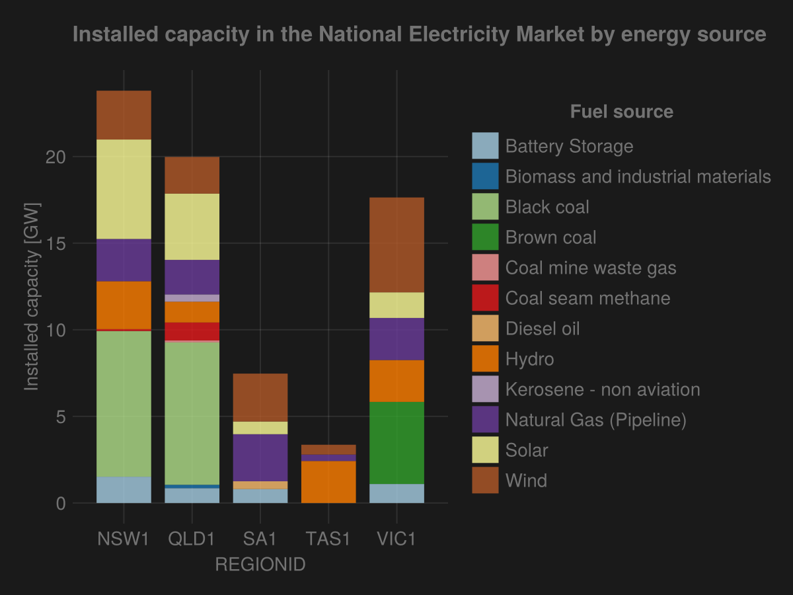
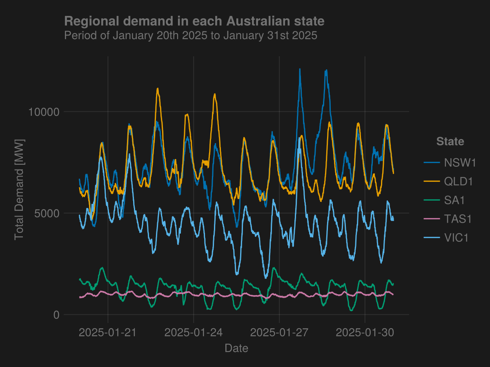
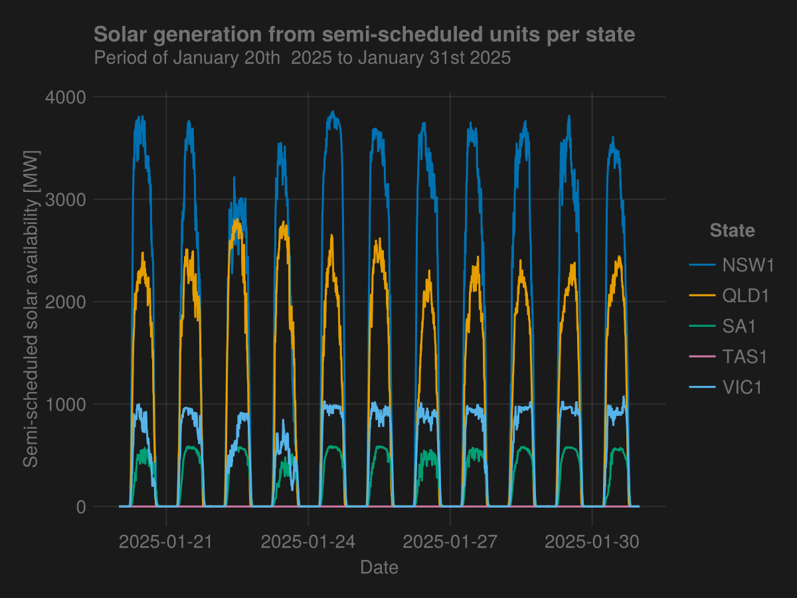

<!-- frozen source=0f6f48f141476029e7a9506a26b18d437a4bc0f0880a682c8ff4167fa7b92bfd -->
```@meta
EditURL = "../../literate/howto/build_system.jl"
```

# [Build a regional system](@id build-regional-system)

This page builds a `PowerSystems.jl` `System` of the NEM's five regions from cached NEMWEB
data. For the market itself (its regions, dispatch process and prices), see
[The National Electricity Market](@ref).

## Simple usage

This package handles the download of data from the [NEMWEB Archive](https://www.aemo.com.au/energy-systems/electricity/national-electricity-market-nem/data-nem/market-data-nemweb)
and the parsing of the data into a System from `PowerSystems.jl`.
`RegionalNetworkConfiguration` builds a zonal model in which each region is a single node, for
economic dispatch studies. `NEMDEConfiguration` builds the full NEMDE system, with bids, FCAS,
constraints and losses, used to run NEMDE dispatch.
By default, the package will create a hidden folder `.nemdb_cache` in the home directory, and save the data into
parquet files.

````julia
using AustralianElectricityMarkets
using AustralianElectricityMarketsData: populate
using Dates
using DuckDB
using PowerSystems
using DataFrames
using Chain
using CairoMakie, AlgebraOfGraphics

db = aem_connect();
date_range = Date(2025, 1, 20):Date(2025, 1, 31)
````

````
Dates.Date("2025-01-20"):Dates.Day(1):Dates.Date("2025-01-31")
````

populate(
    db, first(date_range), last(date_range);
    tables = table_requirements(RegionalNetworkConfiguration()),
)


Once the data is downloaded, a few utility functions allow direct parsing of key quantities,
such as a table of all units registered in the NEM, or the region zonal operational demand.

````julia
units = read_units(db, date_range)

capacity_by_fuel = @chain units begin
    select(:DUID, :REGISTEREDCAPACITY, :CO2E_ENERGY_SOURCE, :REGIONID)
    groupby([:CO2E_ENERGY_SOURCE, :REGIONID])
    combine(:REGISTEREDCAPACITY => (x -> sum(x) / 1000) => :installed_capacity_gw)
    dropmissing
    sort!(:installed_capacity_gw)
    subset!(:installed_capacity_gw => ByRow(>=(0.1))) ## Ignore marginal sources
end

spec = mapping(
    :REGIONID,
    :installed_capacity_gw => "Installed capacity [GW]",
    stack = :CO2E_ENERGY_SOURCE,
    color = :CO2E_ENERGY_SOURCE => "Fuel source"
) * visual(BarPlot, alpha = 0.8)
fig = data(capacity_by_fuel) * spec
draw(
    fig,
    figure = (; title = "Installed capacity in the National Electricity Market by energy source"),
    scales(Color = (; palette = from_continuous(:Paired_12)))
)
````


Read the demand for each state. In the NEM, this is referred to as **Operational Demand**,
which is the demand met by local scheduled and semi-scheduled generation, plus net imports
from other regions. It excludes "behind-the-meter" rooftop PV, which instead appears as a
reduction in operational demand.

````julia
demand = read_demand(db, date_range)

begin
    spec = data(
        subset(demand, :SETTLEMENTDATE => ByRow(x -> (Date(2025, 1, 20) <= x <= Date(2025, 1, 31))))
    )
    spec *= mapping(:SETTLEMENTDATE => "Date", :TOTALDEMAND => "Total Demand [MW]", color = :REGIONID => "State")
    spec *= visual(Lines)
    figure_options = (;
        title = "Regional demand in each Australian state",
        subtitle = "Period of January 20th 2025 to January 31st 2025",
    )
    draw(spec; figure = figure_options)
end
````


Australia has a fairly high penetration of PV, which at times exceed a state's total
demand for electricity (in SA in particular). `read_demand` does not return the semi-scheduled
solar availability, so it is queried from `DISPATCHREGIONSUM` directly.

````julia
source = read_hive(db, :DISPATCHREGIONSUM)
solar = DataFrame(
    DuckDB.execute(
        db.db,
        """
        SELECT SETTLEMENTDATE, REGIONID, SS_SOLAR_AVAILABILITY
        FROM $source
        WHERE SETTLEMENTDATE >= '2025-01-20' AND SETTLEMENTDATE <= '2025-01-31'
          AND SS_SOLAR_AVAILABILITY IS NOT NULL
        """,
    ),
)

begin
    spec = data(
        subset(solar, :SETTLEMENTDATE => ByRow(x -> (Date(2025, 1, 20) <= x <= Date(2025, 1, 31))))
    )
    spec *= mapping(:SETTLEMENTDATE => "Date", :SS_SOLAR_AVAILABILITY => "Semi-scheduled solar availability [MW]", color = :REGIONID => "State")
    spec *= visual(Lines)
    figure_options = (;
        title = "Solar generation from semi-scheduled units per state",
        subtitle = "Period of January 20th  2025 to January 31st 2025",
    )
    draw(spec; figure = figure_options)
end
````


## Integration with PowerSystems.jl

The main purpose of this package is to provide the data required for instantiating systems with
`PowerSystems.jl` and leverage the ecosystem of power systems modelling developed by NREL-Sienna.

````julia
sys = nem_system(db, RegionalNetworkConfiguration(); date_range)
````

```@raw html
<table>
  <thead>
    <tr class = "title">
      <td colspan = "2" style = "font-size: x-large; font-weight: bold; text-align: center;">System</td>
    </tr>
    <tr class = "columnLabelRow">
      <th style = "font-weight: bold; text-align: left;">Property</th>
      <th style = "font-weight: bold; text-align: left;">Value</th>
    </tr>
  </thead>
  <tbody>
    <tr class = "dataRow">
      <td style = "text-align: left;">Name</td>
      <td style = "text-align: left;"></td>
    </tr>
    <tr class = "dataRow">
      <td style = "text-align: left;">Description</td>
      <td style = "text-align: left;"></td>
    </tr>
    <tr class = "dataRow">
      <td style = "text-align: left;">System Units Base</td>
      <td style = "text-align: left;">SYSTEM_BASE</td>
    </tr>
    <tr class = "dataRow">
      <td style = "text-align: left;">Base Power</td>
      <td style = "text-align: left;">100.0</td>
    </tr>
    <tr class = "dataRow">
      <td style = "text-align: left;">Base Frequency</td>
      <td style = "text-align: left;">60.0</td>
    </tr>
    <tr class = "dataRow">
      <td style = "text-align: left;">Num Components</td>
      <td style = "text-align: left;">686</td>
    </tr>
  </tbody>
</table>

<table>
  <thead>
    <tr class = "title">
      <td colspan = "2" style = "font-size: x-large; font-weight: bold; text-align: center;">Static Components</td>
    </tr>
    <tr class = "columnLabelRow">
      <th style = "font-weight: bold; text-align: left;">Type</th>
      <th style = "font-weight: bold; text-align: left;">Count</th>
    </tr>
  </thead>
  <tbody>
    <tr class = "dataRow">
      <td style = "text-align: left;">ACBus</td>
      <td style = "text-align: left;">10</td>
    </tr>
    <tr class = "dataRow">
      <td style = "text-align: left;">Arc</td>
      <td style = "text-align: left;">9</td>
    </tr>
    <tr class = "dataRow">
      <td style = "text-align: left;">Area</td>
      <td style = "text-align: left;">5</td>
    </tr>
    <tr class = "dataRow">
      <td style = "text-align: left;">AreaInterchange</td>
      <td style = "text-align: left;">6</td>
    </tr>
    <tr class = "dataRow">
      <td style = "text-align: left;">EnergyReservoirStorage</td>
      <td style = "text-align: left;">31</td>
    </tr>
    <tr class = "dataRow">
      <td style = "text-align: left;">HydroDispatch</td>
      <td style = "text-align: left;">82</td>
    </tr>
    <tr class = "dataRow">
      <td style = "text-align: left;">InterruptiblePowerLoad</td>
      <td style = "text-align: left;">103</td>
    </tr>
    <tr class = "dataRow">
      <td style = "text-align: left;">Line</td>
      <td style = "text-align: left;">11</td>
    </tr>
    <tr class = "dataRow">
      <td style = "text-align: left;">PowerLoad</td>
      <td style = "text-align: left;">5</td>
    </tr>
    <tr class = "dataRow">
      <td style = "text-align: left;">RenewableDispatch</td>
      <td style = "text-align: left;">222</td>
    </tr>
    <tr class = "dataRow">
      <td style = "text-align: left;">ThermalStandard</td>
      <td style = "text-align: left;">202</td>
    </tr>
  </tbody>
</table>


```

Users can then interact with the system with all `PowerSystems` utilities.

````julia
thermal = @chain get_components(ThermalGen, sys) |> DataFrame begin
    select!([:name, :fuel, :prime_mover_type, :base_power])
    groupby(:fuel)
    combine(:base_power => sum => :installed_capacity_mw)
end
````

```@raw html
<div><div style = "float: left;"><span>5×2 DataFrame</span></div><div style = "clear: both;"></div></div><div class = "data-frame" style = "overflow-x: scroll;"><table class = "data-frame" style = "margin-bottom: 6px;"><thead><tr class = "columnLabelRow"><th class = "stubheadLabel" style = "font-weight: bold; text-align: right;">Row</th><th style = "text-align: left;">fuel</th><th style = "text-align: left;">installed_capacity_mw</th></tr><tr class = "columnLabelRow"><th class = "stubheadLabel" style = "font-weight: bold; text-align: right;"></th><th title = "PowerSystems.ThermalFuelsModule.ThermalFuels" style = "text-align: left;">ThermalF…</th><th title = "Float64" style = "text-align: left;">Float64</th></tr></thead><tbody><tr class = "dataRow"><td class = "rowLabel" style = "font-weight: bold; text-align: right;">1</td><td style = "text-align: left;">PowerSystems.ThermalFuelsModule.ThermalFuels.AG_BYPRODUCT = 21</td><td style = "text-align: right;">484.0</td></tr><tr class = "dataRow"><td class = "rowLabel" style = "font-weight: bold; text-align: right;">2</td><td style = "text-align: left;">PowerSystems.ThermalFuelsModule.ThermalFuels.COAL = 1</td><td style = "text-align: right;">21371.0</td></tr><tr class = "dataRow"><td class = "rowLabel" style = "font-weight: bold; text-align: right;">3</td><td style = "text-align: left;">PowerSystems.ThermalFuelsModule.ThermalFuels.NATURAL_GAS = 18</td><td style = "text-align: right;">9952.0</td></tr><tr class = "dataRow"><td class = "rowLabel" style = "font-weight: bold; text-align: right;">4</td><td style = "text-align: left;">PowerSystems.ThermalFuelsModule.ThermalFuels.DISTILLATE_FUEL_OIL = 9</td><td style = "text-align: right;">899.0</td></tr><tr class = "dataRow"><td class = "rowLabel" style = "font-weight: bold; text-align: right;">5</td><td style = "text-align: left;">PowerSystems.ThermalFuelsModule.ThermalFuels.OTHER_GAS = 19</td><td style = "text-align: right;">1329.0</td></tr></tbody></table></div>
```

Get information for a specific unit.

````julia
gen = get_component(ThermalGen, sys, "JLA02")
````

````
ThermalStandard: JLA02:
   name: JLA02
   available: true
   status: true
   bus: ACBus: VIC1_GEN_BUS
   active_power: 0.0
   reactive_power: 0.0
   rating: 0.51
   active_power_limits: (min = 0.0, max = 0.65)
   reactive_power_limits: nothing
   ramp_limits: (up = 0.23, down = 0.23)
   operation_cost: PowerSystems.ThermalGenerationCost composed of variable: InfrastructureSystems.FuelCurve{InfrastructureSystems.LinearCurve}
   base_power: 51.0
   time_limits: (up = 8.0, down = 8.0)
   must_run: false
   prime_mover_type: PowerSystems.PrimeMoversModule.PrimeMovers.CC = 4
   fuel: PowerSystems.ThermalFuelsModule.ThermalFuels.NATURAL_GAS = 18
   services: 0-element Vector{PowerSystems.Service}
   time_at_status: 10000.0
   dynamic_injector: nothing
   ext: Dict{String, Any}()
   InfrastructureSystems.SystemUnitsSettings:
      base_value: 100.0
      unit_system: InfrastructureSystems.UnitSystemModule.UnitSystem.SYSTEM_BASE = 0
   has_supplemental_attributes: true
   has_time_series: false
````

Check the prime mover type.

````julia
get_prime_mover_type(gen)
````

````
PowerSystems.PrimeMoversModule.PrimeMovers.CC = 4
````

Check the rating in natural units.

````julia
with_units_base(sys, "NATURAL_UNITS") do
    get_rating(gen)
end
````

````
51.0
````

