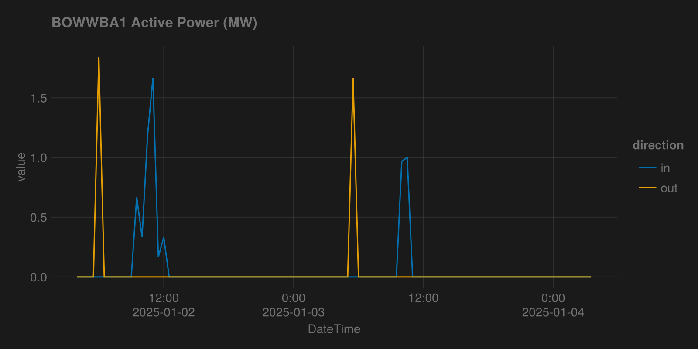
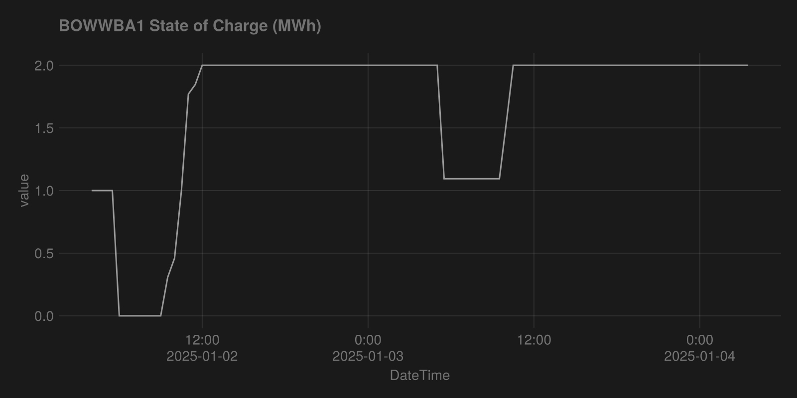
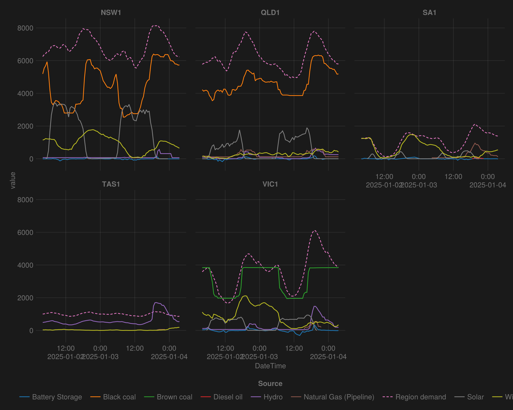

<!-- frozen source=ef645c76c3845482a81da34d044c09f0fb1a886f94d4229685e80789fd821892 -->
```@meta
EditURL = "../../literate/howto/clearing-with-batteries.jl"
```

````julia
begin
    using AustralianElectricityMarkets
    using AustralianElectricityMarketsData: populate
    using PowerSystems
    using PowerSimulations
    using HydroPowerSimulations
    using StorageSystemsSimulations
    using Chain
    using DataFrames
    using AlgebraOfGraphics, CairoMakie
    using Dates
    using HiGHS
end
````

# Addition of batteries

In addition to thermal, renewable, and hydro generators, we now include storage units (batteries)
in our market clearing problem. We use the `EnergyReservoirStorage` component and a
`StorageDispatchWithReserves` model, which allows the optimizer to manage both charging and
discharging while respecting energy limits.

This page uses the stock `StorageDispatchWithReserves` formulation as an energy-only illustration;
the NEMDE run uses its own battery formulation.

Batteries in the NEM play an increasingly vital role. They can perform **Arbitrage**: charging
when electricity prices are low (e.g., during the middle of the day when solar is abundant)
and discharging when prices are high (e.g., during the evening peak). Furthermore, they
provide essential services like **FCAS** (Frequency Control Ancillary Services) to keep the
grid stable. See [FCAS capability and co-optimisation](@ref nemde-fcas) for a full introduction to FCAS markets, offers,
and requirements.

## Setup the system

Initialise a connection to manage the market data via duckdb. In this example, we will look at a period in January 2025.

!!! note "Get the data first!"
    You will first need to download the data from the monthly archive, saving them locally
    in parquet files.

```julia
populate(
    db, Date(2025, 1, 1), Date(2025, 1, 31);
    tables = table_requirements(RegionalNetworkConfiguration()),
)
```

````julia
db = aem_connect();
````

Instantiate the system using a regional network configuration. `as_of` selects the units registered on that date.

````julia
sys = nem_system(db, RegionalNetworkConfiguration(); as_of = Date(2025, 1, 2))
````

```@raw html
<table>
  <thead>
    <tr class = "title">
      <td colspan = "2" style = "font-size: x-large; font-weight: bold; text-align: center;">System</td>
    </tr>
    <tr class = "columnLabelRow">
      <th style = "font-weight: bold; text-align: left;">Property</th>
      <th style = "font-weight: bold; text-align: left;">Value</th>
    </tr>
  </thead>
  <tbody>
    <tr class = "dataRow">
      <td style = "text-align: left;">Name</td>
      <td style = "text-align: left;"></td>
    </tr>
    <tr class = "dataRow">
      <td style = "text-align: left;">Description</td>
      <td style = "text-align: left;"></td>
    </tr>
    <tr class = "dataRow">
      <td style = "text-align: left;">System Units Base</td>
      <td style = "text-align: left;">SYSTEM_BASE</td>
    </tr>
    <tr class = "dataRow">
      <td style = "text-align: left;">Base Power</td>
      <td style = "text-align: left;">100.0</td>
    </tr>
    <tr class = "dataRow">
      <td style = "text-align: left;">Base Frequency</td>
      <td style = "text-align: left;">60.0</td>
    </tr>
    <tr class = "dataRow">
      <td style = "text-align: left;">Num Components</td>
      <td style = "text-align: left;">684</td>
    </tr>
  </tbody>
</table>

<table>
  <thead>
    <tr class = "title">
      <td colspan = "2" style = "font-size: x-large; font-weight: bold; text-align: center;">Static Components</td>
    </tr>
    <tr class = "columnLabelRow">
      <th style = "font-weight: bold; text-align: left;">Type</th>
      <th style = "font-weight: bold; text-align: left;">Count</th>
    </tr>
  </thead>
  <tbody>
    <tr class = "dataRow">
      <td style = "text-align: left;">ACBus</td>
      <td style = "text-align: left;">10</td>
    </tr>
    <tr class = "dataRow">
      <td style = "text-align: left;">Arc</td>
      <td style = "text-align: left;">9</td>
    </tr>
    <tr class = "dataRow">
      <td style = "text-align: left;">Area</td>
      <td style = "text-align: left;">5</td>
    </tr>
    <tr class = "dataRow">
      <td style = "text-align: left;">AreaInterchange</td>
      <td style = "text-align: left;">6</td>
    </tr>
    <tr class = "dataRow">
      <td style = "text-align: left;">EnergyReservoirStorage</td>
      <td style = "text-align: left;">30</td>
    </tr>
    <tr class = "dataRow">
      <td style = "text-align: left;">HydroDispatch</td>
      <td style = "text-align: left;">82</td>
    </tr>
    <tr class = "dataRow">
      <td style = "text-align: left;">InterruptiblePowerLoad</td>
      <td style = "text-align: left;">102</td>
    </tr>
    <tr class = "dataRow">
      <td style = "text-align: left;">Line</td>
      <td style = "text-align: left;">11</td>
    </tr>
    <tr class = "dataRow">
      <td style = "text-align: left;">PowerLoad</td>
      <td style = "text-align: left;">5</td>
    </tr>
    <tr class = "dataRow">
      <td style = "text-align: left;">RenewableDispatch</td>
      <td style = "text-align: left;">222</td>
    </tr>
    <tr class = "dataRow">
      <td style = "text-align: left;">ThermalStandard</td>
      <td style = "text-align: left;">202</td>
    </tr>
  </tbody>
</table>


```

Set the horizon and resolution for the simulation. Batteries are often more interesting to
observe at higher resolutions or over longer periods where their energy constraints become
relevant. Here we use a 30-minute interval over a 48-hour horizon.

````julia
interval = Minute(30)
horizon = Hour(48)
start_date = DateTime(2025, 1, 2, 4, 0)
date_range = start_date:interval:(start_date + horizon)
@show date_range
````

````
Dates.DateTime("2025-01-02T04:00:00"):Dates.Minute(30):Dates.DateTime("2025-01-04T04:00:00")
````

Set deterministic time series for demand, availability, and market bids.

````julia
set_demand!(sys, db, date_range; resolution = interval)
set_market_bids!(sys, db, date_range; resolution = interval)
set_regional_availability!(sys, db, date_range; resolution = interval)
````

````

````

Derive forecasts from the deterministic time series.

````julia
transform_single_time_series!(sys, horizon, interval);
@show sys
````

```@raw html
<table>
  <thead>
    <tr class = "title">
      <td colspan = "2" style = "font-size: x-large; font-weight: bold; text-align: center;">System</td>
    </tr>
    <tr class = "columnLabelRow">
      <th style = "font-weight: bold; text-align: left;">Property</th>
      <th style = "font-weight: bold; text-align: left;">Value</th>
    </tr>
  </thead>
  <tbody>
    <tr class = "dataRow">
      <td style = "text-align: left;">Name</td>
      <td style = "text-align: left;"></td>
    </tr>
    <tr class = "dataRow">
      <td style = "text-align: left;">Description</td>
      <td style = "text-align: left;"></td>
    </tr>
    <tr class = "dataRow">
      <td style = "text-align: left;">System Units Base</td>
      <td style = "text-align: left;">SYSTEM_BASE</td>
    </tr>
    <tr class = "dataRow">
      <td style = "text-align: left;">Base Power</td>
      <td style = "text-align: left;">100.0</td>
    </tr>
    <tr class = "dataRow">
      <td style = "text-align: left;">Base Frequency</td>
      <td style = "text-align: left;">60.0</td>
    </tr>
    <tr class = "dataRow">
      <td style = "text-align: left;">Num Components</td>
      <td style = "text-align: left;">684</td>
    </tr>
  </tbody>
</table>

<table>
  <thead>
    <tr class = "title">
      <td colspan = "2" style = "font-size: x-large; font-weight: bold; text-align: center;">Static Components</td>
    </tr>
    <tr class = "columnLabelRow">
      <th style = "font-weight: bold; text-align: left;">Type</th>
      <th style = "font-weight: bold; text-align: left;">Count</th>
    </tr>
  </thead>
  <tbody>
    <tr class = "dataRow">
      <td style = "text-align: left;">ACBus</td>
      <td style = "text-align: left;">10</td>
    </tr>
    <tr class = "dataRow">
      <td style = "text-align: left;">Arc</td>
      <td style = "text-align: left;">9</td>
    </tr>
    <tr class = "dataRow">
      <td style = "text-align: left;">Area</td>
      <td style = "text-align: left;">5</td>
    </tr>
    <tr class = "dataRow">
      <td style = "text-align: left;">AreaInterchange</td>
      <td style = "text-align: left;">6</td>
    </tr>
    <tr class = "dataRow">
      <td style = "text-align: left;">EnergyReservoirStorage</td>
      <td style = "text-align: left;">30</td>
    </tr>
    <tr class = "dataRow">
      <td style = "text-align: left;">HydroDispatch</td>
      <td style = "text-align: left;">82</td>
    </tr>
    <tr class = "dataRow">
      <td style = "text-align: left;">InterruptiblePowerLoad</td>
      <td style = "text-align: left;">102</td>
    </tr>
    <tr class = "dataRow">
      <td style = "text-align: left;">Line</td>
      <td style = "text-align: left;">11</td>
    </tr>
    <tr class = "dataRow">
      <td style = "text-align: left;">PowerLoad</td>
      <td style = "text-align: left;">5</td>
    </tr>
    <tr class = "dataRow">
      <td style = "text-align: left;">RenewableDispatch</td>
      <td style = "text-align: left;">222</td>
    </tr>
    <tr class = "dataRow">
      <td style = "text-align: left;">ThermalStandard</td>
      <td style = "text-align: left;">202</td>
    </tr>
  </tbody>
</table>

<table>
  <thead>
    <tr class = "title">
      <td colspan = "8" style = "font-size: x-large; font-weight: bold; text-align: center;">StaticTimeSeries Summary</td>
    </tr>
    <tr class = "columnLabelRow">
      <th style = "font-weight: bold; text-align: left;">owner_type</th>
      <th style = "font-weight: bold; text-align: left;">owner_category</th>
      <th style = "font-weight: bold; text-align: left;">name</th>
      <th style = "font-weight: bold; text-align: left;">time_series_type</th>
      <th style = "font-weight: bold; text-align: left;">initial_timestamp</th>
      <th style = "font-weight: bold; text-align: left;">resolution</th>
      <th style = "font-weight: bold; text-align: left;">count</th>
      <th style = "font-weight: bold; text-align: left;">time_step_count</th>
    </tr>
    <tr class = "columnLabelRow">
      <th style = "text-align: left;">String</th>
      <th style = "text-align: left;">String</th>
      <th style = "text-align: left;">String</th>
      <th style = "text-align: left;">String</th>
      <th style = "text-align: left;">String</th>
      <th style = "text-align: left;">Dates.CompoundPeriod</th>
      <th style = "text-align: left;">Int64</th>
      <th style = "text-align: left;">Int64</th>
    </tr>
  </thead>
  <tbody>
    <tr class = "dataRow">
      <td style = "text-align: left;">EnergyReservoirStorage</td>
      <td style = "text-align: left;">Component</td>
      <td style = "text-align: left;">decremental_initial_input</td>
      <td style = "text-align: left;">SingleTimeSeries</td>
      <td style = "text-align: left;">2025-01-02T04:00:00</td>
      <td style = "text-align: left;">30 minutes</td>
      <td style = "text-align: left;">30</td>
      <td style = "text-align: left;">96</td>
    </tr>
    <tr class = "dataRow">
      <td style = "text-align: left;">EnergyReservoirStorage</td>
      <td style = "text-align: left;">Component</td>
      <td style = "text-align: left;">decremental_variable_cost</td>
      <td style = "text-align: left;">SingleTimeSeries</td>
      <td style = "text-align: left;">2025-01-02T04:00:00</td>
      <td style = "text-align: left;">30 minutes</td>
      <td style = "text-align: left;">30</td>
      <td style = "text-align: left;">96</td>
    </tr>
    <tr class = "dataRow">
      <td style = "text-align: left;">EnergyReservoirStorage</td>
      <td style = "text-align: left;">Component</td>
      <td style = "text-align: left;">incremental_initial_input</td>
      <td style = "text-align: left;">SingleTimeSeries</td>
      <td style = "text-align: left;">2025-01-02T04:00:00</td>
      <td style = "text-align: left;">30 minutes</td>
      <td style = "text-align: left;">30</td>
      <td style = "text-align: left;">96</td>
    </tr>
    <tr class = "dataRow">
      <td style = "text-align: left;">EnergyReservoirStorage</td>
      <td style = "text-align: left;">Component</td>
      <td style = "text-align: left;">incremental_variable_cost</td>
      <td style = "text-align: left;">SingleTimeSeries</td>
      <td style = "text-align: left;">2025-01-02T04:00:00</td>
      <td style = "text-align: left;">30 minutes</td>
      <td style = "text-align: left;">30</td>
      <td style = "text-align: left;">96</td>
    </tr>
    <tr class = "dataRow">
      <td style = "text-align: left;">HydroDispatch</td>
      <td style = "text-align: left;">Component</td>
      <td style = "text-align: left;">incremental_initial_input</td>
      <td style = "text-align: left;">SingleTimeSeries</td>
      <td style = "text-align: left;">2025-01-02T04:00:00</td>
      <td style = "text-align: left;">30 minutes</td>
      <td style = "text-align: left;">41</td>
      <td style = "text-align: left;">96</td>
    </tr>
    <tr class = "dataRow">
      <td style = "text-align: left;">HydroDispatch</td>
      <td style = "text-align: left;">Component</td>
      <td style = "text-align: left;">incremental_variable_cost</td>
      <td style = "text-align: left;">SingleTimeSeries</td>
      <td style = "text-align: left;">2025-01-02T04:00:00</td>
      <td style = "text-align: left;">30 minutes</td>
      <td style = "text-align: left;">41</td>
      <td style = "text-align: left;">96</td>
    </tr>
    <tr class = "dataRow">
      <td style = "text-align: left;">HydroDispatch</td>
      <td style = "text-align: left;">Component</td>
      <td style = "text-align: left;">max_active_power</td>
      <td style = "text-align: left;">SingleTimeSeries</td>
      <td style = "text-align: left;">2025-01-02T04:00:00</td>
      <td style = "text-align: left;">30 minutes</td>
      <td style = "text-align: left;">41</td>
      <td style = "text-align: left;">96</td>
    </tr>
    <tr class = "dataRow">
      <td style = "text-align: left;">InterruptiblePowerLoad</td>
      <td style = "text-align: left;">Component</td>
      <td style = "text-align: left;">decremental_initial_input</td>
      <td style = "text-align: left;">SingleTimeSeries</td>
      <td style = "text-align: left;">2025-01-02T04:00:00</td>
      <td style = "text-align: left;">30 minutes</td>
      <td style = "text-align: left;">30</td>
      <td style = "text-align: left;">96</td>
    </tr>
    <tr class = "dataRow">
      <td style = "text-align: left;">InterruptiblePowerLoad</td>
      <td style = "text-align: left;">Component</td>
      <td style = "text-align: left;">decremental_variable_cost</td>
      <td style = "text-align: left;">SingleTimeSeries</td>
      <td style = "text-align: left;">2025-01-02T04:00:00</td>
      <td style = "text-align: left;">30 minutes</td>
      <td style = "text-align: left;">30</td>
      <td style = "text-align: left;">96</td>
    </tr>
    <tr class = "dataRow">
      <td style = "text-align: left;">PowerLoad</td>
      <td style = "text-align: left;">Component</td>
      <td style = "text-align: left;">loss_demand</td>
      <td style = "text-align: left;">SingleTimeSeries</td>
      <td style = "text-align: left;">2025-01-02T04:00:00</td>
      <td style = "text-align: left;">30 minutes</td>
      <td style = "text-align: left;">5</td>
      <td style = "text-align: left;">96</td>
    </tr>
    <tr class = "dataRow">
      <td style = "text-align: left;">PowerLoad</td>
      <td style = "text-align: left;">Component</td>
      <td style = "text-align: left;">max_active_power</td>
      <td style = "text-align: left;">SingleTimeSeries</td>
      <td style = "text-align: left;">2025-01-02T04:00:00</td>
      <td style = "text-align: left;">30 minutes</td>
      <td style = "text-align: left;">5</td>
      <td style = "text-align: left;">96</td>
    </tr>
    <tr class = "dataRow">
      <td style = "text-align: left;">RenewableDispatch</td>
      <td style = "text-align: left;">Component</td>
      <td style = "text-align: left;">incremental_initial_input</td>
      <td style = "text-align: left;">SingleTimeSeries</td>
      <td style = "text-align: left;">2025-01-02T04:00:00</td>
      <td style = "text-align: left;">30 minutes</td>
      <td style = "text-align: left;">186</td>
      <td style = "text-align: left;">96</td>
    </tr>
    <tr class = "dataRow">
      <td style = "text-align: left;">RenewableDispatch</td>
      <td style = "text-align: left;">Component</td>
      <td style = "text-align: left;">incremental_variable_cost</td>
      <td style = "text-align: left;">SingleTimeSeries</td>
      <td style = "text-align: left;">2025-01-02T04:00:00</td>
      <td style = "text-align: left;">30 minutes</td>
      <td style = "text-align: left;">186</td>
      <td style = "text-align: left;">96</td>
    </tr>
    <tr class = "dataRow">
      <td style = "text-align: left;">RenewableDispatch</td>
      <td style = "text-align: left;">Component</td>
      <td style = "text-align: left;">max_active_power</td>
      <td style = "text-align: left;">SingleTimeSeries</td>
      <td style = "text-align: left;">2025-01-02T04:00:00</td>
      <td style = "text-align: left;">30 minutes</td>
      <td style = "text-align: left;">186</td>
      <td style = "text-align: left;">96</td>
    </tr>
    <tr class = "dataRow">
      <td style = "text-align: left;">ThermalStandard</td>
      <td style = "text-align: left;">Component</td>
      <td style = "text-align: left;">incremental_initial_input</td>
      <td style = "text-align: left;">SingleTimeSeries</td>
      <td style = "text-align: left;">2025-01-02T04:00:00</td>
      <td style = "text-align: left;">30 minutes</td>
      <td style = "text-align: left;">129</td>
      <td style = "text-align: left;">96</td>
    </tr>
    <tr class = "dataRow">
      <td style = "text-align: left;">ThermalStandard</td>
      <td style = "text-align: left;">Component</td>
      <td style = "text-align: left;">incremental_variable_cost</td>
      <td style = "text-align: left;">SingleTimeSeries</td>
      <td style = "text-align: left;">2025-01-02T04:00:00</td>
      <td style = "text-align: left;">30 minutes</td>
      <td style = "text-align: left;">129</td>
      <td style = "text-align: left;">96</td>
    </tr>
  </tbody>
</table>
<table>
  <thead>
    <tr class = "title">
      <td colspan = "10" style = "font-size: x-large; font-weight: bold; text-align: center;">Forecast Summary</td>
    </tr>
    <tr class = "columnLabelRow">
      <th style = "font-weight: bold; text-align: left;">owner_type</th>
      <th style = "font-weight: bold; text-align: left;">owner_category</th>
      <th style = "font-weight: bold; text-align: left;">name</th>
      <th style = "font-weight: bold; text-align: left;">time_series_type</th>
      <th style = "font-weight: bold; text-align: left;">initial_timestamp</th>
      <th style = "font-weight: bold; text-align: left;">resolution</th>
      <th style = "font-weight: bold; text-align: left;">count</th>
      <th style = "font-weight: bold; text-align: left;">horizon</th>
      <th style = "font-weight: bold; text-align: left;">interval</th>
      <th style = "font-weight: bold; text-align: left;">window_count</th>
    </tr>
    <tr class = "columnLabelRow">
      <th style = "text-align: left;">String</th>
      <th style = "text-align: left;">String</th>
      <th style = "text-align: left;">String</th>
      <th style = "text-align: left;">String</th>
      <th style = "text-align: left;">String</th>
      <th style = "text-align: left;">Dates.CompoundPeriod</th>
      <th style = "text-align: left;">Int64</th>
      <th style = "text-align: left;">Dates.CompoundPeriod</th>
      <th style = "text-align: left;">Dates.CompoundPeriod</th>
      <th style = "text-align: left;">Int64</th>
    </tr>
  </thead>
  <tbody>
    <tr class = "dataRow">
      <td style = "text-align: left;">EnergyReservoirStorage</td>
      <td style = "text-align: left;">Component</td>
      <td style = "text-align: left;">decremental_initial_input</td>
      <td style = "text-align: left;">DeterministicSingleTimeSeries</td>
      <td style = "text-align: left;">2025-01-02T04:00:00</td>
      <td style = "text-align: left;">30 minutes</td>
      <td style = "text-align: left;">30</td>
      <td style = "text-align: left;">2 days</td>
      <td style = "text-align: left;">30 minutes</td>
      <td style = "text-align: left;">1</td>
    </tr>
    <tr class = "dataRow">
      <td style = "text-align: left;">EnergyReservoirStorage</td>
      <td style = "text-align: left;">Component</td>
      <td style = "text-align: left;">decremental_variable_cost</td>
      <td style = "text-align: left;">DeterministicSingleTimeSeries</td>
      <td style = "text-align: left;">2025-01-02T04:00:00</td>
      <td style = "text-align: left;">30 minutes</td>
      <td style = "text-align: left;">30</td>
      <td style = "text-align: left;">2 days</td>
      <td style = "text-align: left;">30 minutes</td>
      <td style = "text-align: left;">1</td>
    </tr>
    <tr class = "dataRow">
      <td style = "text-align: left;">EnergyReservoirStorage</td>
      <td style = "text-align: left;">Component</td>
      <td style = "text-align: left;">incremental_initial_input</td>
      <td style = "text-align: left;">DeterministicSingleTimeSeries</td>
      <td style = "text-align: left;">2025-01-02T04:00:00</td>
      <td style = "text-align: left;">30 minutes</td>
      <td style = "text-align: left;">30</td>
      <td style = "text-align: left;">2 days</td>
      <td style = "text-align: left;">30 minutes</td>
      <td style = "text-align: left;">1</td>
    </tr>
    <tr class = "dataRow">
      <td style = "text-align: left;">EnergyReservoirStorage</td>
      <td style = "text-align: left;">Component</td>
      <td style = "text-align: left;">incremental_variable_cost</td>
      <td style = "text-align: left;">DeterministicSingleTimeSeries</td>
      <td style = "text-align: left;">2025-01-02T04:00:00</td>
      <td style = "text-align: left;">30 minutes</td>
      <td style = "text-align: left;">30</td>
      <td style = "text-align: left;">2 days</td>
      <td style = "text-align: left;">30 minutes</td>
      <td style = "text-align: left;">1</td>
    </tr>
    <tr class = "dataRow">
      <td style = "text-align: left;">HydroDispatch</td>
      <td style = "text-align: left;">Component</td>
      <td style = "text-align: left;">incremental_initial_input</td>
      <td style = "text-align: left;">DeterministicSingleTimeSeries</td>
      <td style = "text-align: left;">2025-01-02T04:00:00</td>
      <td style = "text-align: left;">30 minutes</td>
      <td style = "text-align: left;">41</td>
      <td style = "text-align: left;">2 days</td>
      <td style = "text-align: left;">30 minutes</td>
      <td style = "text-align: left;">1</td>
    </tr>
    <tr class = "dataRow">
      <td style = "text-align: left;">HydroDispatch</td>
      <td style = "text-align: left;">Component</td>
      <td style = "text-align: left;">incremental_variable_cost</td>
      <td style = "text-align: left;">DeterministicSingleTimeSeries</td>
      <td style = "text-align: left;">2025-01-02T04:00:00</td>
      <td style = "text-align: left;">30 minutes</td>
      <td style = "text-align: left;">41</td>
      <td style = "text-align: left;">2 days</td>
      <td style = "text-align: left;">30 minutes</td>
      <td style = "text-align: left;">1</td>
    </tr>
    <tr class = "dataRow">
      <td style = "text-align: left;">HydroDispatch</td>
      <td style = "text-align: left;">Component</td>
      <td style = "text-align: left;">max_active_power</td>
      <td style = "text-align: left;">DeterministicSingleTimeSeries</td>
      <td style = "text-align: left;">2025-01-02T04:00:00</td>
      <td style = "text-align: left;">30 minutes</td>
      <td style = "text-align: left;">41</td>
      <td style = "text-align: left;">2 days</td>
      <td style = "text-align: left;">30 minutes</td>
      <td style = "text-align: left;">1</td>
    </tr>
    <tr class = "dataRow">
      <td style = "text-align: left;">InterruptiblePowerLoad</td>
      <td style = "text-align: left;">Component</td>
      <td style = "text-align: left;">decremental_initial_input</td>
      <td style = "text-align: left;">DeterministicSingleTimeSeries</td>
      <td style = "text-align: left;">2025-01-02T04:00:00</td>
      <td style = "text-align: left;">30 minutes</td>
      <td style = "text-align: left;">30</td>
      <td style = "text-align: left;">2 days</td>
      <td style = "text-align: left;">30 minutes</td>
      <td style = "text-align: left;">1</td>
    </tr>
    <tr class = "dataRow">
      <td style = "text-align: left;">InterruptiblePowerLoad</td>
      <td style = "text-align: left;">Component</td>
      <td style = "text-align: left;">decremental_variable_cost</td>
      <td style = "text-align: left;">DeterministicSingleTimeSeries</td>
      <td style = "text-align: left;">2025-01-02T04:00:00</td>
      <td style = "text-align: left;">30 minutes</td>
      <td style = "text-align: left;">30</td>
      <td style = "text-align: left;">2 days</td>
      <td style = "text-align: left;">30 minutes</td>
      <td style = "text-align: left;">1</td>
    </tr>
    <tr class = "dataRow">
      <td style = "text-align: left;">PowerLoad</td>
      <td style = "text-align: left;">Component</td>
      <td style = "text-align: left;">loss_demand</td>
      <td style = "text-align: left;">DeterministicSingleTimeSeries</td>
      <td style = "text-align: left;">2025-01-02T04:00:00</td>
      <td style = "text-align: left;">30 minutes</td>
      <td style = "text-align: left;">5</td>
      <td style = "text-align: left;">2 days</td>
      <td style = "text-align: left;">30 minutes</td>
      <td style = "text-align: left;">1</td>
    </tr>
    <tr class = "dataRow">
      <td style = "text-align: left;">PowerLoad</td>
      <td style = "text-align: left;">Component</td>
      <td style = "text-align: left;">max_active_power</td>
      <td style = "text-align: left;">DeterministicSingleTimeSeries</td>
      <td style = "text-align: left;">2025-01-02T04:00:00</td>
      <td style = "text-align: left;">30 minutes</td>
      <td style = "text-align: left;">5</td>
      <td style = "text-align: left;">2 days</td>
      <td style = "text-align: left;">30 minutes</td>
      <td style = "text-align: left;">1</td>
    </tr>
    <tr class = "dataRow">
      <td style = "text-align: left;">RenewableDispatch</td>
      <td style = "text-align: left;">Component</td>
      <td style = "text-align: left;">incremental_initial_input</td>
      <td style = "text-align: left;">DeterministicSingleTimeSeries</td>
      <td style = "text-align: left;">2025-01-02T04:00:00</td>
      <td style = "text-align: left;">30 minutes</td>
      <td style = "text-align: left;">186</td>
      <td style = "text-align: left;">2 days</td>
      <td style = "text-align: left;">30 minutes</td>
      <td style = "text-align: left;">1</td>
    </tr>
    <tr class = "dataRow">
      <td style = "text-align: left;">RenewableDispatch</td>
      <td style = "text-align: left;">Component</td>
      <td style = "text-align: left;">incremental_variable_cost</td>
      <td style = "text-align: left;">DeterministicSingleTimeSeries</td>
      <td style = "text-align: left;">2025-01-02T04:00:00</td>
      <td style = "text-align: left;">30 minutes</td>
      <td style = "text-align: left;">186</td>
      <td style = "text-align: left;">2 days</td>
      <td style = "text-align: left;">30 minutes</td>
      <td style = "text-align: left;">1</td>
    </tr>
    <tr class = "dataRow">
      <td style = "text-align: left;">RenewableDispatch</td>
      <td style = "text-align: left;">Component</td>
      <td style = "text-align: left;">max_active_power</td>
      <td style = "text-align: left;">DeterministicSingleTimeSeries</td>
      <td style = "text-align: left;">2025-01-02T04:00:00</td>
      <td style = "text-align: left;">30 minutes</td>
      <td style = "text-align: left;">186</td>
      <td style = "text-align: left;">2 days</td>
      <td style = "text-align: left;">30 minutes</td>
      <td style = "text-align: left;">1</td>
    </tr>
    <tr class = "dataRow">
      <td style = "text-align: left;">ThermalStandard</td>
      <td style = "text-align: left;">Component</td>
      <td style = "text-align: left;">incremental_initial_input</td>
      <td style = "text-align: left;">DeterministicSingleTimeSeries</td>
      <td style = "text-align: left;">2025-01-02T04:00:00</td>
      <td style = "text-align: left;">30 minutes</td>
      <td style = "text-align: left;">129</td>
      <td style = "text-align: left;">2 days</td>
      <td style = "text-align: left;">30 minutes</td>
      <td style = "text-align: left;">1</td>
    </tr>
    <tr class = "dataRow">
      <td style = "text-align: left;">ThermalStandard</td>
      <td style = "text-align: left;">Component</td>
      <td style = "text-align: left;">incremental_variable_cost</td>
      <td style = "text-align: left;">DeterministicSingleTimeSeries</td>
      <td style = "text-align: left;">2025-01-02T04:00:00</td>
      <td style = "text-align: left;">30 minutes</td>
      <td style = "text-align: left;">129</td>
      <td style = "text-align: left;">2 days</td>
      <td style = "text-align: left;">30 minutes</td>
      <td style = "text-align: left;">1</td>
    </tr>
  </tbody>
</table>

```

## Setup the problem

````julia
begin
    template = ProblemTemplate()
    set_device_model!(template, Line, StaticBranch)
    set_device_model!(template, PowerLoad, StaticPowerLoad)
    set_device_model!(template, RenewableDispatch, RenewableFullDispatch)
    set_device_model!(template, ThermalStandard, ThermalBasicUnitCommitment)
    set_device_model!(template, HydroDispatch, HydroDispatchRunOfRiver)
    set_network_model!(template, NetworkModel(AreaBalancePowerModel; use_slacks = true))
    set_device_model!(template, AreaInterchange, StaticBranch)
    storage_model = DeviceModel(
        EnergyReservoirStorage,
        StorageDispatchWithReserves;
        attributes = Dict(
            "reservation" => true,
            "energy_target" => false,
            "cycling_limits" => false,
            "regularization" => false,
        ),
    )
    set_device_model!(template, storage_model)
    template
end
````

```@raw html
<table>
  <thead>
    <tr class = "title">
      <td colspan = "2" style = "font-size: x-large; font-weight: bold; text-align: center;">Network Model</td>
    </tr>
  </thead>
  <tbody>
    <tr class = "dataRow">
      <td style = "text-align: left;">Network Model</td>
      <td style = "text-align: left;">PowerSimulations.AreaBalancePowerModel</td>
    </tr>
    <tr class = "dataRow">
      <td style = "text-align: left;">Slacks</td>
      <td style = "text-align: left;">true</td>
    </tr>
    <tr class = "dataRow">
      <td style = "text-align: left;">Slack cost</td>
      <td style = "text-align: left;">1.0e6</td>
    </tr>
    <tr class = "dataRow">
      <td style = "text-align: left;">PTDF</td>
      <td style = "text-align: left;">false</td>
    </tr>
    <tr class = "dataRow">
      <td style = "text-align: left;">Duals</td>
      <td style = "text-align: left;">None</td>
    </tr>
    <tr class = "dataRow">
      <td style = "text-align: left;">HVDC Network Model</td>
      <td style = "text-align: left;">None</td>
    </tr>
  </tbody>
</table>

<table>
  <thead>
    <tr class = "title">
      <td colspan = "3" style = "font-size: x-large; font-weight: bold; text-align: center;">Device Models</td>
    </tr>
    <tr class = "columnLabelRow">
      <th style = "font-weight: bold; text-align: left;">Device Type</th>
      <th style = "font-weight: bold; text-align: left;">Formulation</th>
      <th style = "font-weight: bold; text-align: left;">Slacks</th>
    </tr>
  </thead>
  <tbody>
    <tr class = "dataRow">
      <td style = "text-align: left;">PowerSystems.ThermalStandard</td>
      <td style = "text-align: left;">PowerSimulations.ThermalBasicUnitCommitment</td>
      <td style = "text-align: left;">false</td>
    </tr>
    <tr class = "dataRow">
      <td style = "text-align: left;">PowerSystems.PowerLoad</td>
      <td style = "text-align: left;">PowerSimulations.StaticPowerLoad</td>
      <td style = "text-align: left;">false</td>
    </tr>
    <tr class = "dataRow">
      <td style = "text-align: left;">PowerSystems.HydroDispatch</td>
      <td style = "text-align: left;">HydroPowerSimulations.HydroDispatchRunOfRiver</td>
      <td style = "text-align: left;">false</td>
    </tr>
    <tr class = "dataRow">
      <td style = "text-align: left;">PowerSystems.RenewableDispatch</td>
      <td style = "text-align: left;">PowerSimulations.RenewableFullDispatch</td>
      <td style = "text-align: left;">false</td>
    </tr>
    <tr class = "dataRow">
      <td style = "text-align: left;">PowerSystems.EnergyReservoirStorage</td>
      <td style = "text-align: left;">StorageSystemsSimulations.StorageDispatchWithReserves</td>
      <td style = "text-align: left;">false</td>
    </tr>
  </tbody>
</table>

<table>
  <thead>
    <tr class = "title">
      <td colspan = "3" style = "font-size: x-large; font-weight: bold; text-align: center;">Branch Models</td>
    </tr>
    <tr class = "columnLabelRow">
      <th style = "font-weight: bold; text-align: left;">Branch Type</th>
      <th style = "font-weight: bold; text-align: left;">Formulation</th>
      <th style = "font-weight: bold; text-align: left;">Slacks</th>
    </tr>
  </thead>
  <tbody>
    <tr class = "dataRow">
      <td style = "text-align: left;">PowerSystems.Line</td>
      <td style = "text-align: left;">PowerSimulations.StaticBranch</td>
      <td style = "text-align: left;">false</td>
    </tr>
    <tr class = "dataRow">
      <td style = "text-align: left;">PowerSystems.AreaInterchange</td>
      <td style = "text-align: left;">PowerSimulations.StaticBranch</td>
      <td style = "text-align: left;">false</td>
    </tr>
  </tbody>
</table>

```

The dispatch problem is solved using the HiGHS solver.

````julia
solver = optimizer_with_attributes(HiGHS.Optimizer, "mip_rel_gap" => 0.05)
problem = DecisionModel(template, sys; optimizer = solver, horizon = horizon)
build!(problem; output_dir = mktempdir())
````

````
InfrastructureSystems.Optimization.ModelBuildStatusModule.ModelBuildStatus.BUILT = 0
````

Solve the problem.

````julia
solve!(problem)
````

````
InfrastructureSystems.Simulation.RunStatusModule.RunStatus.SUCCESSFULLY_FINALIZED = 0
````

Observe the results.

````julia
res = OptimizationProblemResults(problem)
````

```@raw html
<p> Start: 2025-01-02T04:00:00</p>
<p> End: 2025-01-04T03:30:00</p>
<p> Resolution: 30 minutes</p>

<table>
  <thead>
    <tr class = "title">
      <td colspan = "1" style = "font-size: x-large; font-weight: bold; text-align: center;">PowerSimulations Problem Expressions Results</td>
    </tr>
  </thead>
  <tbody>
    <tr class = "dataRow">
      <td style = "text-align: left;">VOMCostExpression__ThermalStandard</td>
    </tr>
    <tr class = "dataRow">
      <td style = "text-align: left;">ProductionCostExpression__RenewableDispatch</td>
    </tr>
    <tr class = "dataRow">
      <td style = "text-align: left;">VOMCostExpression__RenewableDispatch</td>
    </tr>
    <tr class = "dataRow">
      <td style = "text-align: left;">StartUpCostExpression__ThermalStandard</td>
    </tr>
    <tr class = "dataRow">
      <td style = "text-align: left;">FuelCostExpression__ThermalStandard</td>
    </tr>
    <tr class = "dataRow">
      <td style = "text-align: left;">ProductionCostExpression__ThermalStandard</td>
    </tr>
    <tr class = "dataRow">
      <td style = "text-align: left;">ActivePowerBalance__Area</td>
    </tr>
    <tr class = "dataRow">
      <td style = "text-align: left;">CurtailmentCostExpression__RenewableDispatch</td>
    </tr>
    <tr class = "dataRow">
      <td style = "text-align: left;">ProductionCostExpression__HydroDispatch</td>
    </tr>
    <tr class = "dataRow">
      <td style = "text-align: left;">ShutDownCostExpression__ThermalStandard</td>
    </tr>
    <tr class = "dataRow">
      <td style = "text-align: left;">FixedCostExpression__ThermalStandard</td>
    </tr>
    <tr class = "dataRow">
      <td style = "text-align: left;">FixedCostExpression__RenewableDispatch</td>
    </tr>
  </tbody>
</table>

<table>
  <thead>
    <tr class = "title">
      <td colspan = "1" style = "font-size: x-large; font-weight: bold; text-align: center;">PowerSimulations Problem Auxiliary variables Results</td>
    </tr>
  </thead>
  <tbody>
    <tr class = "dataRow">
      <td style = "text-align: left;">TimeDurationOn__ThermalStandard</td>
    </tr>
    <tr class = "dataRow">
      <td style = "text-align: left;">HydroEnergyOutput__HydroDispatch</td>
    </tr>
    <tr class = "dataRow">
      <td style = "text-align: left;">StorageEnergyOutput__EnergyReservoirStorage</td>
    </tr>
    <tr class = "dataRow">
      <td style = "text-align: left;">TimeDurationOff__ThermalStandard</td>
    </tr>
  </tbody>
</table>

<table>
  <thead>
    <tr class = "title">
      <td colspan = "1" style = "font-size: x-large; font-weight: bold; text-align: center;">PowerSimulations Problem Parameters Results</td>
    </tr>
  </thead>
  <tbody>
    <tr class = "dataRow">
      <td style = "text-align: left;">IncrementalPiecewiseLinearSlopeParameter__EnergyReservoirStorage</td>
    </tr>
    <tr class = "dataRow">
      <td style = "text-align: left;">DecrementalPiecewiseLinearSlopeParameter__EnergyReservoirStorage</td>
    </tr>
    <tr class = "dataRow">
      <td style = "text-align: left;">DecrementalPiecewiseLinearBreakpointParameter__EnergyReservoirStorage</td>
    </tr>
    <tr class = "dataRow">
      <td style = "text-align: left;">ActivePowerTimeSeriesParameter__RenewableDispatch</td>
    </tr>
    <tr class = "dataRow">
      <td style = "text-align: left;">IncrementalPiecewiseLinearBreakpointParameter__ThermalStandard</td>
    </tr>
    <tr class = "dataRow">
      <td style = "text-align: left;">IncrementalPiecewiseLinearSlopeParameter__RenewableDispatch</td>
    </tr>
    <tr class = "dataRow">
      <td style = "text-align: left;">IncrementalPiecewiseLinearSlopeParameter__ThermalStandard</td>
    </tr>
    <tr class = "dataRow">
      <td style = "text-align: left;">IncrementalPiecewiseLinearBreakpointParameter__RenewableDispatch</td>
    </tr>
    <tr class = "dataRow">
      <td style = "text-align: left;">ActivePowerTimeSeriesParameter__PowerLoad</td>
    </tr>
    <tr class = "dataRow">
      <td style = "text-align: left;">IncrementalPiecewiseLinearBreakpointParameter__HydroDispatch</td>
    </tr>
    <tr class = "dataRow">
      <td style = "text-align: left;">IncrementalPiecewiseLinearBreakpointParameter__EnergyReservoirStorage</td>
    </tr>
    <tr class = "dataRow">
      <td style = "text-align: left;">ActivePowerTimeSeriesParameter__HydroDispatch</td>
    </tr>
    <tr class = "dataRow">
      <td style = "text-align: left;">IncrementalCostAtMinParameter__ThermalStandard</td>
    </tr>
    <tr class = "dataRow">
      <td style = "text-align: left;">IncrementalPiecewiseLinearSlopeParameter__HydroDispatch</td>
    </tr>
  </tbody>
</table>

<table>
  <thead>
    <tr class = "title">
      <td colspan = "1" style = "font-size: x-large; font-weight: bold; text-align: center;">PowerSimulations Problem Variables Results</td>
    </tr>
  </thead>
  <tbody>
    <tr class = "dataRow">
      <td style = "text-align: left;">OnVariable__ThermalStandard</td>
    </tr>
    <tr class = "dataRow">
      <td style = "text-align: left;">EnergyVariable__EnergyReservoirStorage</td>
    </tr>
    <tr class = "dataRow">
      <td style = "text-align: left;">StartVariable__ThermalStandard</td>
    </tr>
    <tr class = "dataRow">
      <td style = "text-align: left;">SystemBalanceSlackUp__Area</td>
    </tr>
    <tr class = "dataRow">
      <td style = "text-align: left;">ActivePowerVariable__RenewableDispatch</td>
    </tr>
    <tr class = "dataRow">
      <td style = "text-align: left;">StopVariable__ThermalStandard</td>
    </tr>
    <tr class = "dataRow">
      <td style = "text-align: left;">FlowActivePowerVariable__AreaInterchange</td>
    </tr>
    <tr class = "dataRow">
      <td style = "text-align: left;">SystemBalanceSlackDown__Area</td>
    </tr>
    <tr class = "dataRow">
      <td style = "text-align: left;">ActivePowerOutVariable__EnergyReservoirStorage</td>
    </tr>
    <tr class = "dataRow">
      <td style = "text-align: left;">ActivePowerVariable__HydroDispatch</td>
    </tr>
    <tr class = "dataRow">
      <td style = "text-align: left;">ActivePowerInVariable__EnergyReservoirStorage</td>
    </tr>
    <tr class = "dataRow">
      <td style = "text-align: left;">ReservationVariable__EnergyReservoirStorage</td>
    </tr>
    <tr class = "dataRow">
      <td style = "text-align: left;">ActivePowerVariable__ThermalStandard</td>
    </tr>
  </tbody>
</table>

```

# Battery Behavior: BOWWBA1

Let's focus on the behavior of a specific battery, "BOWWBA1" (Bolivar Waste Water Treatment BESS),
located in South Australia. South Australia is a world leader in battery integration, often relying
on them to manage its high penetration of wind and solar.

We can examine the battery's charging (ActivePowerIn) and discharging (ActivePowerOut) cycles.

````julia
batteries_in = read_variable(res, "ActivePowerInVariable__EnergyReservoirStorage")
batteries_out = read_variable(res, "ActivePowerOutVariable__EnergyReservoirStorage")

begin
    batteries_all = vcat(
        insertcols(batteries_in, :direction => "in"),
        insertcols(batteries_out, :direction => "out"),
    )
    bowwba1_power = subset(batteries_all, :name => ByRow(==("BOWWBA1")))
    plt = data(bowwba1_power) *
        mapping(:DateTime, :value, color = :direction) *
        visual(Lines)
    draw(plt; figure = (; size = (800, 400), title = "BOWWBA1 Active Power (MW)"))
end
````


We can also look at the State of Charge (SOC) of the battery over the simulation period
to see how it fills and empties.

````julia
begin
    soc = read_variable(res, "EnergyVariable__EnergyReservoirStorage")
    bowwba1_soc = subset(soc, :name => ByRow(==("BOWWBA1")))
    plt = data(bowwba1_soc) * mapping(:DateTime, :value) * visual(Lines)
    draw(plt; figure = (; size = (800, 400), title = "BOWWBA1 State of Charge (MWh)"))
end
````


# Regional Dispatch with Storage

Finally, let's see how batteries integrate into the overall generation mix across the regions.
In the NEM's regulatory framework, batteries were historically treated as both a generator and
a load. More recently, new categories like the **Integrated Resource Provider (IRP)** have been
introduced to better reflect their dual nature.

In our results, batteries appear as a source of energy when discharging and a consumer of energy
when charging.

````julia
begin
    function filter_non_all_zero(df, group_by)
        gdf = groupby(df, group_by)
        is_all_zero = combine(gdf, :value => (x -> all(x == 0)) => :all_zero)
        subset!(is_all_zero, :all_zero => x -> .!x)
        return innerjoin(df, is_all_zero, on = group_by)
    end

    renewables = read_variable(res, "ActivePowerVariable__RenewableDispatch")
    thermal = read_variable(res, "ActivePowerVariable__ThermalStandard")
    hydro = read_variable(res, "ActivePowerVariable__HydroDispatch")

    batteries_tot = @chain innerjoin(batteries_in, batteries_out, on = [:DateTime, :name]; makeunique = true) begin
        select!(:DateTime, :name, [:value, :value_1] => ((in_, out_) -> out_ - in_) => :value)
    end

    gens_long = vcat(renewables, thermal, hydro, batteries_tot)
    select!(gens_long, :DateTime, :name => :DUID, :value)

    by_fuel = @chain select(
        read_units(db),
        [:DUID, :STATIONID, :CO2E_ENERGY_SOURCE, :REGIONID]
    ) begin
        rightjoin(gens_long, on = :DUID)
        groupby([:CO2E_ENERGY_SOURCE, :REGIONID, :DateTime])
        combine(:value => sum => :value)
        subset(:value => ByRow(!=(0.0)))
        dropmissing!
        select!(:DateTime, :REGIONID, :CO2E_ENERGY_SOURCE => :Source, :value)
    end

    loads = @chain res begin
        read_parameter("ActivePowerTimeSeriesParameter__PowerLoad")
        transform!(:name => ByRow(x -> split(x, " ")[1]) => :REGIONID)
        subset!(:REGIONID => ByRow(!=("SNOWY1")))
        insertcols!(:Source => "Region demand")
        select!(:DateTime, :REGIONID, :Source, :value => ByRow(-) => :value)
    end

    mapping_ = mapping(:DateTime, :value, color = :Source, layout = :REGIONID)
    demand = data(loads) * mapping_ * visual(Lines, linestyle = (:dash, :dense))
    generation = data(by_fuel) * mapping_ * visual(Lines)
    draw(
        demand + generation,
        scales(Color = (; palette = :tab10));
        figure = (; size = (1000, 800)),
        legend = (; position = :bottom),
    )
end
````

