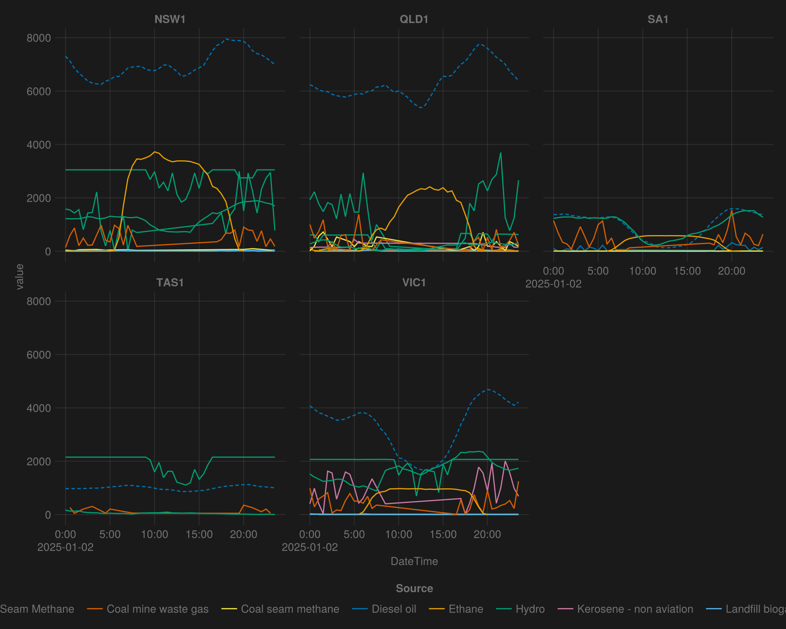
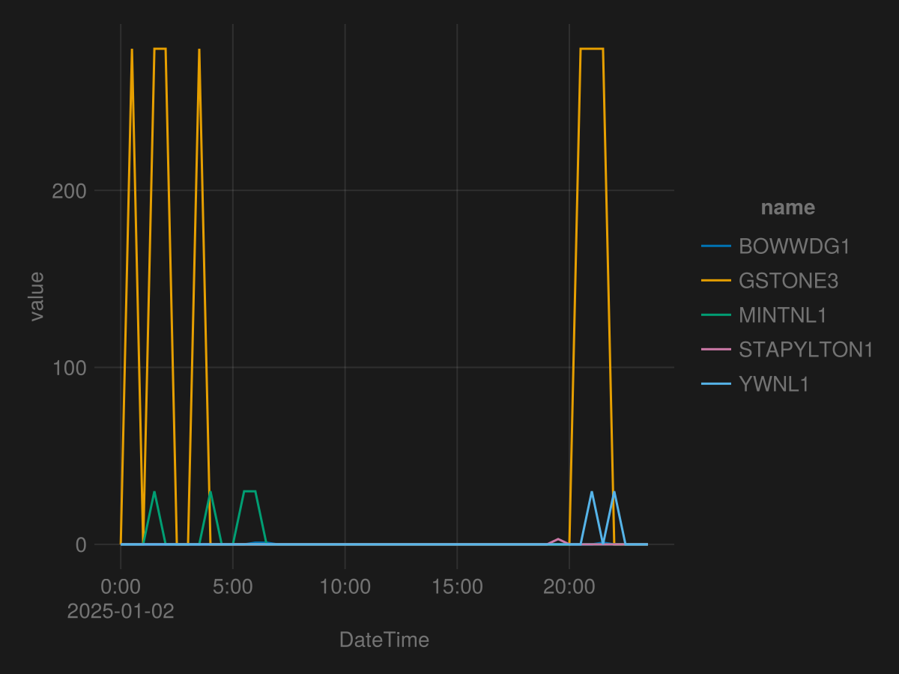
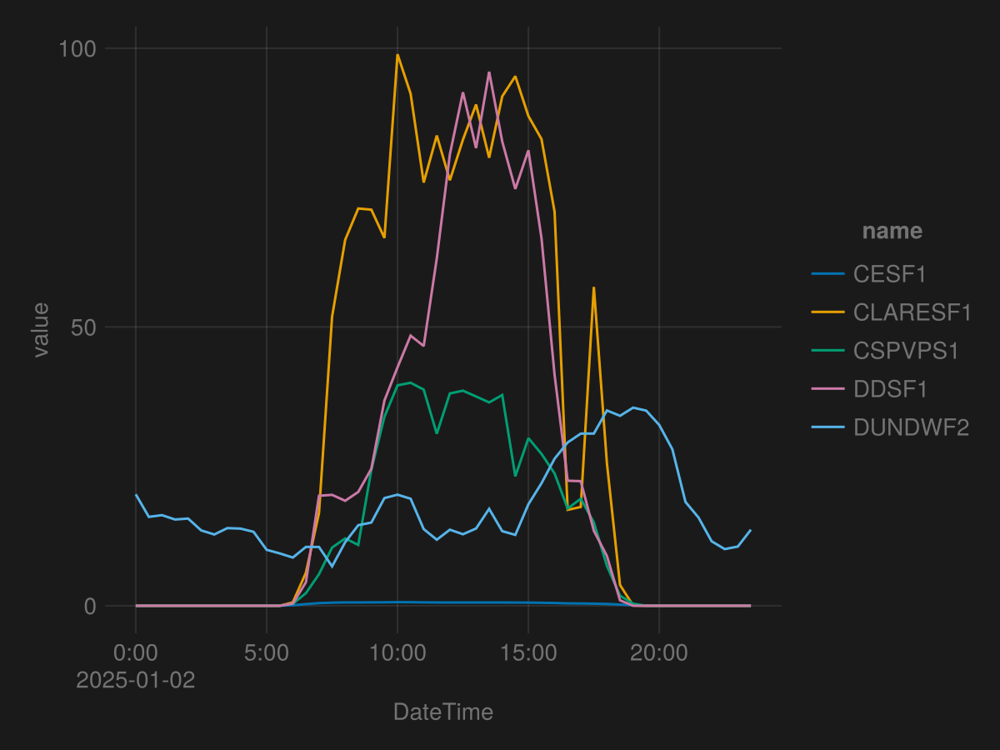
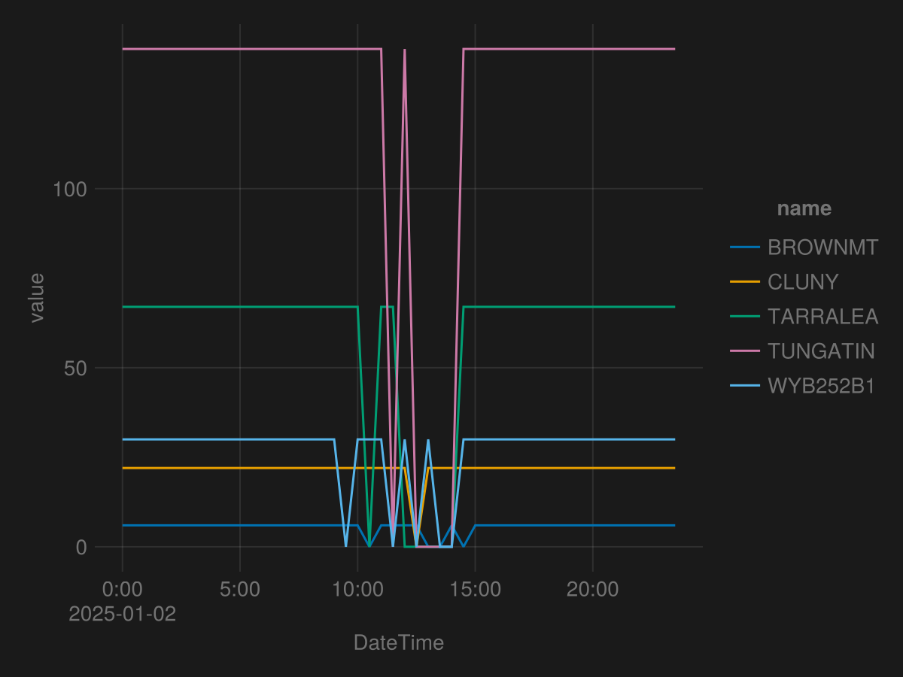

<!-- frozen source=764b691ceba2b0f0422eab642834f1259caea95d4199338512d81af625b4eb15 -->
```@meta
EditURL = "../../literate/howto/economic_dispatch.jl"
```

````julia
using AustralianElectricityMarkets
using AustralianElectricityMarketsData: populate
using PowerSystems
using PowerSimulations
using HydroPowerSimulations
using Chain
using DataFrames
using AlgebraOfGraphics, CairoMakie
using Dates
using HiGHS
````

# Economic dispatch

`PowerSimulations.jl` provides different utilities to simulate an electricity system.

The following section demonstrates the definition of an economic dispatch problem, where
all units in the NEM need to be dispatched at the lowest cost to meet the aggregate
demand at each region.

## Setup the system

Initialise a connection to manage the market data via duckdb.

!!! note "Get the data first!"
    You will first need to download the data from the monthly archive, saving them locally
    in parquet files.

```julia
populate(
    db, Date(2025, 1, 2), Date(2025, 1, 3);
    tables = table_requirements(RegionalNetworkConfiguration()),
)
```

Only the data requirements for a `RegionalNetworkConfiguration` are downloaded.

````julia
db = aem_connect();
````

Instantiate the system. `as_of` selects the units registered on that date.

````julia
sys = nem_system(db, RegionalNetworkConfiguration(); as_of = Date(2025, 1, 2))
````

```@raw html
<table>
  <thead>
    <tr class = "title">
      <td colspan = "2" style = "font-size: x-large; font-weight: bold; text-align: center;">System</td>
    </tr>
    <tr class = "columnLabelRow">
      <th style = "font-weight: bold; text-align: left;">Property</th>
      <th style = "font-weight: bold; text-align: left;">Value</th>
    </tr>
  </thead>
  <tbody>
    <tr class = "dataRow">
      <td style = "text-align: left;">Name</td>
      <td style = "text-align: left;"></td>
    </tr>
    <tr class = "dataRow">
      <td style = "text-align: left;">Description</td>
      <td style = "text-align: left;"></td>
    </tr>
    <tr class = "dataRow">
      <td style = "text-align: left;">System Units Base</td>
      <td style = "text-align: left;">SYSTEM_BASE</td>
    </tr>
    <tr class = "dataRow">
      <td style = "text-align: left;">Base Power</td>
      <td style = "text-align: left;">100.0</td>
    </tr>
    <tr class = "dataRow">
      <td style = "text-align: left;">Base Frequency</td>
      <td style = "text-align: left;">60.0</td>
    </tr>
    <tr class = "dataRow">
      <td style = "text-align: left;">Num Components</td>
      <td style = "text-align: left;">684</td>
    </tr>
  </tbody>
</table>

<table>
  <thead>
    <tr class = "title">
      <td colspan = "2" style = "font-size: x-large; font-weight: bold; text-align: center;">Static Components</td>
    </tr>
    <tr class = "columnLabelRow">
      <th style = "font-weight: bold; text-align: left;">Type</th>
      <th style = "font-weight: bold; text-align: left;">Count</th>
    </tr>
  </thead>
  <tbody>
    <tr class = "dataRow">
      <td style = "text-align: left;">ACBus</td>
      <td style = "text-align: left;">10</td>
    </tr>
    <tr class = "dataRow">
      <td style = "text-align: left;">Arc</td>
      <td style = "text-align: left;">9</td>
    </tr>
    <tr class = "dataRow">
      <td style = "text-align: left;">Area</td>
      <td style = "text-align: left;">5</td>
    </tr>
    <tr class = "dataRow">
      <td style = "text-align: left;">AreaInterchange</td>
      <td style = "text-align: left;">6</td>
    </tr>
    <tr class = "dataRow">
      <td style = "text-align: left;">EnergyReservoirStorage</td>
      <td style = "text-align: left;">30</td>
    </tr>
    <tr class = "dataRow">
      <td style = "text-align: left;">HydroDispatch</td>
      <td style = "text-align: left;">82</td>
    </tr>
    <tr class = "dataRow">
      <td style = "text-align: left;">InterruptiblePowerLoad</td>
      <td style = "text-align: left;">102</td>
    </tr>
    <tr class = "dataRow">
      <td style = "text-align: left;">Line</td>
      <td style = "text-align: left;">11</td>
    </tr>
    <tr class = "dataRow">
      <td style = "text-align: left;">PowerLoad</td>
      <td style = "text-align: left;">5</td>
    </tr>
    <tr class = "dataRow">
      <td style = "text-align: left;">RenewableDispatch</td>
      <td style = "text-align: left;">222</td>
    </tr>
    <tr class = "dataRow">
      <td style = "text-align: left;">ThermalStandard</td>
      <td style = "text-align: left;">202</td>
    </tr>
  </tbody>
</table>


```

Set the horizon to consider for the simulation.

````julia
date_range = Date(2025, 1, 2):Date(2025, 1, 3)
interval = Minute(30)
horizon = Hour(24)
````

````
24 hours
````

Set deterministic time series for demand and the availability of each unit.

````julia
set_demand!(sys, db, date_range; resolution = interval)
set_regional_availability!(sys, db, date_range; resolution = interval)
````

Derive forecasts from the deterministic time series.

````julia
transform_single_time_series!(sys, horizon, interval);
@show sys
````

```@raw html
<table>
  <thead>
    <tr class = "title">
      <td colspan = "2" style = "font-size: x-large; font-weight: bold; text-align: center;">System</td>
    </tr>
    <tr class = "columnLabelRow">
      <th style = "font-weight: bold; text-align: left;">Property</th>
      <th style = "font-weight: bold; text-align: left;">Value</th>
    </tr>
  </thead>
  <tbody>
    <tr class = "dataRow">
      <td style = "text-align: left;">Name</td>
      <td style = "text-align: left;"></td>
    </tr>
    <tr class = "dataRow">
      <td style = "text-align: left;">Description</td>
      <td style = "text-align: left;"></td>
    </tr>
    <tr class = "dataRow">
      <td style = "text-align: left;">System Units Base</td>
      <td style = "text-align: left;">SYSTEM_BASE</td>
    </tr>
    <tr class = "dataRow">
      <td style = "text-align: left;">Base Power</td>
      <td style = "text-align: left;">100.0</td>
    </tr>
    <tr class = "dataRow">
      <td style = "text-align: left;">Base Frequency</td>
      <td style = "text-align: left;">60.0</td>
    </tr>
    <tr class = "dataRow">
      <td style = "text-align: left;">Num Components</td>
      <td style = "text-align: left;">684</td>
    </tr>
  </tbody>
</table>

<table>
  <thead>
    <tr class = "title">
      <td colspan = "2" style = "font-size: x-large; font-weight: bold; text-align: center;">Static Components</td>
    </tr>
    <tr class = "columnLabelRow">
      <th style = "font-weight: bold; text-align: left;">Type</th>
      <th style = "font-weight: bold; text-align: left;">Count</th>
    </tr>
  </thead>
  <tbody>
    <tr class = "dataRow">
      <td style = "text-align: left;">ACBus</td>
      <td style = "text-align: left;">10</td>
    </tr>
    <tr class = "dataRow">
      <td style = "text-align: left;">Arc</td>
      <td style = "text-align: left;">9</td>
    </tr>
    <tr class = "dataRow">
      <td style = "text-align: left;">Area</td>
      <td style = "text-align: left;">5</td>
    </tr>
    <tr class = "dataRow">
      <td style = "text-align: left;">AreaInterchange</td>
      <td style = "text-align: left;">6</td>
    </tr>
    <tr class = "dataRow">
      <td style = "text-align: left;">EnergyReservoirStorage</td>
      <td style = "text-align: left;">30</td>
    </tr>
    <tr class = "dataRow">
      <td style = "text-align: left;">HydroDispatch</td>
      <td style = "text-align: left;">82</td>
    </tr>
    <tr class = "dataRow">
      <td style = "text-align: left;">InterruptiblePowerLoad</td>
      <td style = "text-align: left;">102</td>
    </tr>
    <tr class = "dataRow">
      <td style = "text-align: left;">Line</td>
      <td style = "text-align: left;">11</td>
    </tr>
    <tr class = "dataRow">
      <td style = "text-align: left;">PowerLoad</td>
      <td style = "text-align: left;">5</td>
    </tr>
    <tr class = "dataRow">
      <td style = "text-align: left;">RenewableDispatch</td>
      <td style = "text-align: left;">222</td>
    </tr>
    <tr class = "dataRow">
      <td style = "text-align: left;">ThermalStandard</td>
      <td style = "text-align: left;">202</td>
    </tr>
  </tbody>
</table>

<table>
  <thead>
    <tr class = "title">
      <td colspan = "8" style = "font-size: x-large; font-weight: bold; text-align: center;">StaticTimeSeries Summary</td>
    </tr>
    <tr class = "columnLabelRow">
      <th style = "font-weight: bold; text-align: left;">owner_type</th>
      <th style = "font-weight: bold; text-align: left;">owner_category</th>
      <th style = "font-weight: bold; text-align: left;">name</th>
      <th style = "font-weight: bold; text-align: left;">time_series_type</th>
      <th style = "font-weight: bold; text-align: left;">initial_timestamp</th>
      <th style = "font-weight: bold; text-align: left;">resolution</th>
      <th style = "font-weight: bold; text-align: left;">count</th>
      <th style = "font-weight: bold; text-align: left;">time_step_count</th>
    </tr>
    <tr class = "columnLabelRow">
      <th style = "text-align: left;">String</th>
      <th style = "text-align: left;">String</th>
      <th style = "text-align: left;">String</th>
      <th style = "text-align: left;">String</th>
      <th style = "text-align: left;">String</th>
      <th style = "text-align: left;">Dates.CompoundPeriod</th>
      <th style = "text-align: left;">Int64</th>
      <th style = "text-align: left;">Int64</th>
    </tr>
  </thead>
  <tbody>
    <tr class = "dataRow">
      <td style = "text-align: left;">HydroDispatch</td>
      <td style = "text-align: left;">Component</td>
      <td style = "text-align: left;">max_active_power</td>
      <td style = "text-align: left;">SingleTimeSeries</td>
      <td style = "text-align: left;">2025-01-02T00:00:00</td>
      <td style = "text-align: left;">30 minutes</td>
      <td style = "text-align: left;">82</td>
      <td style = "text-align: left;">48</td>
    </tr>
    <tr class = "dataRow">
      <td style = "text-align: left;">PowerLoad</td>
      <td style = "text-align: left;">Component</td>
      <td style = "text-align: left;">loss_demand</td>
      <td style = "text-align: left;">SingleTimeSeries</td>
      <td style = "text-align: left;">2025-01-02T00:00:00</td>
      <td style = "text-align: left;">30 minutes</td>
      <td style = "text-align: left;">5</td>
      <td style = "text-align: left;">48</td>
    </tr>
    <tr class = "dataRow">
      <td style = "text-align: left;">PowerLoad</td>
      <td style = "text-align: left;">Component</td>
      <td style = "text-align: left;">max_active_power</td>
      <td style = "text-align: left;">SingleTimeSeries</td>
      <td style = "text-align: left;">2025-01-02T00:00:00</td>
      <td style = "text-align: left;">30 minutes</td>
      <td style = "text-align: left;">5</td>
      <td style = "text-align: left;">48</td>
    </tr>
    <tr class = "dataRow">
      <td style = "text-align: left;">RenewableDispatch</td>
      <td style = "text-align: left;">Component</td>
      <td style = "text-align: left;">max_active_power</td>
      <td style = "text-align: left;">SingleTimeSeries</td>
      <td style = "text-align: left;">2025-01-02T00:00:00</td>
      <td style = "text-align: left;">30 minutes</td>
      <td style = "text-align: left;">222</td>
      <td style = "text-align: left;">48</td>
    </tr>
  </tbody>
</table>
<table>
  <thead>
    <tr class = "title">
      <td colspan = "10" style = "font-size: x-large; font-weight: bold; text-align: center;">Forecast Summary</td>
    </tr>
    <tr class = "columnLabelRow">
      <th style = "font-weight: bold; text-align: left;">owner_type</th>
      <th style = "font-weight: bold; text-align: left;">owner_category</th>
      <th style = "font-weight: bold; text-align: left;">name</th>
      <th style = "font-weight: bold; text-align: left;">time_series_type</th>
      <th style = "font-weight: bold; text-align: left;">initial_timestamp</th>
      <th style = "font-weight: bold; text-align: left;">resolution</th>
      <th style = "font-weight: bold; text-align: left;">count</th>
      <th style = "font-weight: bold; text-align: left;">horizon</th>
      <th style = "font-weight: bold; text-align: left;">interval</th>
      <th style = "font-weight: bold; text-align: left;">window_count</th>
    </tr>
    <tr class = "columnLabelRow">
      <th style = "text-align: left;">String</th>
      <th style = "text-align: left;">String</th>
      <th style = "text-align: left;">String</th>
      <th style = "text-align: left;">String</th>
      <th style = "text-align: left;">String</th>
      <th style = "text-align: left;">Dates.CompoundPeriod</th>
      <th style = "text-align: left;">Int64</th>
      <th style = "text-align: left;">Dates.CompoundPeriod</th>
      <th style = "text-align: left;">Dates.CompoundPeriod</th>
      <th style = "text-align: left;">Int64</th>
    </tr>
  </thead>
  <tbody>
    <tr class = "dataRow">
      <td style = "text-align: left;">HydroDispatch</td>
      <td style = "text-align: left;">Component</td>
      <td style = "text-align: left;">max_active_power</td>
      <td style = "text-align: left;">DeterministicSingleTimeSeries</td>
      <td style = "text-align: left;">2025-01-02T00:00:00</td>
      <td style = "text-align: left;">30 minutes</td>
      <td style = "text-align: left;">82</td>
      <td style = "text-align: left;">1 day</td>
      <td style = "text-align: left;">30 minutes</td>
      <td style = "text-align: left;">1</td>
    </tr>
    <tr class = "dataRow">
      <td style = "text-align: left;">PowerLoad</td>
      <td style = "text-align: left;">Component</td>
      <td style = "text-align: left;">loss_demand</td>
      <td style = "text-align: left;">DeterministicSingleTimeSeries</td>
      <td style = "text-align: left;">2025-01-02T00:00:00</td>
      <td style = "text-align: left;">30 minutes</td>
      <td style = "text-align: left;">5</td>
      <td style = "text-align: left;">1 day</td>
      <td style = "text-align: left;">30 minutes</td>
      <td style = "text-align: left;">1</td>
    </tr>
    <tr class = "dataRow">
      <td style = "text-align: left;">PowerLoad</td>
      <td style = "text-align: left;">Component</td>
      <td style = "text-align: left;">max_active_power</td>
      <td style = "text-align: left;">DeterministicSingleTimeSeries</td>
      <td style = "text-align: left;">2025-01-02T00:00:00</td>
      <td style = "text-align: left;">30 minutes</td>
      <td style = "text-align: left;">5</td>
      <td style = "text-align: left;">1 day</td>
      <td style = "text-align: left;">30 minutes</td>
      <td style = "text-align: left;">1</td>
    </tr>
    <tr class = "dataRow">
      <td style = "text-align: left;">RenewableDispatch</td>
      <td style = "text-align: left;">Component</td>
      <td style = "text-align: left;">max_active_power</td>
      <td style = "text-align: left;">DeterministicSingleTimeSeries</td>
      <td style = "text-align: left;">2025-01-02T00:00:00</td>
      <td style = "text-align: left;">30 minutes</td>
      <td style = "text-align: left;">222</td>
      <td style = "text-align: left;">1 day</td>
      <td style = "text-align: left;">30 minutes</td>
      <td style = "text-align: left;">1</td>
    </tr>
  </tbody>
</table>

```

## Setup the problem

````julia
begin
    template = ProblemTemplate()
    set_device_model!(template, Line, StaticBranch)
    set_device_model!(template, PowerLoad, StaticPowerLoad)
    set_device_model!(template, RenewableDispatch, RenewableFullDispatch)
    set_device_model!(template, ThermalStandard, ThermalBasicDispatch)
    set_device_model!(template, HydroDispatch, HydroDispatchRunOfRiver)
    set_network_model!(template, NetworkModel(CopperPlatePowerModel))
    template
end
````

```@raw html
<table>
  <thead>
    <tr class = "title">
      <td colspan = "2" style = "font-size: x-large; font-weight: bold; text-align: center;">Network Model</td>
    </tr>
  </thead>
  <tbody>
    <tr class = "dataRow">
      <td style = "text-align: left;">Network Model</td>
      <td style = "text-align: left;">PowerSimulations.CopperPlatePowerModel</td>
    </tr>
    <tr class = "dataRow">
      <td style = "text-align: left;">Slacks</td>
      <td style = "text-align: left;">false</td>
    </tr>
    <tr class = "dataRow">
      <td style = "text-align: left;">Slack cost</td>
      <td style = "text-align: left;">1.0e6</td>
    </tr>
    <tr class = "dataRow">
      <td style = "text-align: left;">PTDF</td>
      <td style = "text-align: left;">false</td>
    </tr>
    <tr class = "dataRow">
      <td style = "text-align: left;">Duals</td>
      <td style = "text-align: left;">None</td>
    </tr>
    <tr class = "dataRow">
      <td style = "text-align: left;">HVDC Network Model</td>
      <td style = "text-align: left;">None</td>
    </tr>
  </tbody>
</table>

<table>
  <thead>
    <tr class = "title">
      <td colspan = "3" style = "font-size: x-large; font-weight: bold; text-align: center;">Device Models</td>
    </tr>
    <tr class = "columnLabelRow">
      <th style = "font-weight: bold; text-align: left;">Device Type</th>
      <th style = "font-weight: bold; text-align: left;">Formulation</th>
      <th style = "font-weight: bold; text-align: left;">Slacks</th>
    </tr>
  </thead>
  <tbody>
    <tr class = "dataRow">
      <td style = "text-align: left;">PowerSystems.ThermalStandard</td>
      <td style = "text-align: left;">PowerSimulations.ThermalBasicDispatch</td>
      <td style = "text-align: left;">false</td>
    </tr>
    <tr class = "dataRow">
      <td style = "text-align: left;">PowerSystems.PowerLoad</td>
      <td style = "text-align: left;">PowerSimulations.StaticPowerLoad</td>
      <td style = "text-align: left;">false</td>
    </tr>
    <tr class = "dataRow">
      <td style = "text-align: left;">PowerSystems.HydroDispatch</td>
      <td style = "text-align: left;">HydroPowerSimulations.HydroDispatchRunOfRiver</td>
      <td style = "text-align: left;">false</td>
    </tr>
    <tr class = "dataRow">
      <td style = "text-align: left;">PowerSystems.RenewableDispatch</td>
      <td style = "text-align: left;">PowerSimulations.RenewableFullDispatch</td>
      <td style = "text-align: left;">false</td>
    </tr>
  </tbody>
</table>

<table>
  <thead>
    <tr class = "title">
      <td colspan = "3" style = "font-size: x-large; font-weight: bold; text-align: center;">Branch Models</td>
    </tr>
    <tr class = "columnLabelRow">
      <th style = "font-weight: bold; text-align: left;">Branch Type</th>
      <th style = "font-weight: bold; text-align: left;">Formulation</th>
      <th style = "font-weight: bold; text-align: left;">Slacks</th>
    </tr>
  </thead>
  <tbody>
    <tr class = "dataRow">
      <td style = "text-align: left;">PowerSystems.Line</td>
      <td style = "text-align: left;">PowerSimulations.StaticBranch</td>
      <td style = "text-align: left;">false</td>
    </tr>
  </tbody>
</table>

```

!!! warning "Copper Plate Assumption"
    A **Copper Plate** formulation assumes that power can flow freely across the entire
    network without any losses or transmission constraints. In the real NEM, the vast
    geographical distances (over 4,000 km from North QLD to TAS) and limited interconnector
    capacities mean that this is a significant simplification. It is useful for a first
    approximation of the lowest possible system cost.

The Economic Dispatch problem will be solved with open source solver HiGHS.

````julia
solver = optimizer_with_attributes(HiGHS.Optimizer, "mip_rel_gap" => 0.2)
problem = DecisionModel(template, sys; optimizer = solver, horizon = horizon)
build!(problem; output_dir = mktempdir())
````

````
InfrastructureSystems.Optimization.ModelBuildStatusModule.ModelBuildStatus.BUILT = 0
````

Solve the problem.

````julia
solve!(problem)
````

````
InfrastructureSystems.Simulation.RunStatusModule.RunStatus.SUCCESSFULLY_FINALIZED = 0
````

Observe the results.

````julia
res = OptimizationProblemResults(problem)
````

```@raw html
<p> Start: 2025-01-02T00:00:00</p>
<p> End: 2025-01-02T23:30:00</p>
<p> Resolution: 30 minutes</p>

<table>
  <thead>
    <tr class = "title">
      <td colspan = "1" style = "font-size: x-large; font-weight: bold; text-align: center;">PowerSimulations Problem Expressions Results</td>
    </tr>
  </thead>
  <tbody>
    <tr class = "dataRow">
      <td style = "text-align: left;">VOMCostExpression__ThermalStandard</td>
    </tr>
    <tr class = "dataRow">
      <td style = "text-align: left;">ProductionCostExpression__RenewableDispatch</td>
    </tr>
    <tr class = "dataRow">
      <td style = "text-align: left;">VOMCostExpression__RenewableDispatch</td>
    </tr>
    <tr class = "dataRow">
      <td style = "text-align: left;">StartUpCostExpression__ThermalStandard</td>
    </tr>
    <tr class = "dataRow">
      <td style = "text-align: left;">FuelCostExpression__ThermalStandard</td>
    </tr>
    <tr class = "dataRow">
      <td style = "text-align: left;">ProductionCostExpression__ThermalStandard</td>
    </tr>
    <tr class = "dataRow">
      <td style = "text-align: left;">FuelConsumptionExpression__ThermalStandard</td>
    </tr>
    <tr class = "dataRow">
      <td style = "text-align: left;">CurtailmentCostExpression__RenewableDispatch</td>
    </tr>
    <tr class = "dataRow">
      <td style = "text-align: left;">ProductionCostExpression__HydroDispatch</td>
    </tr>
    <tr class = "dataRow">
      <td style = "text-align: left;">ShutDownCostExpression__ThermalStandard</td>
    </tr>
    <tr class = "dataRow">
      <td style = "text-align: left;">ActivePowerBalance__System</td>
    </tr>
    <tr class = "dataRow">
      <td style = "text-align: left;">FixedCostExpression__ThermalStandard</td>
    </tr>
    <tr class = "dataRow">
      <td style = "text-align: left;">FixedCostExpression__RenewableDispatch</td>
    </tr>
  </tbody>
</table>

<table>
  <thead>
    <tr class = "title">
      <td colspan = "1" style = "font-size: x-large; font-weight: bold; text-align: center;">PowerSimulations Problem Auxiliary variables Results</td>
    </tr>
  </thead>
  <tbody>
    <tr class = "dataRow">
      <td style = "text-align: left;">HydroEnergyOutput__HydroDispatch</td>
    </tr>
  </tbody>
</table>

<table>
  <thead>
    <tr class = "title">
      <td colspan = "1" style = "font-size: x-large; font-weight: bold; text-align: center;">PowerSimulations Problem Parameters Results</td>
    </tr>
  </thead>
  <tbody>
    <tr class = "dataRow">
      <td style = "text-align: left;">ActivePowerTimeSeriesParameter__HydroDispatch</td>
    </tr>
    <tr class = "dataRow">
      <td style = "text-align: left;">ActivePowerTimeSeriesParameter__RenewableDispatch</td>
    </tr>
    <tr class = "dataRow">
      <td style = "text-align: left;">ActivePowerTimeSeriesParameter__PowerLoad</td>
    </tr>
  </tbody>
</table>

<table>
  <thead>
    <tr class = "title">
      <td colspan = "1" style = "font-size: x-large; font-weight: bold; text-align: center;">PowerSimulations Problem Variables Results</td>
    </tr>
  </thead>
  <tbody>
    <tr class = "dataRow">
      <td style = "text-align: left;">ActivePowerVariable__ThermalStandard</td>
    </tr>
    <tr class = "dataRow">
      <td style = "text-align: left;">ActivePowerVariable__HydroDispatch</td>
    </tr>
    <tr class = "dataRow">
      <td style = "text-align: left;">ActivePowerVariable__RenewableDispatch</td>
    </tr>
  </tbody>
</table>

```

Let's observe how the units are dispatched.

````julia
begin
    renewables = read_variable(res, "ActivePowerVariable__RenewableDispatch")
    thermal = read_variable(res, "ActivePowerVariable__ThermalStandard")
    hydro = read_variable(res, "ActivePowerVariable__HydroDispatch")
    gens_long = vcat(renewables, thermal, hydro)
    select!(gens_long, :DateTime, :name => :DUID, :value)

    by_fuel = @chain select(
        read_units(db),
        [:DUID, :STATIONID, :CO2E_ENERGY_SOURCE, :REGIONID]
    ) begin
        rightjoin(gens_long, on = :DUID)
        groupby([:CO2E_ENERGY_SOURCE, :REGIONID, :DateTime])
        combine(:value => sum => :value)
        subset(:value => ByRow(>(0.0)))
        dropmissing!
        select!(:DateTime, :REGIONID, :CO2E_ENERGY_SOURCE => :Source, :value)
    end

    loads = @chain res begin
        read_parameter("ActivePowerTimeSeriesParameter__PowerLoad")
        transform!(:name => ByRow(x -> split(x, " ")[1]) => :REGIONID)
        subset!(:REGIONID => ByRow(!=("SNOWY1")))
        insertcols!(:Source => "Region demand")
        select!(:DateTime, :REGIONID, :Source, :value => ByRow(-) => :value)
    end

    demand = data(loads) * mapping(:DateTime, :value, color = :Source, layout = :REGIONID) * visual(Lines, linestyle = (:dash, :dense))
    generation = data(by_fuel) * mapping(:DateTime, :value, color = :Source, layout = :REGIONID) * visual(Lines)
    draw(demand + generation; figure = (; size = (1000, 800)), legend = (; position = :bottom))
end
````


Let's observe the dispatch of a few thermal generators.

````julia
function filter_non_all_zero(df, group_by)
    gdf = groupby(df, group_by)
    is_all_zero = combine(gdf, :value => (x -> all(x == 0)) => :all_zero)
    subset!(is_all_zero, :all_zero => x -> .!x)
    return innerjoin(df, is_all_zero, on = group_by)
end

begin
    thermals_non_zero = filter_non_all_zero(thermal, :name)
    sample = first(unique(thermals_non_zero.name), 5)
    sample = subset!(thermals_non_zero, :name => ByRow(in(sample)))
    data(sample) * mapping(:DateTime, :value, color = :name) * visual(Lines) |> draw
end
````


Let's observe the dispatch of a few renewable generators.

````julia
begin
    renewables_non_zero = filter_non_all_zero(renewables, :name)
    sample = first(unique(renewables_non_zero.name), 5)
    sample = subset!(renewables_non_zero, :name => ByRow(in(sample)))
    data(sample) * mapping(:DateTime, :value, color = :name) * visual(Lines) |> draw
end
````


Let's observe the dispatch of a few hydro generators.

````julia
begin
    hydro_non_zero = filter_non_all_zero(hydro, :name)
    sample = first(unique(hydro_non_zero.name), 5)
    sample = subset!(hydro_non_zero, :name => ByRow(in(sample)))
    data(sample) * mapping(:DateTime, :value, color = :name) * visual(Lines) |> draw
end
````

