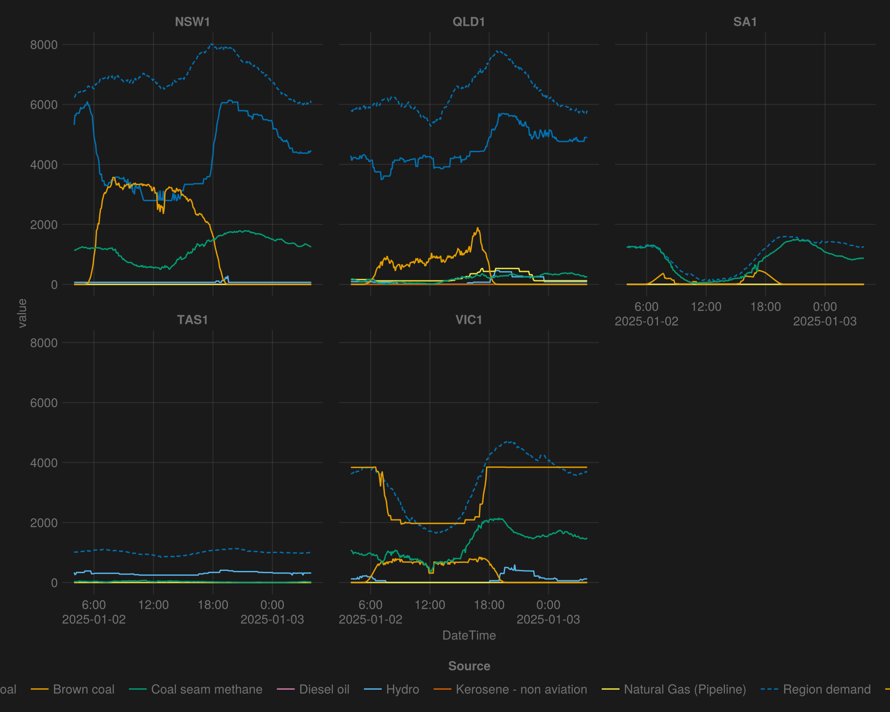
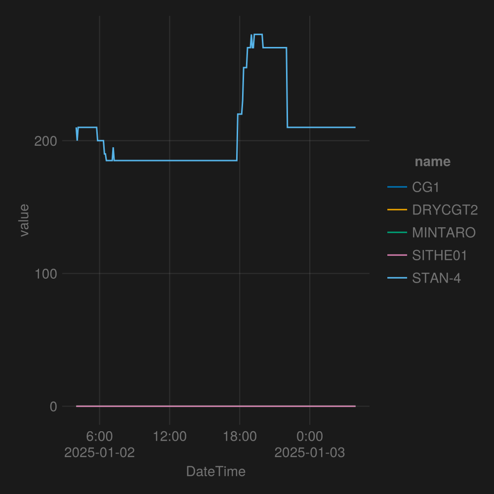
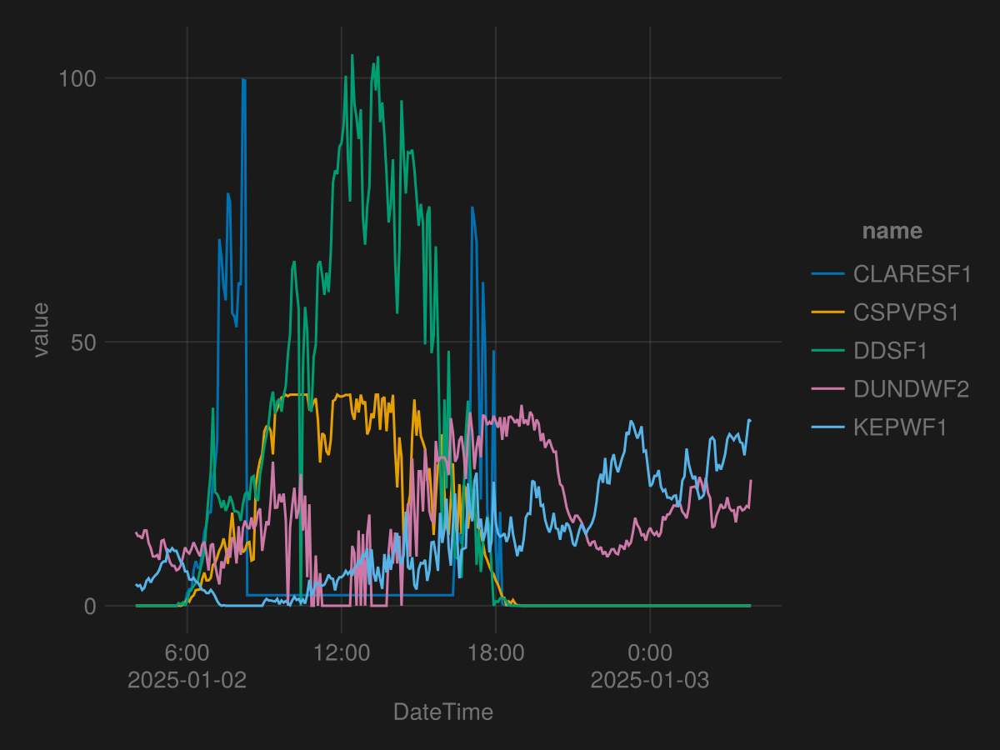
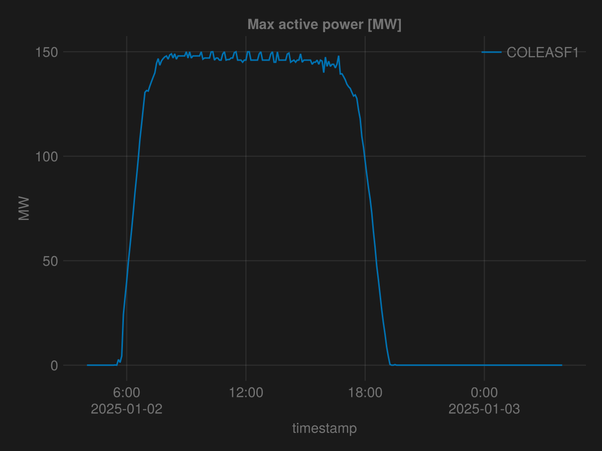

<!-- frozen source=cea449243e73b3d31029732d3c42a6552f691553a44900c2f4627edcceef6f8b -->
```@meta
EditURL = "../../literate/howto/market_bids.jl"
```

````julia
using AustralianElectricityMarkets
using AustralianElectricityMarketsData: populate
using PowerSystems
using PowerSimulations
using HydroPowerSimulations
using Chain
using DataFrames
using AlgebraOfGraphics, CairoMakie
using Dates
using HiGHS
````

# Market Clearing

In the NEM, generators submit bids consisting of up to **10 price-quantity bands** for
each 5-minute dispatch interval. Prices can range from the market floor (-\$1,000/MWh) to
the market price cap (\$23,200/MWh for FY2026-27) - see [Prices, caps and
floors](@ref nem-price-settings) in [The National Electricity Market](@ref) for the full
set of reliability settings.

The following section demonstrates the definition of a market clearing problem, where
all units in the NEM need to be dispatched according to their energy bids to meet the aggregate
demand at each region. In this example, we still ignore network constraints to simplify the problem,
and adopt a "Copper Plate" formulation.

## Setup the system

Initialise a connection to manage the market data via duckdb.

!!! note "Get the data first!"
    You will first need to download the data from the monthly archive, saving them locally
    in parquet files.

```julia
populate(
    db, Date(2025, 1, 2), Date(2025, 1, 3);
    tables = table_requirements(RegionalNetworkConfiguration()),
)
```

Only the data requirements for a `RegionalNetworkConfiguration` are downloaded.

````julia
db = aem_connect();
````

Instantiate the system. `date_range` selects the units registered during that day.

````julia
sys = nem_system(db, RegionalNetworkConfiguration(); date_range = DateTime(2025, 1, 2):Minute(5):DateTime(2025, 1, 3))
````

```@raw html
<table>
  <thead>
    <tr class = "title">
      <td colspan = "2" style = "font-size: x-large; font-weight: bold; text-align: center;">System</td>
    </tr>
    <tr class = "columnLabelRow">
      <th style = "font-weight: bold; text-align: left;">Property</th>
      <th style = "font-weight: bold; text-align: left;">Value</th>
    </tr>
  </thead>
  <tbody>
    <tr class = "dataRow">
      <td style = "text-align: left;">Name</td>
      <td style = "text-align: left;"></td>
    </tr>
    <tr class = "dataRow">
      <td style = "text-align: left;">Description</td>
      <td style = "text-align: left;"></td>
    </tr>
    <tr class = "dataRow">
      <td style = "text-align: left;">System Units Base</td>
      <td style = "text-align: left;">SYSTEM_BASE</td>
    </tr>
    <tr class = "dataRow">
      <td style = "text-align: left;">Base Power</td>
      <td style = "text-align: left;">100.0</td>
    </tr>
    <tr class = "dataRow">
      <td style = "text-align: left;">Base Frequency</td>
      <td style = "text-align: left;">60.0</td>
    </tr>
    <tr class = "dataRow">
      <td style = "text-align: left;">Num Components</td>
      <td style = "text-align: left;">684</td>
    </tr>
  </tbody>
</table>

<table>
  <thead>
    <tr class = "title">
      <td colspan = "2" style = "font-size: x-large; font-weight: bold; text-align: center;">Static Components</td>
    </tr>
    <tr class = "columnLabelRow">
      <th style = "font-weight: bold; text-align: left;">Type</th>
      <th style = "font-weight: bold; text-align: left;">Count</th>
    </tr>
  </thead>
  <tbody>
    <tr class = "dataRow">
      <td style = "text-align: left;">ACBus</td>
      <td style = "text-align: left;">10</td>
    </tr>
    <tr class = "dataRow">
      <td style = "text-align: left;">Arc</td>
      <td style = "text-align: left;">9</td>
    </tr>
    <tr class = "dataRow">
      <td style = "text-align: left;">Area</td>
      <td style = "text-align: left;">5</td>
    </tr>
    <tr class = "dataRow">
      <td style = "text-align: left;">AreaInterchange</td>
      <td style = "text-align: left;">6</td>
    </tr>
    <tr class = "dataRow">
      <td style = "text-align: left;">EnergyReservoirStorage</td>
      <td style = "text-align: left;">30</td>
    </tr>
    <tr class = "dataRow">
      <td style = "text-align: left;">HydroDispatch</td>
      <td style = "text-align: left;">82</td>
    </tr>
    <tr class = "dataRow">
      <td style = "text-align: left;">InterruptiblePowerLoad</td>
      <td style = "text-align: left;">102</td>
    </tr>
    <tr class = "dataRow">
      <td style = "text-align: left;">Line</td>
      <td style = "text-align: left;">11</td>
    </tr>
    <tr class = "dataRow">
      <td style = "text-align: left;">PowerLoad</td>
      <td style = "text-align: left;">5</td>
    </tr>
    <tr class = "dataRow">
      <td style = "text-align: left;">RenewableDispatch</td>
      <td style = "text-align: left;">222</td>
    </tr>
    <tr class = "dataRow">
      <td style = "text-align: left;">ThermalStandard</td>
      <td style = "text-align: left;">202</td>
    </tr>
  </tbody>
</table>


```

Set the horizon to consider for the simulation.

````julia
interval = Minute(5)
horizon = Hour(24)
start_date = DateTime(2025, 1, 2, 4, 0)
date_range = start_date:interval:(start_date + horizon)
@show date_range
````

````
Dates.DateTime("2025-01-02T04:00:00"):Dates.Minute(5):Dates.DateTime("2025-01-03T04:00:00")
````

Set deterministic time series for demand, availability and market bids.

````julia
set_demand!(sys, db, date_range; resolution = interval)
set_market_bids!(sys, db, date_range; resolution = interval)
set_regional_availability!(sys, db, date_range; resolution = interval)
````

````

````

Derive forecasts from the deterministic time series.

````julia
transform_single_time_series!(sys, horizon, interval);
@show sys
````

```@raw html
<table>
  <thead>
    <tr class = "title">
      <td colspan = "2" style = "font-size: x-large; font-weight: bold; text-align: center;">System</td>
    </tr>
    <tr class = "columnLabelRow">
      <th style = "font-weight: bold; text-align: left;">Property</th>
      <th style = "font-weight: bold; text-align: left;">Value</th>
    </tr>
  </thead>
  <tbody>
    <tr class = "dataRow">
      <td style = "text-align: left;">Name</td>
      <td style = "text-align: left;"></td>
    </tr>
    <tr class = "dataRow">
      <td style = "text-align: left;">Description</td>
      <td style = "text-align: left;"></td>
    </tr>
    <tr class = "dataRow">
      <td style = "text-align: left;">System Units Base</td>
      <td style = "text-align: left;">SYSTEM_BASE</td>
    </tr>
    <tr class = "dataRow">
      <td style = "text-align: left;">Base Power</td>
      <td style = "text-align: left;">100.0</td>
    </tr>
    <tr class = "dataRow">
      <td style = "text-align: left;">Base Frequency</td>
      <td style = "text-align: left;">60.0</td>
    </tr>
    <tr class = "dataRow">
      <td style = "text-align: left;">Num Components</td>
      <td style = "text-align: left;">684</td>
    </tr>
  </tbody>
</table>

<table>
  <thead>
    <tr class = "title">
      <td colspan = "2" style = "font-size: x-large; font-weight: bold; text-align: center;">Static Components</td>
    </tr>
    <tr class = "columnLabelRow">
      <th style = "font-weight: bold; text-align: left;">Type</th>
      <th style = "font-weight: bold; text-align: left;">Count</th>
    </tr>
  </thead>
  <tbody>
    <tr class = "dataRow">
      <td style = "text-align: left;">ACBus</td>
      <td style = "text-align: left;">10</td>
    </tr>
    <tr class = "dataRow">
      <td style = "text-align: left;">Arc</td>
      <td style = "text-align: left;">9</td>
    </tr>
    <tr class = "dataRow">
      <td style = "text-align: left;">Area</td>
      <td style = "text-align: left;">5</td>
    </tr>
    <tr class = "dataRow">
      <td style = "text-align: left;">AreaInterchange</td>
      <td style = "text-align: left;">6</td>
    </tr>
    <tr class = "dataRow">
      <td style = "text-align: left;">EnergyReservoirStorage</td>
      <td style = "text-align: left;">30</td>
    </tr>
    <tr class = "dataRow">
      <td style = "text-align: left;">HydroDispatch</td>
      <td style = "text-align: left;">82</td>
    </tr>
    <tr class = "dataRow">
      <td style = "text-align: left;">InterruptiblePowerLoad</td>
      <td style = "text-align: left;">102</td>
    </tr>
    <tr class = "dataRow">
      <td style = "text-align: left;">Line</td>
      <td style = "text-align: left;">11</td>
    </tr>
    <tr class = "dataRow">
      <td style = "text-align: left;">PowerLoad</td>
      <td style = "text-align: left;">5</td>
    </tr>
    <tr class = "dataRow">
      <td style = "text-align: left;">RenewableDispatch</td>
      <td style = "text-align: left;">222</td>
    </tr>
    <tr class = "dataRow">
      <td style = "text-align: left;">ThermalStandard</td>
      <td style = "text-align: left;">202</td>
    </tr>
  </tbody>
</table>

<table>
  <thead>
    <tr class = "title">
      <td colspan = "8" style = "font-size: x-large; font-weight: bold; text-align: center;">StaticTimeSeries Summary</td>
    </tr>
    <tr class = "columnLabelRow">
      <th style = "font-weight: bold; text-align: left;">owner_type</th>
      <th style = "font-weight: bold; text-align: left;">owner_category</th>
      <th style = "font-weight: bold; text-align: left;">name</th>
      <th style = "font-weight: bold; text-align: left;">time_series_type</th>
      <th style = "font-weight: bold; text-align: left;">initial_timestamp</th>
      <th style = "font-weight: bold; text-align: left;">resolution</th>
      <th style = "font-weight: bold; text-align: left;">count</th>
      <th style = "font-weight: bold; text-align: left;">time_step_count</th>
    </tr>
    <tr class = "columnLabelRow">
      <th style = "text-align: left;">String</th>
      <th style = "text-align: left;">String</th>
      <th style = "text-align: left;">String</th>
      <th style = "text-align: left;">String</th>
      <th style = "text-align: left;">String</th>
      <th style = "text-align: left;">Dates.CompoundPeriod</th>
      <th style = "text-align: left;">Int64</th>
      <th style = "text-align: left;">Int64</th>
    </tr>
  </thead>
  <tbody>
    <tr class = "dataRow">
      <td style = "text-align: left;">EnergyReservoirStorage</td>
      <td style = "text-align: left;">Component</td>
      <td style = "text-align: left;">decremental_initial_input</td>
      <td style = "text-align: left;">SingleTimeSeries</td>
      <td style = "text-align: left;">2025-01-02T04:00:00</td>
      <td style = "text-align: left;">5 minutes</td>
      <td style = "text-align: left;">30</td>
      <td style = "text-align: left;">288</td>
    </tr>
    <tr class = "dataRow">
      <td style = "text-align: left;">EnergyReservoirStorage</td>
      <td style = "text-align: left;">Component</td>
      <td style = "text-align: left;">decremental_variable_cost</td>
      <td style = "text-align: left;">SingleTimeSeries</td>
      <td style = "text-align: left;">2025-01-02T04:00:00</td>
      <td style = "text-align: left;">5 minutes</td>
      <td style = "text-align: left;">30</td>
      <td style = "text-align: left;">288</td>
    </tr>
    <tr class = "dataRow">
      <td style = "text-align: left;">EnergyReservoirStorage</td>
      <td style = "text-align: left;">Component</td>
      <td style = "text-align: left;">incremental_initial_input</td>
      <td style = "text-align: left;">SingleTimeSeries</td>
      <td style = "text-align: left;">2025-01-02T04:00:00</td>
      <td style = "text-align: left;">5 minutes</td>
      <td style = "text-align: left;">30</td>
      <td style = "text-align: left;">288</td>
    </tr>
    <tr class = "dataRow">
      <td style = "text-align: left;">EnergyReservoirStorage</td>
      <td style = "text-align: left;">Component</td>
      <td style = "text-align: left;">incremental_variable_cost</td>
      <td style = "text-align: left;">SingleTimeSeries</td>
      <td style = "text-align: left;">2025-01-02T04:00:00</td>
      <td style = "text-align: left;">5 minutes</td>
      <td style = "text-align: left;">30</td>
      <td style = "text-align: left;">288</td>
    </tr>
    <tr class = "dataRow">
      <td style = "text-align: left;">HydroDispatch</td>
      <td style = "text-align: left;">Component</td>
      <td style = "text-align: left;">incremental_initial_input</td>
      <td style = "text-align: left;">SingleTimeSeries</td>
      <td style = "text-align: left;">2025-01-02T04:00:00</td>
      <td style = "text-align: left;">5 minutes</td>
      <td style = "text-align: left;">41</td>
      <td style = "text-align: left;">288</td>
    </tr>
    <tr class = "dataRow">
      <td style = "text-align: left;">HydroDispatch</td>
      <td style = "text-align: left;">Component</td>
      <td style = "text-align: left;">incremental_variable_cost</td>
      <td style = "text-align: left;">SingleTimeSeries</td>
      <td style = "text-align: left;">2025-01-02T04:00:00</td>
      <td style = "text-align: left;">5 minutes</td>
      <td style = "text-align: left;">41</td>
      <td style = "text-align: left;">288</td>
    </tr>
    <tr class = "dataRow">
      <td style = "text-align: left;">HydroDispatch</td>
      <td style = "text-align: left;">Component</td>
      <td style = "text-align: left;">max_active_power</td>
      <td style = "text-align: left;">SingleTimeSeries</td>
      <td style = "text-align: left;">2025-01-02T04:00:00</td>
      <td style = "text-align: left;">5 minutes</td>
      <td style = "text-align: left;">41</td>
      <td style = "text-align: left;">288</td>
    </tr>
    <tr class = "dataRow">
      <td style = "text-align: left;">InterruptiblePowerLoad</td>
      <td style = "text-align: left;">Component</td>
      <td style = "text-align: left;">decremental_initial_input</td>
      <td style = "text-align: left;">SingleTimeSeries</td>
      <td style = "text-align: left;">2025-01-02T04:00:00</td>
      <td style = "text-align: left;">5 minutes</td>
      <td style = "text-align: left;">30</td>
      <td style = "text-align: left;">288</td>
    </tr>
    <tr class = "dataRow">
      <td style = "text-align: left;">InterruptiblePowerLoad</td>
      <td style = "text-align: left;">Component</td>
      <td style = "text-align: left;">decremental_variable_cost</td>
      <td style = "text-align: left;">SingleTimeSeries</td>
      <td style = "text-align: left;">2025-01-02T04:00:00</td>
      <td style = "text-align: left;">5 minutes</td>
      <td style = "text-align: left;">30</td>
      <td style = "text-align: left;">288</td>
    </tr>
    <tr class = "dataRow">
      <td style = "text-align: left;">PowerLoad</td>
      <td style = "text-align: left;">Component</td>
      <td style = "text-align: left;">loss_demand</td>
      <td style = "text-align: left;">SingleTimeSeries</td>
      <td style = "text-align: left;">2025-01-02T04:00:00</td>
      <td style = "text-align: left;">5 minutes</td>
      <td style = "text-align: left;">5</td>
      <td style = "text-align: left;">288</td>
    </tr>
    <tr class = "dataRow">
      <td style = "text-align: left;">PowerLoad</td>
      <td style = "text-align: left;">Component</td>
      <td style = "text-align: left;">max_active_power</td>
      <td style = "text-align: left;">SingleTimeSeries</td>
      <td style = "text-align: left;">2025-01-02T04:00:00</td>
      <td style = "text-align: left;">5 minutes</td>
      <td style = "text-align: left;">5</td>
      <td style = "text-align: left;">288</td>
    </tr>
    <tr class = "dataRow">
      <td style = "text-align: left;">RenewableDispatch</td>
      <td style = "text-align: left;">Component</td>
      <td style = "text-align: left;">incremental_initial_input</td>
      <td style = "text-align: left;">SingleTimeSeries</td>
      <td style = "text-align: left;">2025-01-02T04:00:00</td>
      <td style = "text-align: left;">5 minutes</td>
      <td style = "text-align: left;">186</td>
      <td style = "text-align: left;">288</td>
    </tr>
    <tr class = "dataRow">
      <td style = "text-align: left;">RenewableDispatch</td>
      <td style = "text-align: left;">Component</td>
      <td style = "text-align: left;">incremental_variable_cost</td>
      <td style = "text-align: left;">SingleTimeSeries</td>
      <td style = "text-align: left;">2025-01-02T04:00:00</td>
      <td style = "text-align: left;">5 minutes</td>
      <td style = "text-align: left;">186</td>
      <td style = "text-align: left;">288</td>
    </tr>
    <tr class = "dataRow">
      <td style = "text-align: left;">RenewableDispatch</td>
      <td style = "text-align: left;">Component</td>
      <td style = "text-align: left;">max_active_power</td>
      <td style = "text-align: left;">SingleTimeSeries</td>
      <td style = "text-align: left;">2025-01-02T04:00:00</td>
      <td style = "text-align: left;">5 minutes</td>
      <td style = "text-align: left;">186</td>
      <td style = "text-align: left;">288</td>
    </tr>
    <tr class = "dataRow">
      <td style = "text-align: left;">ThermalStandard</td>
      <td style = "text-align: left;">Component</td>
      <td style = "text-align: left;">incremental_initial_input</td>
      <td style = "text-align: left;">SingleTimeSeries</td>
      <td style = "text-align: left;">2025-01-02T04:00:00</td>
      <td style = "text-align: left;">5 minutes</td>
      <td style = "text-align: left;">129</td>
      <td style = "text-align: left;">288</td>
    </tr>
    <tr class = "dataRow">
      <td style = "text-align: left;">ThermalStandard</td>
      <td style = "text-align: left;">Component</td>
      <td style = "text-align: left;">incremental_variable_cost</td>
      <td style = "text-align: left;">SingleTimeSeries</td>
      <td style = "text-align: left;">2025-01-02T04:00:00</td>
      <td style = "text-align: left;">5 minutes</td>
      <td style = "text-align: left;">129</td>
      <td style = "text-align: left;">288</td>
    </tr>
  </tbody>
</table>
<table>
  <thead>
    <tr class = "title">
      <td colspan = "10" style = "font-size: x-large; font-weight: bold; text-align: center;">Forecast Summary</td>
    </tr>
    <tr class = "columnLabelRow">
      <th style = "font-weight: bold; text-align: left;">owner_type</th>
      <th style = "font-weight: bold; text-align: left;">owner_category</th>
      <th style = "font-weight: bold; text-align: left;">name</th>
      <th style = "font-weight: bold; text-align: left;">time_series_type</th>
      <th style = "font-weight: bold; text-align: left;">initial_timestamp</th>
      <th style = "font-weight: bold; text-align: left;">resolution</th>
      <th style = "font-weight: bold; text-align: left;">count</th>
      <th style = "font-weight: bold; text-align: left;">horizon</th>
      <th style = "font-weight: bold; text-align: left;">interval</th>
      <th style = "font-weight: bold; text-align: left;">window_count</th>
    </tr>
    <tr class = "columnLabelRow">
      <th style = "text-align: left;">String</th>
      <th style = "text-align: left;">String</th>
      <th style = "text-align: left;">String</th>
      <th style = "text-align: left;">String</th>
      <th style = "text-align: left;">String</th>
      <th style = "text-align: left;">Dates.CompoundPeriod</th>
      <th style = "text-align: left;">Int64</th>
      <th style = "text-align: left;">Dates.CompoundPeriod</th>
      <th style = "text-align: left;">Dates.CompoundPeriod</th>
      <th style = "text-align: left;">Int64</th>
    </tr>
  </thead>
  <tbody>
    <tr class = "dataRow">
      <td style = "text-align: left;">EnergyReservoirStorage</td>
      <td style = "text-align: left;">Component</td>
      <td style = "text-align: left;">decremental_initial_input</td>
      <td style = "text-align: left;">DeterministicSingleTimeSeries</td>
      <td style = "text-align: left;">2025-01-02T04:00:00</td>
      <td style = "text-align: left;">5 minutes</td>
      <td style = "text-align: left;">30</td>
      <td style = "text-align: left;">1 day</td>
      <td style = "text-align: left;">5 minutes</td>
      <td style = "text-align: left;">1</td>
    </tr>
    <tr class = "dataRow">
      <td style = "text-align: left;">EnergyReservoirStorage</td>
      <td style = "text-align: left;">Component</td>
      <td style = "text-align: left;">decremental_variable_cost</td>
      <td style = "text-align: left;">DeterministicSingleTimeSeries</td>
      <td style = "text-align: left;">2025-01-02T04:00:00</td>
      <td style = "text-align: left;">5 minutes</td>
      <td style = "text-align: left;">30</td>
      <td style = "text-align: left;">1 day</td>
      <td style = "text-align: left;">5 minutes</td>
      <td style = "text-align: left;">1</td>
    </tr>
    <tr class = "dataRow">
      <td style = "text-align: left;">EnergyReservoirStorage</td>
      <td style = "text-align: left;">Component</td>
      <td style = "text-align: left;">incremental_initial_input</td>
      <td style = "text-align: left;">DeterministicSingleTimeSeries</td>
      <td style = "text-align: left;">2025-01-02T04:00:00</td>
      <td style = "text-align: left;">5 minutes</td>
      <td style = "text-align: left;">30</td>
      <td style = "text-align: left;">1 day</td>
      <td style = "text-align: left;">5 minutes</td>
      <td style = "text-align: left;">1</td>
    </tr>
    <tr class = "dataRow">
      <td style = "text-align: left;">EnergyReservoirStorage</td>
      <td style = "text-align: left;">Component</td>
      <td style = "text-align: left;">incremental_variable_cost</td>
      <td style = "text-align: left;">DeterministicSingleTimeSeries</td>
      <td style = "text-align: left;">2025-01-02T04:00:00</td>
      <td style = "text-align: left;">5 minutes</td>
      <td style = "text-align: left;">30</td>
      <td style = "text-align: left;">1 day</td>
      <td style = "text-align: left;">5 minutes</td>
      <td style = "text-align: left;">1</td>
    </tr>
    <tr class = "dataRow">
      <td style = "text-align: left;">HydroDispatch</td>
      <td style = "text-align: left;">Component</td>
      <td style = "text-align: left;">incremental_initial_input</td>
      <td style = "text-align: left;">DeterministicSingleTimeSeries</td>
      <td style = "text-align: left;">2025-01-02T04:00:00</td>
      <td style = "text-align: left;">5 minutes</td>
      <td style = "text-align: left;">41</td>
      <td style = "text-align: left;">1 day</td>
      <td style = "text-align: left;">5 minutes</td>
      <td style = "text-align: left;">1</td>
    </tr>
    <tr class = "dataRow">
      <td style = "text-align: left;">HydroDispatch</td>
      <td style = "text-align: left;">Component</td>
      <td style = "text-align: left;">incremental_variable_cost</td>
      <td style = "text-align: left;">DeterministicSingleTimeSeries</td>
      <td style = "text-align: left;">2025-01-02T04:00:00</td>
      <td style = "text-align: left;">5 minutes</td>
      <td style = "text-align: left;">41</td>
      <td style = "text-align: left;">1 day</td>
      <td style = "text-align: left;">5 minutes</td>
      <td style = "text-align: left;">1</td>
    </tr>
    <tr class = "dataRow">
      <td style = "text-align: left;">HydroDispatch</td>
      <td style = "text-align: left;">Component</td>
      <td style = "text-align: left;">max_active_power</td>
      <td style = "text-align: left;">DeterministicSingleTimeSeries</td>
      <td style = "text-align: left;">2025-01-02T04:00:00</td>
      <td style = "text-align: left;">5 minutes</td>
      <td style = "text-align: left;">41</td>
      <td style = "text-align: left;">1 day</td>
      <td style = "text-align: left;">5 minutes</td>
      <td style = "text-align: left;">1</td>
    </tr>
    <tr class = "dataRow">
      <td style = "text-align: left;">InterruptiblePowerLoad</td>
      <td style = "text-align: left;">Component</td>
      <td style = "text-align: left;">decremental_initial_input</td>
      <td style = "text-align: left;">DeterministicSingleTimeSeries</td>
      <td style = "text-align: left;">2025-01-02T04:00:00</td>
      <td style = "text-align: left;">5 minutes</td>
      <td style = "text-align: left;">30</td>
      <td style = "text-align: left;">1 day</td>
      <td style = "text-align: left;">5 minutes</td>
      <td style = "text-align: left;">1</td>
    </tr>
    <tr class = "dataRow">
      <td style = "text-align: left;">InterruptiblePowerLoad</td>
      <td style = "text-align: left;">Component</td>
      <td style = "text-align: left;">decremental_variable_cost</td>
      <td style = "text-align: left;">DeterministicSingleTimeSeries</td>
      <td style = "text-align: left;">2025-01-02T04:00:00</td>
      <td style = "text-align: left;">5 minutes</td>
      <td style = "text-align: left;">30</td>
      <td style = "text-align: left;">1 day</td>
      <td style = "text-align: left;">5 minutes</td>
      <td style = "text-align: left;">1</td>
    </tr>
    <tr class = "dataRow">
      <td style = "text-align: left;">PowerLoad</td>
      <td style = "text-align: left;">Component</td>
      <td style = "text-align: left;">loss_demand</td>
      <td style = "text-align: left;">DeterministicSingleTimeSeries</td>
      <td style = "text-align: left;">2025-01-02T04:00:00</td>
      <td style = "text-align: left;">5 minutes</td>
      <td style = "text-align: left;">5</td>
      <td style = "text-align: left;">1 day</td>
      <td style = "text-align: left;">5 minutes</td>
      <td style = "text-align: left;">1</td>
    </tr>
    <tr class = "dataRow">
      <td style = "text-align: left;">PowerLoad</td>
      <td style = "text-align: left;">Component</td>
      <td style = "text-align: left;">max_active_power</td>
      <td style = "text-align: left;">DeterministicSingleTimeSeries</td>
      <td style = "text-align: left;">2025-01-02T04:00:00</td>
      <td style = "text-align: left;">5 minutes</td>
      <td style = "text-align: left;">5</td>
      <td style = "text-align: left;">1 day</td>
      <td style = "text-align: left;">5 minutes</td>
      <td style = "text-align: left;">1</td>
    </tr>
    <tr class = "dataRow">
      <td style = "text-align: left;">RenewableDispatch</td>
      <td style = "text-align: left;">Component</td>
      <td style = "text-align: left;">incremental_initial_input</td>
      <td style = "text-align: left;">DeterministicSingleTimeSeries</td>
      <td style = "text-align: left;">2025-01-02T04:00:00</td>
      <td style = "text-align: left;">5 minutes</td>
      <td style = "text-align: left;">186</td>
      <td style = "text-align: left;">1 day</td>
      <td style = "text-align: left;">5 minutes</td>
      <td style = "text-align: left;">1</td>
    </tr>
    <tr class = "dataRow">
      <td style = "text-align: left;">RenewableDispatch</td>
      <td style = "text-align: left;">Component</td>
      <td style = "text-align: left;">incremental_variable_cost</td>
      <td style = "text-align: left;">DeterministicSingleTimeSeries</td>
      <td style = "text-align: left;">2025-01-02T04:00:00</td>
      <td style = "text-align: left;">5 minutes</td>
      <td style = "text-align: left;">186</td>
      <td style = "text-align: left;">1 day</td>
      <td style = "text-align: left;">5 minutes</td>
      <td style = "text-align: left;">1</td>
    </tr>
    <tr class = "dataRow">
      <td style = "text-align: left;">RenewableDispatch</td>
      <td style = "text-align: left;">Component</td>
      <td style = "text-align: left;">max_active_power</td>
      <td style = "text-align: left;">DeterministicSingleTimeSeries</td>
      <td style = "text-align: left;">2025-01-02T04:00:00</td>
      <td style = "text-align: left;">5 minutes</td>
      <td style = "text-align: left;">186</td>
      <td style = "text-align: left;">1 day</td>
      <td style = "text-align: left;">5 minutes</td>
      <td style = "text-align: left;">1</td>
    </tr>
    <tr class = "dataRow">
      <td style = "text-align: left;">ThermalStandard</td>
      <td style = "text-align: left;">Component</td>
      <td style = "text-align: left;">incremental_initial_input</td>
      <td style = "text-align: left;">DeterministicSingleTimeSeries</td>
      <td style = "text-align: left;">2025-01-02T04:00:00</td>
      <td style = "text-align: left;">5 minutes</td>
      <td style = "text-align: left;">129</td>
      <td style = "text-align: left;">1 day</td>
      <td style = "text-align: left;">5 minutes</td>
      <td style = "text-align: left;">1</td>
    </tr>
    <tr class = "dataRow">
      <td style = "text-align: left;">ThermalStandard</td>
      <td style = "text-align: left;">Component</td>
      <td style = "text-align: left;">incremental_variable_cost</td>
      <td style = "text-align: left;">DeterministicSingleTimeSeries</td>
      <td style = "text-align: left;">2025-01-02T04:00:00</td>
      <td style = "text-align: left;">5 minutes</td>
      <td style = "text-align: left;">129</td>
      <td style = "text-align: left;">1 day</td>
      <td style = "text-align: left;">5 minutes</td>
      <td style = "text-align: left;">1</td>
    </tr>
  </tbody>
</table>

```

## Define the problem

````julia
begin
    template = ProblemTemplate()
    set_device_model!(template, Line, StaticBranch)
    set_device_model!(template, PowerLoad, StaticPowerLoad)
    set_device_model!(template, RenewableDispatch, RenewableFullDispatch)
    set_device_model!(template, ThermalStandard, ThermalBasicUnitCommitment)
    set_device_model!(template, HydroDispatch, HydroDispatchRunOfRiver)
    set_network_model!(template, NetworkModel(CopperPlatePowerModel))
    template
end
````

```@raw html
<table>
  <thead>
    <tr class = "title">
      <td colspan = "2" style = "font-size: x-large; font-weight: bold; text-align: center;">Network Model</td>
    </tr>
  </thead>
  <tbody>
    <tr class = "dataRow">
      <td style = "text-align: left;">Network Model</td>
      <td style = "text-align: left;">PowerSimulations.CopperPlatePowerModel</td>
    </tr>
    <tr class = "dataRow">
      <td style = "text-align: left;">Slacks</td>
      <td style = "text-align: left;">false</td>
    </tr>
    <tr class = "dataRow">
      <td style = "text-align: left;">Slack cost</td>
      <td style = "text-align: left;">1.0e6</td>
    </tr>
    <tr class = "dataRow">
      <td style = "text-align: left;">PTDF</td>
      <td style = "text-align: left;">false</td>
    </tr>
    <tr class = "dataRow">
      <td style = "text-align: left;">Duals</td>
      <td style = "text-align: left;">None</td>
    </tr>
    <tr class = "dataRow">
      <td style = "text-align: left;">HVDC Network Model</td>
      <td style = "text-align: left;">None</td>
    </tr>
  </tbody>
</table>

<table>
  <thead>
    <tr class = "title">
      <td colspan = "3" style = "font-size: x-large; font-weight: bold; text-align: center;">Device Models</td>
    </tr>
    <tr class = "columnLabelRow">
      <th style = "font-weight: bold; text-align: left;">Device Type</th>
      <th style = "font-weight: bold; text-align: left;">Formulation</th>
      <th style = "font-weight: bold; text-align: left;">Slacks</th>
    </tr>
  </thead>
  <tbody>
    <tr class = "dataRow">
      <td style = "text-align: left;">PowerSystems.ThermalStandard</td>
      <td style = "text-align: left;">PowerSimulations.ThermalBasicUnitCommitment</td>
      <td style = "text-align: left;">false</td>
    </tr>
    <tr class = "dataRow">
      <td style = "text-align: left;">PowerSystems.PowerLoad</td>
      <td style = "text-align: left;">PowerSimulations.StaticPowerLoad</td>
      <td style = "text-align: left;">false</td>
    </tr>
    <tr class = "dataRow">
      <td style = "text-align: left;">PowerSystems.HydroDispatch</td>
      <td style = "text-align: left;">HydroPowerSimulations.HydroDispatchRunOfRiver</td>
      <td style = "text-align: left;">false</td>
    </tr>
    <tr class = "dataRow">
      <td style = "text-align: left;">PowerSystems.RenewableDispatch</td>
      <td style = "text-align: left;">PowerSimulations.RenewableFullDispatch</td>
      <td style = "text-align: left;">false</td>
    </tr>
  </tbody>
</table>

<table>
  <thead>
    <tr class = "title">
      <td colspan = "3" style = "font-size: x-large; font-weight: bold; text-align: center;">Branch Models</td>
    </tr>
    <tr class = "columnLabelRow">
      <th style = "font-weight: bold; text-align: left;">Branch Type</th>
      <th style = "font-weight: bold; text-align: left;">Formulation</th>
      <th style = "font-weight: bold; text-align: left;">Slacks</th>
    </tr>
  </thead>
  <tbody>
    <tr class = "dataRow">
      <td style = "text-align: left;">PowerSystems.Line</td>
      <td style = "text-align: left;">PowerSimulations.StaticBranch</td>
      <td style = "text-align: left;">false</td>
    </tr>
  </tbody>
</table>

```

The dispatch problem will be solved with open source solver HiGHS.

````julia
solver = optimizer_with_attributes(HiGHS.Optimizer, "mip_rel_gap" => 0.05)
problem = DecisionModel(template, sys; optimizer = solver, horizon = horizon)
build!(problem; output_dir = mktempdir())
````

````
InfrastructureSystems.Optimization.ModelBuildStatusModule.ModelBuildStatus.BUILT = 0
````

Solve the problem.

````julia
solve!(problem)
````

````
InfrastructureSystems.Simulation.RunStatusModule.RunStatus.SUCCESSFULLY_FINALIZED = 0
````

Observe the results.

````julia
res = OptimizationProblemResults(problem)
````

```@raw html
<p> Start: 2025-01-02T04:00:00</p>
<p> End: 2025-01-03T03:55:00</p>
<p> Resolution: 5 minutes</p>

<table>
  <thead>
    <tr class = "title">
      <td colspan = "1" style = "font-size: x-large; font-weight: bold; text-align: center;">PowerSimulations Problem Expressions Results</td>
    </tr>
  </thead>
  <tbody>
    <tr class = "dataRow">
      <td style = "text-align: left;">VOMCostExpression__ThermalStandard</td>
    </tr>
    <tr class = "dataRow">
      <td style = "text-align: left;">ProductionCostExpression__RenewableDispatch</td>
    </tr>
    <tr class = "dataRow">
      <td style = "text-align: left;">VOMCostExpression__RenewableDispatch</td>
    </tr>
    <tr class = "dataRow">
      <td style = "text-align: left;">StartUpCostExpression__ThermalStandard</td>
    </tr>
    <tr class = "dataRow">
      <td style = "text-align: left;">FuelCostExpression__ThermalStandard</td>
    </tr>
    <tr class = "dataRow">
      <td style = "text-align: left;">ProductionCostExpression__ThermalStandard</td>
    </tr>
    <tr class = "dataRow">
      <td style = "text-align: left;">CurtailmentCostExpression__RenewableDispatch</td>
    </tr>
    <tr class = "dataRow">
      <td style = "text-align: left;">ProductionCostExpression__HydroDispatch</td>
    </tr>
    <tr class = "dataRow">
      <td style = "text-align: left;">ShutDownCostExpression__ThermalStandard</td>
    </tr>
    <tr class = "dataRow">
      <td style = "text-align: left;">ActivePowerBalance__System</td>
    </tr>
    <tr class = "dataRow">
      <td style = "text-align: left;">FixedCostExpression__ThermalStandard</td>
    </tr>
    <tr class = "dataRow">
      <td style = "text-align: left;">FixedCostExpression__RenewableDispatch</td>
    </tr>
  </tbody>
</table>

<table>
  <thead>
    <tr class = "title">
      <td colspan = "1" style = "font-size: x-large; font-weight: bold; text-align: center;">PowerSimulations Problem Auxiliary variables Results</td>
    </tr>
  </thead>
  <tbody>
    <tr class = "dataRow">
      <td style = "text-align: left;">TimeDurationOn__ThermalStandard</td>
    </tr>
    <tr class = "dataRow">
      <td style = "text-align: left;">HydroEnergyOutput__HydroDispatch</td>
    </tr>
    <tr class = "dataRow">
      <td style = "text-align: left;">TimeDurationOff__ThermalStandard</td>
    </tr>
  </tbody>
</table>

<table>
  <thead>
    <tr class = "title">
      <td colspan = "1" style = "font-size: x-large; font-weight: bold; text-align: center;">PowerSimulations Problem Parameters Results</td>
    </tr>
  </thead>
  <tbody>
    <tr class = "dataRow">
      <td style = "text-align: left;">IncrementalPiecewiseLinearBreakpointParameter__HydroDispatch</td>
    </tr>
    <tr class = "dataRow">
      <td style = "text-align: left;">IncrementalPiecewiseLinearBreakpointParameter__RenewableDispatch</td>
    </tr>
    <tr class = "dataRow">
      <td style = "text-align: left;">ActivePowerTimeSeriesParameter__HydroDispatch</td>
    </tr>
    <tr class = "dataRow">
      <td style = "text-align: left;">ActivePowerTimeSeriesParameter__RenewableDispatch</td>
    </tr>
    <tr class = "dataRow">
      <td style = "text-align: left;">IncrementalPiecewiseLinearBreakpointParameter__ThermalStandard</td>
    </tr>
    <tr class = "dataRow">
      <td style = "text-align: left;">IncrementalPiecewiseLinearSlopeParameter__RenewableDispatch</td>
    </tr>
    <tr class = "dataRow">
      <td style = "text-align: left;">ActivePowerTimeSeriesParameter__PowerLoad</td>
    </tr>
    <tr class = "dataRow">
      <td style = "text-align: left;">IncrementalCostAtMinParameter__ThermalStandard</td>
    </tr>
    <tr class = "dataRow">
      <td style = "text-align: left;">IncrementalPiecewiseLinearSlopeParameter__HydroDispatch</td>
    </tr>
    <tr class = "dataRow">
      <td style = "text-align: left;">IncrementalPiecewiseLinearSlopeParameter__ThermalStandard</td>
    </tr>
  </tbody>
</table>

<table>
  <thead>
    <tr class = "title">
      <td colspan = "1" style = "font-size: x-large; font-weight: bold; text-align: center;">PowerSimulations Problem Variables Results</td>
    </tr>
  </thead>
  <tbody>
    <tr class = "dataRow">
      <td style = "text-align: left;">OnVariable__ThermalStandard</td>
    </tr>
    <tr class = "dataRow">
      <td style = "text-align: left;">StartVariable__ThermalStandard</td>
    </tr>
    <tr class = "dataRow">
      <td style = "text-align: left;">StopVariable__ThermalStandard</td>
    </tr>
    <tr class = "dataRow">
      <td style = "text-align: left;">ActivePowerVariable__ThermalStandard</td>
    </tr>
    <tr class = "dataRow">
      <td style = "text-align: left;">ActivePowerVariable__HydroDispatch</td>
    </tr>
    <tr class = "dataRow">
      <td style = "text-align: left;">ActivePowerVariable__RenewableDispatch</td>
    </tr>
  </tbody>
</table>

```

Let's observe how the units are dispatched.

````julia
function filter_non_all_zero(df, group_by)
    gdf = groupby(df, group_by)
    is_all_zero = combine(gdf, :value => (x -> all(x == 0)) => :all_zero)
    subset!(is_all_zero, :all_zero => x -> .!x)
    return innerjoin(df, is_all_zero, on = group_by)
end

begin
    renewables = read_variable(res, "ActivePowerVariable__RenewableDispatch")
    thermal = read_variable(res, "ActivePowerVariable__ThermalStandard")
    hydro = read_variable(res, "ActivePowerVariable__HydroDispatch")
    gens_long = vcat(renewables, thermal, hydro)
    select!(gens_long, :DateTime, :name => :DUID, :value)

    by_fuel = @chain select(
        read_units(db, date_range),
        [:DUID, :STATIONID, :CO2E_ENERGY_SOURCE, :REGIONID]
    ) begin
        rightjoin(gens_long, on = :DUID)
        groupby([:CO2E_ENERGY_SOURCE, :REGIONID, :DateTime])
        combine(:value => sum => :value)
        dropmissing!
        select!(:DateTime, :REGIONID, :CO2E_ENERGY_SOURCE => :Source, :value)
        filter_non_all_zero([:REGIONID, :Source])
    end

    loads = @chain res begin
        read_parameter("ActivePowerTimeSeriesParameter__PowerLoad")
        transform!(:name => ByRow(x -> split(x, " ")[1]) => :REGIONID)
        subset!(:REGIONID => ByRow(!=("SNOWY1")))
        insertcols!(:Source => "Region demand")
        select!(:DateTime, :REGIONID, :Source, :value => ByRow(-) => :value)
    end

    demand = data(loads) * mapping(:DateTime, :value, color = :Source, layout = :REGIONID) * visual(Lines, linestyle = (:dash, :dense))
    generation = data(by_fuel) * mapping(:DateTime, :value, color = :Source, layout = :REGIONID) * visual(Lines)
    draw(demand + generation; figure = (; size = (1000, 800)), legend = (; position = :bottom))
end
````


Let's observe the dispatch of a few thermal generators.

````julia
begin
    thermals_non_zero = filter_non_all_zero(thermal, :name)
    sample = first(unique(thermals_non_zero.name), 5)
    sample = subset!(thermals_non_zero, :name => ByRow(in(sample)))
    spec = data(sample) * mapping(:DateTime, :value, color = :name) * visual(Lines)
    draw(spec; figure = (; size = (500, 500)))
end
````


Let's observe the dispatch of a few renewable generators.

````julia
begin
    renewables_non_zero = filter_non_all_zero(renewables, :name)
    sample = first(unique(renewables_non_zero.name), 5)
    sample = subset!(renewables_non_zero, :name => ByRow(in(sample)))
    data(sample) * mapping(:DateTime, :value, color = :name) * visual(Lines) |> draw
end
````


Notice that most solar generators are actually **not** dispatched during the day here even
though the solar output is definitely non-zero.

````julia
begin
    ren = get_component(RenewableDispatch, sys, "COLEASF1")
    ts = get_time_series_array(SingleTimeSeries, ren, "max_active_power") |> DataFrame
    index, values = ts.timestamp, ts.A .* get_base_power(sys)
    fig = Figure()
    ax = Axis(fig[1, 1], xlabel = "timestamp", title = "Max active power [MW]", ylabel = "MW")
    lines!(index, values; label = "COLEASF1")
    axislegend(ax)
    fig
end
````


This was not observed in the Economic dispatch example, and many factors can explain this behaviour:

- **Negative Bidding**: In the NEM, many generators (especially coal) have high "cycling costs":
  it is expensive for them to turn off and restart. To avoid this, they often bid at very low or
  even negative prices, ensuring they are dispatched even when demand is low or renewables are abundant.
- **Contractual Obligations**: Some generators may have hedged their risk with future contracts,
  requiring them to generate regardless of the spot price.
- **Strategic Behavior**: The 10-band bidding system allows for complex strategies that simple
  cost-minimization models do not capture.
