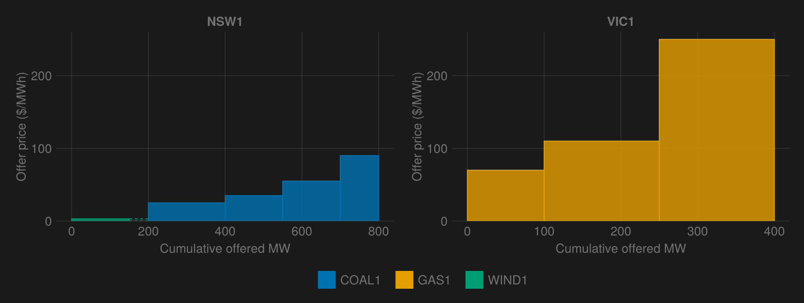
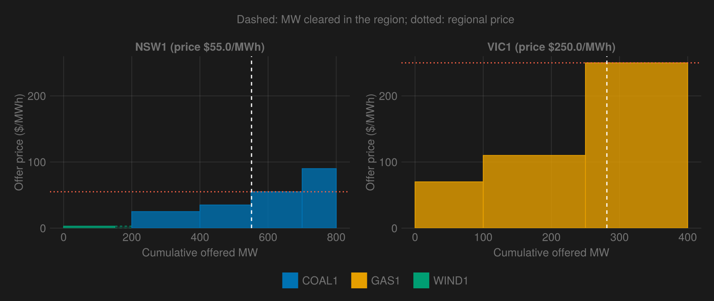
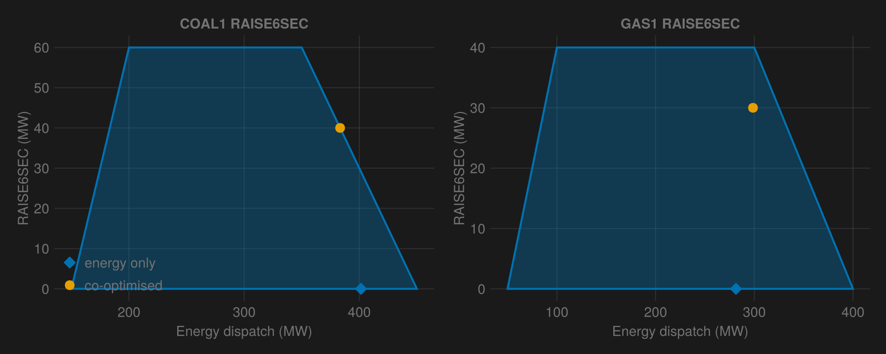
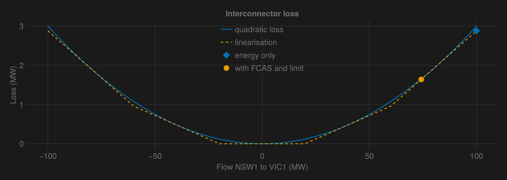

<!-- frozen source=0ff67cec439ed1e363a1490b389a02856738a845a409b22923545b6412e37a23 -->
```@meta
EditURL = "../../literate/tutorials/nemde_jump.jl"
```

````julia
begin
    using JuMP
    using HiGHS
    using DataFrames
    using CairoMakie
    using Markdown
    import PowerSystems as PSY
end;

````

# [NEMDE as a JuMP model](@id nemde-jump)

The [formulation overview](@ref nemde-model) introduces the full model. This page turns
a deliberately reduced subset into running code: a [JuMP](https://jump.dev) model of a small market, solved with
[HiGHS](https://highs.dev). The market data is a `PowerSystems.jl` `System`, and the model reads its
energy data through PSY's getters. The [next page](@ref nemde-psi) builds the energy part of this model
with `PowerSimulations.jl` from the same `System`.

!!! note "Example scope"
    This teaching model omits scheduled consumption, batteries, regulation FCAS scaling,
    fast-start profiles and price processing. Its piecewise loss curve is a toy approximation.
    See the [formulation overview](@ref nemde-model) for the wider market formulation.

## The toy market

Two regions joined by one interconnector with losses. `COAL1` (thermal) and `WIND1`
(semi-scheduled, with a forecast `UIGF`) sit in `NSW1`; `GAS1` (thermal) sits in `VIC1`. Both
thermal units also offer `RAISE6SEC` FCAS. Three generic constraints complete the market: a
stability limit on `COAL1` and one `RAISE6SEC` requirement per region. A single 5-minute
dispatch interval is cleared.

The market is built once, as the `System` returned by `toy_system`. Each generator carries its
offer as a cost curve and its dispatch envelope as its active power limits, and each region has
an `Area`, a bus and a load. Initial output, ramp rates, FCAS offers, generic constraints and loss
parameters are not stock PSY fields for this toy, so they stay plain Julia data keyed by unit name.

````julia
sys = toy_system(market)
unit_names = generator_names(sys)
regions = region_names(sys)
````

````
2-element Vector{String}:
 "NSW1"
 "VIC1"
````

The table shows each unit's availability, metered initial output and ramp capability, which
the envelope is built from, together with the envelope and the offers as the `System` holds them:

````julia
DataFrame(
    unit = unit_names,
    region = [generator_region(sys, n) for n in unit_names],
    availability_MW = [availability(find_unit(market, n)) for n in unit_names],
    initial_MW = [find_unit(market, n).initial_mw for n in unit_names],
    ramp_up_MW_per_interval = [ramp_up(find_unit(market, n)) for n in unit_names],
    envelope_min_MW = [envelope(sys, n)[1] for n in unit_names],
    envelope_max_MW = [envelope(sys, n)[2] for n in unit_names],
    bands = [join(["$(quantity(b)) MW @ \$$(price(b))" for b in offer_bids(sys, n)], ", ") for n in unit_names],
)
````

```@raw html
<div><div style = "float: left;"><span>3×8 DataFrame</span></div><div style = "clear: both;"></div></div><div class = "data-frame" style = "overflow-x: scroll;"><table class = "data-frame" style = "margin-bottom: 6px;"><thead><tr class = "columnLabelRow"><th class = "stubheadLabel" style = "font-weight: bold; text-align: right;">Row</th><th style = "text-align: left;">unit</th><th style = "text-align: left;">region</th><th style = "text-align: left;">availability_MW</th><th style = "text-align: left;">initial_MW</th><th style = "text-align: left;">ramp_up_MW_per_interval</th><th style = "text-align: left;">envelope_min_MW</th><th style = "text-align: left;">envelope_max_MW</th><th style = "text-align: left;">bands</th></tr><tr class = "columnLabelRow"><th class = "stubheadLabel" style = "font-weight: bold; text-align: right;"></th><th title = "String" style = "text-align: left;">String</th><th title = "String" style = "text-align: left;">String</th><th title = "Float64" style = "text-align: left;">Float64</th><th title = "Float64" style = "text-align: left;">Float64</th><th title = "Float64" style = "text-align: left;">Float64</th><th title = "Float64" style = "text-align: left;">Float64</th><th title = "Float64" style = "text-align: left;">Float64</th><th title = "String" style = "text-align: left;">String</th></tr></thead><tbody><tr class = "dataRow"><td class = "rowLabel" style = "font-weight: bold; text-align: right;">1</td><td style = "text-align: left;">COAL1</td><td style = "text-align: left;">NSW1</td><td style = "text-align: right;">600.0</td><td style = "text-align: right;">420.0</td><td style = "text-align: right;">50.0</td><td style = "text-align: right;">370.0</td><td style = "text-align: right;">470.0</td><td style = "text-align: left;">200.0 MW @ &#36;25.0, 150.0 MW @ &#36;35.0, 150.0 MW @ &#36;55.0, 100.0 MW @ &#36;90.0</td></tr><tr class = "dataRow"><td class = "rowLabel" style = "font-weight: bold; text-align: right;">2</td><td style = "text-align: left;">GAS1</td><td style = "text-align: left;">VIC1</td><td style = "text-align: right;">400.0</td><td style = "text-align: right;">180.0</td><td style = "text-align: right;">150.0</td><td style = "text-align: right;">30.0</td><td style = "text-align: right;">330.0</td><td style = "text-align: left;">100.0 MW @ &#36;70.0, 150.0 MW @ &#36;110.0, 150.0 MW @ &#36;250.0</td></tr><tr class = "dataRow"><td class = "rowLabel" style = "font-weight: bold; text-align: right;">3</td><td style = "text-align: left;">WIND1</td><td style = "text-align: left;">NSW1</td><td style = "text-align: right;">150.0</td><td style = "text-align: right;">140.0</td><td style = "text-align: right;">100.0</td><td style = "text-align: right;">0.0</td><td style = "text-align: right;">150.0</td><td style = "text-align: left;">200.0 MW @ &#36;0.0</td></tr></tbody></table></div>
```

`WIND1` offers 200 MW at \$0 but its forecast is 150 MW, so only 150 MW of its offer is usable:
the first place a forecast changes the bid stack. The merit order of each region, with the
unusable part of the wind offer drawn faded:

````julia
region_colors = Dict(n => c for (n, c) in zip(unit_names, Makie.wong_colors()))

function merit_order(sys, region_name)
    steps = [(name = n, b = b) for n in units_in(sys, region_name) for b in offer_bids(sys, n)]
    sort!(steps; by = s -> price(s.b))
    return steps
end

function plot_merit_order!(ax, sys, market, region_name, region_colors; cleared = nothing, clearing_price = nothing)
    left = 0.0
    used = Dict(n => availability(find_unit(market, n)) for n in units_in(sys, region_name))
    for s in merit_order(sys, region_name)
        usable = min(quantity(s.b), used[s.name])
        used[s.name] -= usable
        height = max(price(s.b), 3.0)
        color = region_colors[s.name]
        poly!(
            ax, Rect2f(left, 0.0, usable, height);
            color = (color, 0.8), strokecolor = color, strokewidth = 1,
        )
        if usable < quantity(s.b)
            poly!(
                ax, Rect2f(left + usable, 0.0, quantity(s.b) - usable, height);
                color = (color, 0.15), strokecolor = color, strokewidth = 1, linestyle = :dash,
            )
        end
        left += quantity(s.b)
    end
    isnothing(cleared) || vlines!(ax, cleared; color = :white, linestyle = :dash)
    isnothing(clearing_price) || hlines!(ax, clearing_price; color = :tomato, linestyle = :dot)
    return nothing
end

function merit_order_legend!(fig, position, names, region_colors)
    return Legend(
        fig[position...],
        [PolyElement(color = region_colors[n]) for n in names],
        names;
        orientation = :horizontal, tellheight = true,
    )
end

let
    fig = Figure(size = (900, 340))
    for (i, r) in enumerate(regions)
        ax = Axis(fig[1, i]; title = r, xlabel = "Cumulative offered MW", ylabel = "Offer price (\$/MWh)")
        plot_merit_order!(ax, sys, market, r, region_colors)
        ylims!(ax, 0, 260)
    end
    merit_order_legend!(fig, (2, 1:2), unit_names, region_colors)
    fig
end
````


## Energy: bands, envelopes and regional balance

The decision variables are the MW cleared in each band of each offer, bounded by the band
quantity. The bands are read from each generator's cost curve. A unit's dispatch is the sum of its
bands, and the objective is the offer cost over the interval of ``\Delta = 5/60`` hours.

````julia
model = Model(HiGHS.Optimizer)
set_silent(model)

bands = Dict(n => offer_bids(sys, n) for n in unit_names)
@variable(model, 0 <= cleared[n in unit_names, j in eachindex(bands[n])] <= quantity(bands[n][j]))
@expression(model, dispatch[n in unit_names], sum(cleared[n, j] for j in eachindex(bands[n])))
@expression(model, offer_cost, sum(price(bands[n][j]) * cleared[n, j] * INTERVAL_H for n in unit_names for j in eachindex(bands[n])))
@objective(model, Min, offer_cost)
````

````
2.083333333333333 cleared[COAL1,1] + 2.9166666666666665 cleared[COAL1,2] + 4.583333333333333 cleared[COAL1,3] + 7.5 cleared[COAL1,4] + 5.833333333333333 cleared[GAS1,1] + 9.166666666666666 cleared[GAS1,2] + 20.833333333333332 cleared[GAS1,3]
````

Each unit's dispatch is held inside its envelope. The upper limit is its availability (the `UIGF`
cap for `WIND1`) or what it can reach in one interval from `INITIALMW`, whichever is lower. The
lower limit is what it cannot drop below in one interval. PSY's renewable unit has no output floor,
so `WIND1` has a zero lower limit here; its ramp-down limit is not modelled, and it does not bind
because `WIND1` offers at \$0.

````julia
envelopes = Dict(n => envelope(sys, n) for n in unit_names)
@constraint(model, envelope_min[n in unit_names], dispatch[n] >= envelopes[n][1])
@constraint(model, envelope_max[n in unit_names], dispatch[n] <= envelopes[n][2])
````

````
1-dimensional DenseAxisArray{JuMP.ConstraintRef{JuMP.Model, MathOptInterface.ConstraintIndex{MathOptInterface.ScalarAffineFunction{Float64}, MathOptInterface.LessThan{Float64}}, JuMP.ScalarShape},1,...} with index sets:
    Dimension 1, ["COAL1", "GAS1", "WIND1"]
And data, a 3-element Vector{JuMP.ConstraintRef{JuMP.Model, MathOptInterface.ConstraintIndex{MathOptInterface.ScalarAffineFunction{Float64}, MathOptInterface.LessThan{Float64}}, JuMP.ScalarShape}}:
 envelope_max[COAL1] : cleared[COAL1,1] + cleared[COAL1,2] + cleared[COAL1,3] + cleared[COAL1,4] ≤ 470
 envelope_max[GAS1] : cleared[GAS1,1] + cleared[GAS1,2] + cleared[GAS1,3] ≤ 330
 envelope_max[WIND1] : cleared[WIND1,1] ≤ 150
````

### The interconnector and its losses

The flow is a signed variable. The loss curve is linearised on the breakpoints: the flow is the
first breakpoint plus the flow allocated to each segment, the loss is the loss at the first
breakpoint plus each segment's slope times its flow, and a binary per segment boundary forces the
segments to fill in order, so the solved loss follows the curve. The loss of the segment that
brackets zero flow is subtracted, so the linearised curve loses nothing at zero flow, as in the
package's loss model. The flow limit and the exporting region come from the `AreaInterchange`.

````julia
ic = market.interconnector
segments = linearised_losses(ic)
from = PSY.get_name(PSY.get_from_area(interconnector(sys)))
max_flow = flow_limit(sys)

@variable(model, flow)
@variable(model, 0 <= segment_flow[s in eachindex(segments)] <= segments[s].to_mw - segments[s].from_mw)
@variable(model, filled[s in 1:(length(segments) - 1)], Bin)
@expression(model, loss, loss_at(ic, ic.breakpoints[1]) - zero_flow_chord_loss(ic) + sum(segments[s].slope * segment_flow[s] for s in eachindex(segments)))

@constraint(model, flow_definition, flow == ic.breakpoints[1] + sum(segment_flow))
@constraint(model, segment_full[s in 1:(length(segments) - 1)], segment_flow[s] >= (segments[s].to_mw - segments[s].from_mw) * filled[s])
@constraint(model, segment_next[s in 1:(length(segments) - 1)], segment_flow[s + 1] <= (segments[s + 1].to_mw - segments[s + 1].from_mw) * filled[s])
@constraint(model, flow_limit_up, flow <= max_flow)
@constraint(model, flow_limit_down, flow >= -max_flow)
````

````
flow_limit_down : flow ≥ -100
````

### Regional balance and prices

Each region supplies its demand plus the flow it exports plus its share of the losses. The
regional price is the dual of this row: the cost of one more MW of demand there.

````julia
generation(r) = sum(dispatch[n] for n in units_in(sys, r))
exported(r) = r == from ? flow : -flow
loss_charged(r) = (r == from ? ic.from_loss_share : 1 - ic.from_loss_share) * loss

@constraint(model, balance[r in regions], generation(r) - exported(r) - loss_charged(r) == region_demand(sys, r))
````

````
1-dimensional DenseAxisArray{JuMP.ConstraintRef{JuMP.Model, MathOptInterface.ConstraintIndex{MathOptInterface.ScalarAffineFunction{Float64}, MathOptInterface.EqualTo{Float64}}, JuMP.ScalarShape},1,...} with index sets:
    Dimension 1, ["NSW1", "VIC1"]
And data, a 2-element Vector{JuMP.ConstraintRef{JuMP.Model, MathOptInterface.ConstraintIndex{MathOptInterface.ScalarAffineFunction{Float64}, MathOptInterface.EqualTo{Float64}}, JuMP.ScalarShape}}:
 balance[NSW1] : cleared[COAL1,1] + cleared[COAL1,2] + cleared[COAL1,3] + cleared[COAL1,4] + cleared[WIND1,1] - flow + 0.023999999999999997 segment_flow[1] + 0.011999999999999999 segment_flow[2] - 0.011999999999999999 segment_flow[4] - 0.023999999999999997 segment_flow[5] = 451.44
 balance[VIC1] : cleared[GAS1,1] + cleared[GAS1,2] + cleared[GAS1,3] + flow + 0.023999999999999997 segment_flow[1] + 0.011999999999999999 segment_flow[2] - 0.011999999999999999 segment_flow[4] - 0.023999999999999997 segment_flow[5] = 381.44
````

### Solving

The segment binaries make this a small MILP. NEMDE prices come from the LP, so after the first
solve the binaries are fixed at their solution and the LP is solved again to read the duals.
Duals are per MW per interval; dividing by ``\Delta`` gives \$/MWh.

````julia
function solve!(model)
    optimize!(model)
    @assert termination_status(model) == OPTIMAL
    undo = fix_discrete_variables(model)
    optimize!(model)
    @assert termination_status(model) == OPTIMAL
    result = (;
        dispatch = Dict(Symbol(n) => value(model[:dispatch][n]) for n in unit_names),
        flow = value(model[:flow]),
        loss = value(model[:loss]),
        price = Dict(r => dual(model[:balance][r]) / INTERVAL_H for r in regions),
        objective = objective_value(model),
        raise = haskey(model, :raise) ? Dict(Symbol(n) => value(model[:raise][n]) for n in fcas_names(market)) : nothing,
        generic = haskey(model, :generic) ? Dict(n => dual(c) / INTERVAL_H for (n, c) in model[:generic]) : nothing,
        violation = haskey(model, :violation) ? Dict(n => value(v) for (n, v) in model[:violation]) : nothing,
    )
    undo()
    return result
end

energy_only = solve!(model)
````

````
(dispatch = Dict(:GAS1 => 281.44, :WIND1 => 150.0, :COAL1 => 401.44), flow = 100.0, loss = 2.8799999999999994, price = Dict("NSW1" => 55.0, "VIC1" => 250.0), objective = 3703.2666666666664, raise = nothing, generic = nothing, violation = nothing)
````

The cheap `NSW1` coal and wind export up to the interconnector limit and the two prices
separate: the congestion rent. The loss is charged half to each region.

````julia
DataFrame(
    quantity = [
        "COAL1 (MW)", "WIND1 (MW)", "GAS1 (MW)", "Flow NSW1 to VIC1 (MW)", "Loss (MW)",
        "NSW1 price (\$/MWh)", "VIC1 price (\$/MWh)", "Cost (\$)",
    ],
    value = [
        energy_only.dispatch[:COAL1], energy_only.dispatch[:WIND1], energy_only.dispatch[:GAS1],
        energy_only.flow, energy_only.loss, energy_only.price["NSW1"], energy_only.price["VIC1"],
        energy_only.objective,
    ],
)
````

```@raw html
<div><div style = "float: left;"><span>8×2 DataFrame</span></div><div style = "clear: both;"></div></div><div class = "data-frame" style = "overflow-x: scroll;"><table class = "data-frame" style = "margin-bottom: 6px;"><thead><tr class = "columnLabelRow"><th class = "stubheadLabel" style = "font-weight: bold; text-align: right;">Row</th><th style = "text-align: left;">quantity</th><th style = "text-align: left;">value</th></tr><tr class = "columnLabelRow"><th class = "stubheadLabel" style = "font-weight: bold; text-align: right;"></th><th title = "String" style = "text-align: left;">String</th><th title = "Float64" style = "text-align: left;">Float64</th></tr></thead><tbody><tr class = "dataRow"><td class = "rowLabel" style = "font-weight: bold; text-align: right;">1</td><td style = "text-align: left;">COAL1 (MW)</td><td style = "text-align: right;">401.44</td></tr><tr class = "dataRow"><td class = "rowLabel" style = "font-weight: bold; text-align: right;">2</td><td style = "text-align: left;">WIND1 (MW)</td><td style = "text-align: right;">150.0</td></tr><tr class = "dataRow"><td class = "rowLabel" style = "font-weight: bold; text-align: right;">3</td><td style = "text-align: left;">GAS1 (MW)</td><td style = "text-align: right;">281.44</td></tr><tr class = "dataRow"><td class = "rowLabel" style = "font-weight: bold; text-align: right;">4</td><td style = "text-align: left;">Flow NSW1 to VIC1 (MW)</td><td style = "text-align: right;">100.0</td></tr><tr class = "dataRow"><td class = "rowLabel" style = "font-weight: bold; text-align: right;">5</td><td style = "text-align: left;">Loss (MW)</td><td style = "text-align: right;">2.88</td></tr><tr class = "dataRow"><td class = "rowLabel" style = "font-weight: bold; text-align: right;">6</td><td style = "text-align: left;">NSW1 price (&#36;/MWh)</td><td style = "text-align: right;">55.0</td></tr><tr class = "dataRow"><td class = "rowLabel" style = "font-weight: bold; text-align: right;">7</td><td style = "text-align: left;">VIC1 price (&#36;/MWh)</td><td style = "text-align: right;">250.0</td></tr><tr class = "dataRow"><td class = "rowLabel" style = "font-weight: bold; text-align: right;">8</td><td style = "text-align: left;">Cost (&#36;)</td><td style = "text-align: right;">3703.27</td></tr></tbody></table></div>
```

Each region's cleared quantity (demand plus exports plus its loss share) against its merit
order and price:

````julia
function plot_clearing(result)
    fig = Figure(size = (900, 380))
    for (i, r) in enumerate(regions)
        ax = Axis(
            fig[1, i]; title = "$r (price \$$(round(result.price[r]; digits = 1))/MWh)",
            xlabel = "Cumulative offered MW", ylabel = "Offer price (\$/MWh)",
        )
        cleared_mw = sum(result.dispatch[Symbol(n)] for n in units_in(sys, r))
        plot_merit_order!(ax, sys, market, r, region_colors; cleared = cleared_mw, clearing_price = result.price[r])
        ylims!(ax, 0, 260)
    end
    merit_order_legend!(fig, (2, 1:2), unit_names, region_colors)
    Label(fig[0, :], "Dashed: MW cleared in the region; dotted: regional price"; tellwidth = false)
    return fig
end
plot_clearing(energy_only)
````


## FCAS: the trapezium

Each unit offering `RAISE6SEC` gets a capacity variable, the sum of its FCAS bands, and two
*joint* rows that keep that capacity inside the unit's trapezium at its energy dispatch, so
energy and FCAS compete for the same MW. The FCAS offer cost joins the objective. The FCAS
offers are plain data keyed by unit name.

````julia
fnames = fcas_names(market)

DataFrame(
    unit = fnames,
    enablement_min = [trapezium(market, n).enablement_min for n in fnames],
    low_breakpoint = [trapezium(market, n).low_breakpoint for n in fnames],
    high_breakpoint = [trapezium(market, n).high_breakpoint for n in fnames],
    enablement_max = [trapezium(market, n).enablement_max for n in fnames],
    max_avail = [max_avail(trapezium(market, n)) for n in fnames],
    upper_slope = [upper_slope(trapezium(market, n)) for n in fnames],
    lower_slope = [lower_slope(trapezium(market, n)) for n in fnames],
)

@variable(model, 0 <= raise[n in fnames] <= max_avail(trapezium(market, n)))
@variable(model, 0 <= raise_cleared[n in fnames, j in eachindex(fcas_bids(market, n))] <= quantity(fcas_bids(market, n)[j]))
@constraint(model, raise_definition[n in fnames], raise[n] == sum(raise_cleared[n, j] for j in eachindex(fcas_bids(market, n))))
@constraint(model, trapezium_upper[n in fnames], dispatch[n] + upper_slope(trapezium(market, n)) * raise[n] <= trapezium(market, n).enablement_max)
@constraint(model, trapezium_lower[n in fnames], dispatch[n] - lower_slope(trapezium(market, n)) * raise[n] >= trapezium(market, n).enablement_min)
@expression(model, fcas_cost, sum(price(b) * raise_cleared[n, j] * INTERVAL_H for n in fnames for (j, b) in enumerate(fcas_bids(market, n))))
set_objective_function(model, objective_function(model) + fcas_cost)
````

## Generic constraints

Both the `RAISE6SEC` requirements and the network limit are *generic constraints*: a linear
combination of unit energy, unit FCAS and interconnector flow, a sense and a right-hand side.
Each toy constraint carries a violation variable, paid at its penalty factor times the
Market Price Cap. This follows the violation-priority principle in AEMO's *Schedule of
Constraint Violation Penalty Factors* (§1, pp. 3-4). For each independent, unit-coefficient
FCAS requirement here, the dual divided by the interval duration gives its FCAS price.

````julia
model[:generic] = Dict{String, ConstraintRef}()
model[:violation] = Dict{String, VariableRef}()

function term_variable(model, t::Term)
    t.kind == :energy && return model[:dispatch][String(t.id)]
    t.kind == :raise6 && return model[:raise][String(t.id)]
    return model[:flow]
end

function add_generic_constraint!(model, gc::LinearConstraint)
    lhs = sum(t.factor * term_variable(model, t) for t in gc.terms)
    violation = @variable(model, lower_bound = 0, base_name = "violation_$(gc.name)")
    model[:generic][gc.name] = if gc.sense == :LE
        @constraint(model, lhs - violation <= gc.rhs)
    else
        @constraint(model, lhs + violation >= gc.rhs)
    end
    model[:violation][gc.name] = violation
    set_objective_function(model, objective_function(model) + gc.weight * MARKET_PRICE_CAP * INTERVAL_H * violation)
    return nothing
end
````

````
add_generic_constraint! (generic function with 1 method)
````

First the FCAS requirements:

````julia
foreach(gc -> add_generic_constraint!(model, gc), filter(gc -> startswith(gc.name, "F_"), market.constraints))
co_optimised = solve!(model)
````

````
(dispatch = Dict(:GAS1 => 298.6979166666667, :WIND1 => 150.0, :COAL1 => 383.3333333333333), flow = 82.3177083333333, loss = 2.0312499999999982, price = Dict("NSW1" => 238.28125, "VIC1" => 250.0), objective = 4026.484375, raise = Dict(:GAS1 => 30.0, :COAL1 => 40.0), generic = Dict("F_VIC_R6" => 12.0, "F_NSW_R6" => 313.46875000000006), violation = Dict("F_VIC_R6" => 0.0, "F_NSW_R6" => 0.0))
````

Co-optimisation changes the *energy* outcome. `NSW1` has to hold 40 MW of `RAISE6SEC` on the
coal unit; at 400 MW of energy the trapezium only lets it offer 30 MW, so energy is pushed
down until the joint row is satisfied. That removes cheap export, the interconnector comes off
its limit and the gap between the two regional prices shrinks to the cost of marginal losses. The FCAS price is not the \$8/MW/h of the
marginal FCAS offer: it also contains the energy the coal unit gives up.

The coal unit's trapezium in the energy and FCAS plane: every `(energy, FCAS)` pair the unit may
be dispatched at is in the shaded area; the markers are where the solves put it.

````julia
function plot_trapezium!(ax, t::Trapezium, points)
    poly!(
        ax, Point2f[
            (t.enablement_min, 0), (t.low_breakpoint, t.max_avail),
            (t.high_breakpoint, t.max_avail), (t.enablement_max, 0),
        ];
        color = (Makie.wong_colors()[1], 0.35), strokecolor = Makie.wong_colors()[1], strokewidth = 2,
    )
    for (label, energy, fcas, marker) in points
        scatter!(ax, energy, fcas; markersize = 14, marker, label)
    end
    return nothing
end

let
    fig = Figure(size = (900, 360))
    for (i, n) in enumerate(fnames)
        ax = Axis(fig[1, i]; title = "$n RAISE6SEC", xlabel = "Energy dispatch (MW)", ylabel = "RAISE6SEC (MW)")
        plot_trapezium!(
            ax, trapezium(market, n), [
                ("energy only", energy_only.dispatch[Symbol(n)], 0.0, :diamond),
                ("co-optimised", co_optimised.dispatch[Symbol(n)], co_optimised.raise[Symbol(n)], :circle),
            ],
        )
        i == 1 && axislegend(ax; position = :lb)
    end
    fig
end
````


Finally the network limit on the coal unit, just below where co-optimisation left it (383 MW).
The limit binds: gas replaces the coal it caps, and the limit's dual is the cost of that
replacement per MW.

````julia
foreach(gc -> add_generic_constraint!(model, gc), filter(gc -> !startswith(gc.name, "F_"), market.constraints))
constrained = solve!(model)
````

````
(dispatch = Dict(:GAS1 => 306.640625, :WIND1 => 150.0, :COAL1 => 375.0), flow = 74.17968749999997, loss = 1.6406249999999982, price = Dict("NSW1" => 238.28125, "VIC1" => 250.0), objective = 4153.763020833333, raise = Dict(:GAS1 => 30.0, :COAL1 => 40.0), generic = Dict("F_VIC_R6" => 12.0, "N_COAL_LIMIT" => -183.28125, "F_NSW_R6" => 8.0), violation = Dict("F_VIC_R6" => 0.0, "N_COAL_LIMIT" => 0.0, "F_NSW_R6" => 0.0))
````

## Results

One table for the three stages. The dual of `N_COAL_LIMIT` is negative: one more MW of headroom
would lower the cost by that amount.

````julia
results_table = DataFrame(
    quantity = [
        "COAL1 (MW)", "WIND1 (MW)", "GAS1 (MW)", "Flow NSW1 to VIC1 (MW)", "Loss (MW)",
        "NSW1 price (\$/MWh)", "VIC1 price (\$/MWh)",
        "NSW1 RAISE6SEC price (\$/MW/h)", "VIC1 RAISE6SEC price (\$/MW/h)",
        "N_COAL_LIMIT dual (\$/MWh)", "Objective (\$)",
    ],
    energy_only = [
        energy_only.dispatch[:COAL1], energy_only.dispatch[:WIND1], energy_only.dispatch[:GAS1],
        energy_only.flow, energy_only.loss, energy_only.price["NSW1"], energy_only.price["VIC1"],
        NaN, NaN, NaN, energy_only.objective,
    ],
    with_fcas = [
        co_optimised.dispatch[:COAL1], co_optimised.dispatch[:WIND1], co_optimised.dispatch[:GAS1],
        co_optimised.flow, co_optimised.loss, co_optimised.price["NSW1"], co_optimised.price["VIC1"],
        co_optimised.generic["F_NSW_R6"], co_optimised.generic["F_VIC_R6"], NaN, co_optimised.objective,
    ],
    with_fcas_and_limit = [
        constrained.dispatch[:COAL1], constrained.dispatch[:WIND1], constrained.dispatch[:GAS1],
        constrained.flow, constrained.loss, constrained.price["NSW1"], constrained.price["VIC1"],
        constrained.generic["F_NSW_R6"], constrained.generic["F_VIC_R6"],
        constrained.generic["N_COAL_LIMIT"], constrained.objective,
    ],
)
````

```@raw html
<div><div style = "float: left;"><span>11×4 DataFrame</span></div><div style = "clear: both;"></div></div><div class = "data-frame" style = "overflow-x: scroll;"><table class = "data-frame" style = "margin-bottom: 6px;"><thead><tr class = "columnLabelRow"><th class = "stubheadLabel" style = "font-weight: bold; text-align: right;">Row</th><th style = "text-align: left;">quantity</th><th style = "text-align: left;">energy_only</th><th style = "text-align: left;">with_fcas</th><th style = "text-align: left;">with_fcas_and_limit</th></tr><tr class = "columnLabelRow"><th class = "stubheadLabel" style = "font-weight: bold; text-align: right;"></th><th title = "String" style = "text-align: left;">String</th><th title = "Float64" style = "text-align: left;">Float64</th><th title = "Float64" style = "text-align: left;">Float64</th><th title = "Float64" style = "text-align: left;">Float64</th></tr></thead><tbody><tr class = "dataRow"><td class = "rowLabel" style = "font-weight: bold; text-align: right;">1</td><td style = "text-align: left;">COAL1 (MW)</td><td style = "text-align: right;">401.44</td><td style = "text-align: right;">383.333</td><td style = "text-align: right;">375.0</td></tr><tr class = "dataRow"><td class = "rowLabel" style = "font-weight: bold; text-align: right;">2</td><td style = "text-align: left;">WIND1 (MW)</td><td style = "text-align: right;">150.0</td><td style = "text-align: right;">150.0</td><td style = "text-align: right;">150.0</td></tr><tr class = "dataRow"><td class = "rowLabel" style = "font-weight: bold; text-align: right;">3</td><td style = "text-align: left;">GAS1 (MW)</td><td style = "text-align: right;">281.44</td><td style = "text-align: right;">298.698</td><td style = "text-align: right;">306.641</td></tr><tr class = "dataRow"><td class = "rowLabel" style = "font-weight: bold; text-align: right;">4</td><td style = "text-align: left;">Flow NSW1 to VIC1 (MW)</td><td style = "text-align: right;">100.0</td><td style = "text-align: right;">82.3177</td><td style = "text-align: right;">74.1797</td></tr><tr class = "dataRow"><td class = "rowLabel" style = "font-weight: bold; text-align: right;">5</td><td style = "text-align: left;">Loss (MW)</td><td style = "text-align: right;">2.88</td><td style = "text-align: right;">2.03125</td><td style = "text-align: right;">1.64062</td></tr><tr class = "dataRow"><td class = "rowLabel" style = "font-weight: bold; text-align: right;">6</td><td style = "text-align: left;">NSW1 price (&#36;/MWh)</td><td style = "text-align: right;">55.0</td><td style = "text-align: right;">238.281</td><td style = "text-align: right;">238.281</td></tr><tr class = "dataRow"><td class = "rowLabel" style = "font-weight: bold; text-align: right;">7</td><td style = "text-align: left;">VIC1 price (&#36;/MWh)</td><td style = "text-align: right;">250.0</td><td style = "text-align: right;">250.0</td><td style = "text-align: right;">250.0</td></tr><tr class = "dataRow"><td class = "rowLabel" style = "font-weight: bold; text-align: right;">8</td><td style = "text-align: left;">NSW1 RAISE6SEC price (&#36;/MW/h)</td><td style = "text-align: right;">NaN</td><td style = "text-align: right;">313.469</td><td style = "text-align: right;">8.0</td></tr><tr class = "dataRow"><td class = "rowLabel" style = "font-weight: bold; text-align: right;">9</td><td style = "text-align: left;">VIC1 RAISE6SEC price (&#36;/MW/h)</td><td style = "text-align: right;">NaN</td><td style = "text-align: right;">12.0</td><td style = "text-align: right;">12.0</td></tr><tr class = "dataRow"><td class = "rowLabel" style = "font-weight: bold; text-align: right;">10</td><td style = "text-align: left;">N_COAL_LIMIT dual (&#36;/MWh)</td><td style = "text-align: right;">NaN</td><td style = "text-align: right;">NaN</td><td style = "text-align: right;">-183.281</td></tr><tr class = "dataRow"><td class = "rowLabel" style = "font-weight: bold; text-align: right;">11</td><td style = "text-align: left;">Objective (&#36;)</td><td style = "text-align: right;">3703.27</td><td style = "text-align: right;">4026.48</td><td style = "text-align: right;">4153.76</td></tr></tbody></table></div>
```

No constraint was violated: every violation variable is zero, so the penalties only shape the
problem when something is infeasible.

````julia
maximum(abs, values(constrained.violation))
````

````
0.0
````

The loss curve with its linearisation and the solved flows:

````julia
let
    fig = Figure(size = (900, 320))
    ax = Axis(fig[1, 1]; xlabel = "Flow NSW1 to VIC1 (MW)", ylabel = "Loss (MW)", title = "Interconnector loss")
    flows = range(-max_flow, max_flow; length = 101)
    lines!(ax, flows, loss_at.(Ref(ic), flows); label = "quadratic loss")
    bp = ic.breakpoints
    lines!(ax, bp, loss_at.(Ref(ic), bp) .- zero_flow_chord_loss(ic); linestyle = :dash, label = "linearisation")
    for (label, r, marker) in (("energy only", energy_only, :diamond), ("with FCAS and limit", constrained, :circle))
        scatter!(ax, r.flow, r.loss; markersize = 14, marker, label)
    end
    axislegend(ax; position = :ct)
    fig
end
````


This completes the dispatch model for the toy market: an offer-cost objective, unit envelopes,
regional balance with a lossy interconnector, the FCAS trapezium and generic constraints with
violation penalties. The [next page](@ref nemde-psi) solves the energy-only, lossless
version using PowerSimulations.jl.

Compare the dispatch and prices with the reference toy solution:

````julia
reference = solve_toy_jump(sys, market)
@assert maximum(abs, [constrained.dispatch[u] - reference.dispatch[u] for u in keys(reference.dispatch)]) < 1.0e-6
@assert abs(constrained.objective - reference.objective) < 1.0e-6
````
