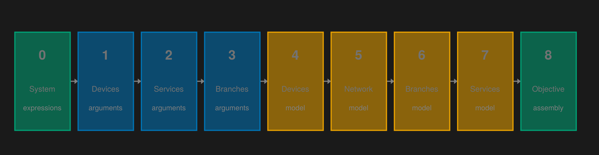

<!-- frozen source=aac5174953776af4489ce6f895f2a6a8fc22096700c71fdfc9bb211c78834077 -->
```@meta
EditURL = "../../literate/tutorials/nemde_psi.jl"
```

````julia
begin
    using PowerSystems
    using PowerSimulations
    using JuMP
    using HiGHS
    using DataFrames
    using Dates
    using CairoMakie
    using InteractiveUtils

    import PowerSystems as PSY
    import PowerSimulations as PSI
end;

````

# [From JuMP to PowerSimulations.jl](@id nemde-psi)

In the [previous section](@ref nemde-jump), we wrote the dispatch of a toy market as one JuMP model.
[PowerSimulations.jl](https://nrel-sienna.github.io/PowerSimulations.jl/stable/) (PSI) is the
framework this repository builds its NEMDE replica on. This page introduces its concepts by
rebuilding the energy-only part of the toy market.

PSI splits a model into three layers of abstraction:

| Layer | Answers | Package and object | On this page |
| --- | --- | --- | --- |
| **Data** | What is the market? | `PowerSystems.jl` (PSY): a `System` of components and time series | regions, units, offers, demand, the interconnector |
| **Formulation** | How is one kind of component modelled? | PSI: a formulation type, with methods that write its variables, constraints and costs | "a scheduled unit is dispatched between bounds at its offer cost" |
| **Problem** | Which formulation applies to which component, over which horizon? | PSI: a `ProblemTemplate` and a `DecisionModel` | one 5-minute dispatch interval |

When using PSI, no line of the JuMP model is written by hand: PSI leverages Julia's **multiple dispatch** on the pair *(component type,
formulation type)* to build the JuMP model.


## Data: the market as a `System`

A `System` is a typed collection of components. Each NEM object of [the JuMP model](@ref nemde-jump)
maps onto a PSY component type:

| Toy market | PSY component | Fields used |
| --- | --- | --- |
| region | `Area` | name |
| regional reference node | `ACBus` in that `Area` | |
| scheduled unit (`COAL1`, `GAS1`) | `ThermalStandard` | `active_power_limits`, `operation_cost` |
| semi-scheduled unit (`WIND1`) | `RenewableDispatch` | `rating`, `operation_cost` |
| regional demand | `PowerLoad` | `max_active_power` and a time series |
| interconnector | `AreaInterchange` between two `Area`s | `flow_limits` |

Values are stored per unit of the system base, `BASE_POWER` MVA. The shared toy market builds
this `System` from the plain market data with `toy_system`:

````julia
sys = toy_system(energy_market(market))
````

```@raw html
<table>
  <thead>
    <tr class = "title">
      <td colspan = "2" style = "font-size: x-large; font-weight: bold; text-align: center;">System</td>
    </tr>
    <tr class = "columnLabelRow">
      <th style = "font-weight: bold; text-align: left;">Property</th>
      <th style = "font-weight: bold; text-align: left;">Value</th>
    </tr>
  </thead>
  <tbody>
    <tr class = "dataRow">
      <td style = "text-align: left;">Name</td>
      <td style = "text-align: left;"></td>
    </tr>
    <tr class = "dataRow">
      <td style = "text-align: left;">Description</td>
      <td style = "text-align: left;"></td>
    </tr>
    <tr class = "dataRow">
      <td style = "text-align: left;">System Units Base</td>
      <td style = "text-align: left;">SYSTEM_BASE</td>
    </tr>
    <tr class = "dataRow">
      <td style = "text-align: left;">Base Power</td>
      <td style = "text-align: left;">100.0</td>
    </tr>
    <tr class = "dataRow">
      <td style = "text-align: left;">Base Frequency</td>
      <td style = "text-align: left;">60.0</td>
    </tr>
    <tr class = "dataRow">
      <td style = "text-align: left;">Num Components</td>
      <td style = "text-align: left;">10</td>
    </tr>
  </tbody>
</table>

<table>
  <thead>
    <tr class = "title">
      <td colspan = "2" style = "font-size: x-large; font-weight: bold; text-align: center;">Static Components</td>
    </tr>
    <tr class = "columnLabelRow">
      <th style = "font-weight: bold; text-align: left;">Type</th>
      <th style = "font-weight: bold; text-align: left;">Count</th>
    </tr>
  </thead>
  <tbody>
    <tr class = "dataRow">
      <td style = "text-align: left;">ACBus</td>
      <td style = "text-align: left;">2</td>
    </tr>
    <tr class = "dataRow">
      <td style = "text-align: left;">Area</td>
      <td style = "text-align: left;">2</td>
    </tr>
    <tr class = "dataRow">
      <td style = "text-align: left;">AreaInterchange</td>
      <td style = "text-align: left;">1</td>
    </tr>
    <tr class = "dataRow">
      <td style = "text-align: left;">PowerLoad</td>
      <td style = "text-align: left;">2</td>
    </tr>
    <tr class = "dataRow">
      <td style = "text-align: left;">RenewableDispatch</td>
      <td style = "text-align: left;">1</td>
    </tr>
    <tr class = "dataRow">
      <td style = "text-align: left;">ThermalStandard</td>
      <td style = "text-align: left;">2</td>
    </tr>
  </tbody>
</table>

<table>
  <thead>
    <tr class = "title">
      <td colspan = "8" style = "font-size: x-large; font-weight: bold; text-align: center;">StaticTimeSeries Summary</td>
    </tr>
    <tr class = "columnLabelRow">
      <th style = "font-weight: bold; text-align: left;">owner_type</th>
      <th style = "font-weight: bold; text-align: left;">owner_category</th>
      <th style = "font-weight: bold; text-align: left;">name</th>
      <th style = "font-weight: bold; text-align: left;">time_series_type</th>
      <th style = "font-weight: bold; text-align: left;">initial_timestamp</th>
      <th style = "font-weight: bold; text-align: left;">resolution</th>
      <th style = "font-weight: bold; text-align: left;">count</th>
      <th style = "font-weight: bold; text-align: left;">time_step_count</th>
    </tr>
    <tr class = "columnLabelRow">
      <th style = "text-align: left;">String</th>
      <th style = "text-align: left;">String</th>
      <th style = "text-align: left;">String</th>
      <th style = "text-align: left;">String</th>
      <th style = "text-align: left;">String</th>
      <th style = "text-align: left;">Dates.CompoundPeriod</th>
      <th style = "text-align: left;">Int64</th>
      <th style = "text-align: left;">Int64</th>
    </tr>
  </thead>
  <tbody>
    <tr class = "dataRow">
      <td style = "text-align: left;">PowerLoad</td>
      <td style = "text-align: left;">Component</td>
      <td style = "text-align: left;">max_active_power</td>
      <td style = "text-align: left;">SingleTimeSeries</td>
      <td style = "text-align: left;">2025-01-01T12:00:00</td>
      <td style = "text-align: left;">5 minutes</td>
      <td style = "text-align: left;">2</td>
      <td style = "text-align: left;">2</td>
    </tr>
  </tbody>
</table>
<table>
  <thead>
    <tr class = "title">
      <td colspan = "10" style = "font-size: x-large; font-weight: bold; text-align: center;">Forecast Summary</td>
    </tr>
    <tr class = "columnLabelRow">
      <th style = "font-weight: bold; text-align: left;">owner_type</th>
      <th style = "font-weight: bold; text-align: left;">owner_category</th>
      <th style = "font-weight: bold; text-align: left;">name</th>
      <th style = "font-weight: bold; text-align: left;">time_series_type</th>
      <th style = "font-weight: bold; text-align: left;">initial_timestamp</th>
      <th style = "font-weight: bold; text-align: left;">resolution</th>
      <th style = "font-weight: bold; text-align: left;">count</th>
      <th style = "font-weight: bold; text-align: left;">horizon</th>
      <th style = "font-weight: bold; text-align: left;">interval</th>
      <th style = "font-weight: bold; text-align: left;">window_count</th>
    </tr>
    <tr class = "columnLabelRow">
      <th style = "text-align: left;">String</th>
      <th style = "text-align: left;">String</th>
      <th style = "text-align: left;">String</th>
      <th style = "text-align: left;">String</th>
      <th style = "text-align: left;">String</th>
      <th style = "text-align: left;">Dates.CompoundPeriod</th>
      <th style = "text-align: left;">Int64</th>
      <th style = "text-align: left;">Dates.CompoundPeriod</th>
      <th style = "text-align: left;">Dates.CompoundPeriod</th>
      <th style = "text-align: left;">Int64</th>
    </tr>
  </thead>
  <tbody>
    <tr class = "dataRow">
      <td style = "text-align: left;">PowerLoad</td>
      <td style = "text-align: left;">Component</td>
      <td style = "text-align: left;">max_active_power</td>
      <td style = "text-align: left;">DeterministicSingleTimeSeries</td>
      <td style = "text-align: left;">2025-01-01T12:00:00</td>
      <td style = "text-align: left;">5 minutes</td>
      <td style = "text-align: left;">2</td>
      <td style = "text-align: left;">10 minutes</td>
      <td style = "text-align: left;">5 minutes</td>
      <td style = "text-align: left;">1</td>
    </tr>
  </tbody>
</table>

```

### Units and their offers

A unit's energy offer is its `variable` cost: a `PiecewiseIncrementalCurve` whose x-coordinates
are the cumulative band quantities and whose slopes are the band prices, the bid stack of
[the JuMP model](@ref nemde-jump). The offer of `COAL1`, read back from the `System`:

````julia
coal_offer = PSY.get_function_data(
    PSY.get_variable(PSY.get_operation_cost(PSY.get_component(PSY.ThermalStandard, sys, "COAL1"))),
)
DataFrame(cumulative_MW = PSY.get_x_coords(coal_offer)[2:end], price = PSY.get_y_coords(coal_offer))
````

```@raw html
<div><div style = "float: left;"><span>4×2 DataFrame</span></div><div style = "clear: both;"></div></div><div class = "data-frame" style = "overflow-x: scroll;"><table class = "data-frame" style = "margin-bottom: 6px;"><thead><tr class = "columnLabelRow"><th class = "stubheadLabel" style = "font-weight: bold; text-align: right;">Row</th><th style = "text-align: left;">cumulative_MW</th><th style = "text-align: left;">price</th></tr><tr class = "columnLabelRow"><th class = "stubheadLabel" style = "font-weight: bold; text-align: right;"></th><th title = "Float64" style = "text-align: left;">Float64</th><th title = "Float64" style = "text-align: left;">Float64</th></tr></thead><tbody><tr class = "dataRow"><td class = "rowLabel" style = "font-weight: bold; text-align: right;">1</td><td style = "text-align: right;">200.0</td><td style = "text-align: right;">25.0</td></tr><tr class = "dataRow"><td class = "rowLabel" style = "font-weight: bold; text-align: right;">2</td><td style = "text-align: right;">350.0</td><td style = "text-align: right;">35.0</td></tr><tr class = "dataRow"><td class = "rowLabel" style = "font-weight: bold; text-align: right;">3</td><td style = "text-align: right;">500.0</td><td style = "text-align: right;">55.0</td></tr><tr class = "dataRow"><td class = "rowLabel" style = "font-weight: bold; text-align: right;">4</td><td style = "text-align: right;">600.0</td><td style = "text-align: right;">90.0</td></tr></tbody></table></div>
```

The dispatch envelope of [the JuMP model](@ref nemde-jump) (availability, and the ramp from
`INITIALMW` over one interval) has no direct field here: PSI's stock formulations ramp between
consecutive time steps of the problem, not from a metered initial output. For a single interval
the envelope is a pair of bounds, so it is stored in `active_power_limits` (and `rating` for the
renewable unit).

### Demand as a time series

A component field is a constant. Anything that changes from one interval to the next (demand,
a forecast, a bid) is a **time series** attached to a component. PSI reads it into the model as
a *parameter*, so the same built model can be re-solved for the next interval by updating
parameter values instead of rebuilding. Here the series is a multiplier on `max_active_power`.

PSI solves over forecast windows, so the single series is turned into windows of two intervals
that advance by one: the shortest window PSI accepts. `toy_system` applies this transform to
each load.

Nothing in the `System` says how a unit is dispatched or what a region's balance looks like.
That is the job of the next two layers.

## Mapping the abstractions

Before going into PSI.jl, let's first build the intuition behind the abstractions it develops.
Let's look again at the complete JuMP model from the previous section, reordering some of the
function calls. It still includes the FCAS service, the interconnector losses and the generic
constraints, which the PSI model of this page leaves out; the grouping is what matters here.

````julia
function build_model(sys, market)
    model = Model(HiGHS.Optimizer)
    set_silent(model)
    ic = market.interconnector
    segments = linearised_losses(ic)
    n_segments = length(segments)
    names = generator_names(sys)
    bands = Dict(n => offer_bids(sys, n) for n in names)
    envelopes = Dict(n => envelope(sys, n) for n in names)
    fnames = fcas_names(market)
    regions = region_names(sys)
    from = PSY.get_name(PSY.get_from_area(interconnector(sys)))

    # Define Arguments: variables and expressions specific to:
    # 1.1. Devices:
    # 1.1.1. Units
    @variable(model, 0 <= cleared[n in names, j in eachindex(bands[n])] <= quantity(bands[n][j]))
    @expression(model, dispatch[n in names], sum(cleared[n, j] for j in eachindex(bands[n])))
    @expression(model, offer_cost, sum(price(bands[n][j]) * cleared[n, j] * INTERVAL_H for n in names for j in eachindex(bands[n])))
    # 1.1.2 Interconnectors
    @variable(model, flow)
    @variable(model, 0 <= segment_flow[s in 1:n_segments] <= segments[s].to_mw - segments[s].from_mw)
    @variable(model, filled[s in 1:(n_segments - 1)], Bin)
    @expression(model, loss, loss_at(ic, ic.breakpoints[1]) - zero_flow_chord_loss(ic) + sum(segments[s].slope * segment_flow[s] for s in 1:n_segments))
    # 1.2 Services
    # 1.2.1 FCAS
    @variable(model, 0 <= raise[n in fnames] <= max_avail(trapezium(market, n)))
    @variable(model, 0 <= raise_cleared[n in fnames, j in eachindex(fcas_bids(market, n))] <= quantity(fcas_bids(market, n)[j]))
    @expression(model, fcas_cost, sum(price(b) * raise_cleared[n, j] * INTERVAL_H for n in fnames for (j, b) in enumerate(fcas_bids(market, n))))


    # Define Constraints. Constraints must be defined after their variables and coefficients / parameters are defined.
    # 2.1 Devices
    # 2.1.1 Units
    @constraint(model, envelope_min[n in names], dispatch[n] >= envelopes[n][1])
    @constraint(model, envelope_max[n in names], dispatch[n] <= envelopes[n][2])
    # 2.1.2 Interconnectors
    @constraint(model, flow_definition, flow == ic.breakpoints[1] + sum(segment_flow))
    @constraint(model, segment_full[s in 1:(n_segments - 1)], segment_flow[s] >= (segments[s].to_mw - segments[s].from_mw) * filled[s])
    @constraint(model, segment_next[s in 1:(n_segments - 1)], segment_flow[s + 1] <= (segments[s + 1].to_mw - segments[s + 1].from_mw) * filled[s])
    @constraint(model, flow_limit_up, flow <= flow_limit(sys))
    @constraint(model, flow_limit_down, flow >= -flow_limit(sys))

    # 2.2 Services
    # 2.2.1 FCAS Constraints
    @constraint(model, raise_definition[n in fnames], raise[n] == sum(raise_cleared[n, j] for j in eachindex(fcas_bids(market, n))))
    @constraint(model, trapezium_upper[n in fnames], dispatch[n] + upper_slope(trapezium(market, n)) * raise[n] <= trapezium(market, n).enablement_max)
    @constraint(model, trapezium_lower[n in fnames], dispatch[n] - lower_slope(trapezium(market, n)) * raise[n] >= trapezium(market, n).enablement_min)


    # 2.3 Joint devices constraints
    generation(r) = sum(dispatch[n] for n in units_in(sys, r))
    exported(r) = r == from ? flow : -flow
    loss_charged(r) = (r == from ? ic.from_loss_share : 1 - ic.from_loss_share) * loss
    @constraint(model, balance[r in regions], generation(r) - exported(r) - loss_charged(r) == region_demand(sys, r))

    function term_variable(t::Term)
        t.kind == :energy && return dispatch[String(t.id)]
        t.kind == :raise6 && return raise[String(t.id)]
        return flow
    end

    generic = Dict{String, ConstraintRef}()
    violation = Dict{String, VariableRef}()
    violation_cost = AffExpr(0.0)
    for gc in market.constraints
        lhs = sum(t.factor * term_variable(t) for t in gc.terms)
        v = @variable(model, lower_bound = 0, base_name = "violation_$(gc.name)")
        generic[gc.name] = if gc.sense == :LE
            @constraint(model, lhs - v <= gc.rhs)
        else
            @constraint(model, lhs + v >= gc.rhs)
        end
        violation[gc.name] = v
        add_to_expression!(violation_cost, gc.weight * MARKET_PRICE_CAP * INTERVAL_H, v)
    end
    model[:generic] = generic
    model[:violation] = violation

    @objective(model, Min, offer_cost + fcas_cost + violation_cost)
    return model
end
````

The grouping above surfaces the main building phases of a model, independently of the concrete data:

0. Initialise empty containers to hold expressions spanning devices and services. These are
   used later to build constraints.
1. Attach the variables and parameters of each system component: devices, services, branches.
2. Attach the constraints:
   1. for each device, service and branch, the constraints indexed only on itself;
   2. the contribution of each device, service and branch to the expression containers of
      step 0, where applicable;
   3. the constraints written on those expression containers.
3. Attach the objective function to the model.

## The problem: a template and a decision model

A `ProblemTemplate` pairs each component type with a formulation, and fixes the **network
model**: how the components' injections are balanced. `AreaBalancePowerModel` writes one
balance row per `Area`, with `AreaInterchange` flows moving power between areas. With one area
per region, that is the NEM's regional market.

````julia
network = PSI.NetworkModel(
    PSI.AreaBalancePowerModel;
    duals = [PSI.CopperPlateBalanceConstraint],
)
template = PSI.ProblemTemplate(network)
PSI.set_device_model!(template, PSY.ThermalStandard, PSI.ThermalBasicDispatch)
PSI.set_device_model!(template, PSY.RenewableDispatch, PSI.RenewableFullDispatch)
PSI.set_device_model!(template, PSY.PowerLoad, PSI.StaticPowerLoad)
PSI.set_device_model!(template, PSY.AreaInterchange, PSI.StaticBranch)
template
````

```@raw html
<table>
  <thead>
    <tr class = "title">
      <td colspan = "2" style = "font-size: x-large; font-weight: bold; text-align: center;">Network Model</td>
    </tr>
  </thead>
  <tbody>
    <tr class = "dataRow">
      <td style = "text-align: left;">Network Model</td>
      <td style = "text-align: left;">PowerSimulations.AreaBalancePowerModel</td>
    </tr>
    <tr class = "dataRow">
      <td style = "text-align: left;">Slacks</td>
      <td style = "text-align: left;">false</td>
    </tr>
    <tr class = "dataRow">
      <td style = "text-align: left;">Slack cost</td>
      <td style = "text-align: left;">1.0e6</td>
    </tr>
    <tr class = "dataRow">
      <td style = "text-align: left;">PTDF</td>
      <td style = "text-align: left;">false</td>
    </tr>
    <tr class = "dataRow">
      <td style = "text-align: left;">Duals</td>
      <td style = "text-align: left;">PowerSimulations.CopperPlateBalanceConstraint</td>
    </tr>
    <tr class = "dataRow">
      <td style = "text-align: left;">HVDC Network Model</td>
      <td style = "text-align: left;">None</td>
    </tr>
  </tbody>
</table>

<table>
  <thead>
    <tr class = "title">
      <td colspan = "3" style = "font-size: x-large; font-weight: bold; text-align: center;">Device Models</td>
    </tr>
    <tr class = "columnLabelRow">
      <th style = "font-weight: bold; text-align: left;">Device Type</th>
      <th style = "font-weight: bold; text-align: left;">Formulation</th>
      <th style = "font-weight: bold; text-align: left;">Slacks</th>
    </tr>
  </thead>
  <tbody>
    <tr class = "dataRow">
      <td style = "text-align: left;">PowerSystems.ThermalStandard</td>
      <td style = "text-align: left;">PowerSimulations.ThermalBasicDispatch</td>
      <td style = "text-align: left;">false</td>
    </tr>
    <tr class = "dataRow">
      <td style = "text-align: left;">PowerSystems.PowerLoad</td>
      <td style = "text-align: left;">PowerSimulations.StaticPowerLoad</td>
      <td style = "text-align: left;">false</td>
    </tr>
    <tr class = "dataRow">
      <td style = "text-align: left;">PowerSystems.RenewableDispatch</td>
      <td style = "text-align: left;">PowerSimulations.RenewableFullDispatch</td>
      <td style = "text-align: left;">false</td>
    </tr>
  </tbody>
</table>

<table>
  <thead>
    <tr class = "title">
      <td colspan = "3" style = "font-size: x-large; font-weight: bold; text-align: center;">Branch Models</td>
    </tr>
    <tr class = "columnLabelRow">
      <th style = "font-weight: bold; text-align: left;">Branch Type</th>
      <th style = "font-weight: bold; text-align: left;">Formulation</th>
      <th style = "font-weight: bold; text-align: left;">Slacks</th>
    </tr>
  </thead>
  <tbody>
    <tr class = "dataRow">
      <td style = "text-align: left;">PowerSystems.AreaInterchange</td>
      <td style = "text-align: left;">PowerSimulations.StaticBranch</td>
      <td style = "text-align: left;">false</td>
    </tr>
  </tbody>
</table>

```

A `DecisionModel` adds what the template leaves open: the data and solver, the first interval and the
horizon. The stock PSI problem used here takes `horizon`, `resolution` and `interval`; the NEM
problem `NEMDispatchProblem` of [the next page](@ref nemde-aem) takes none of them,
because it always solves one five-minute dispatch interval at a time.

````julia
model_psi = PSI.DecisionModel(
    template,
    sys;
    optimizer = optimizer_with_attributes(HiGHS.Optimizer, "output_flag" => false),
    horizon = RESOLUTION,
    resolution = RESOLUTION,
    interval = RESOLUTION,
    initial_time = T0,
    name = "nemde_psi",
    store_variable_names = true,
);
````

## Building: how PSI writes the JuMP model

`build!` runs the construction phases below in a fixed order, handing the same container to
each. Devices, services and branches are each visited twice. The **argument stage** adds
variables, parameters and expressions. The **model stage** adds the constraints and costs on
them. The split lets every component contribute to a shared expression, such as a region's
balance, before any constraint is written on it.

Let's see how this translates into PSI directly.

```julia
function build_impl!(model::DecisionModel{<:DecisionProblem})
    build_pre_step!(model)
    @info "Instantiating Network Model"
    instantiate_network_model!(model)
    handle_initial_conditions!(model)
    build_model!(model)
    serialize_metadata!(get_optimization_container(model), get_output_dir(model))
    log_values(get_settings(model))
    return
end

# Paraphrasing in the below sections to focus in the main bits
# PowerSimulations.jl/src/core/optimization_container.jl
function build_impl!(
    container::OptimizationContainer,
    template::ProblemTemplate,
    sys::PSY.System,
)
    transmission = get_network_formulation(template)
    transmission_model = get_network_model(template)
    hvdc_model = get_hvdc_network_model(template)

    # Expression containers spanning devices/branches/units
    # Contributing components will add their contribution to the expression
    initialize_system_expressions!(
        container,
        get_network_model(template),
        transmission_model.subnetworks,
        get_branch_models(template),
        sys,
        transmission_model.network_reduction.bus_reduction_map
    )

    ...

    # Order is required
    for device_model in values(template.devices)
        # Attach device specific variables and expressions
        construct_device!(
            container,
            sys,
            ArgumentConstructStage(),
            device_model,
            transmission_model,
        )
    end

    # Attach service specific variables and expressions
    construct_services!(
        container,
        sys,
        ArgumentConstructStage(),
        get_service_models(template),
        get_device_models(template),
        transmission_model,
    )

    for branch_model in values(template.branches)
        # Attach branch specific variables and expressions
        construct_device!(
            container,
            sys,
            ArgumentConstructStage(),
            branch_model,
            transmission_model,
        )
    end

    # Now we attach the constraints

    for device_model in values(template.devices)
        # Device specific constraints + expression contributions
        construct_device!(
            container,
            sys,
            ModelConstructStage(),
            device_model,
            transmission_model,
        )
    end

    # This function should be called after construct_device ModelConstructStage
    construct_network!(container, sys, transmission_model, template)
    construct_hvdc_network!(container, sys, transmission_model, hvdc_model, template)

    for branch_model in values(template.branches)
        # branch specific constraints + expression contributions
        construct_device!(
            container,
            sys,
            ModelConstructStage(),
            branch_model,
            transmission_model,
        )
    end

    # Service specific constraints + expression contributions
    construct_services!(
        container,
        sys,
        ModelConstructStage(),
        get_service_models(template),
        get_device_models(template),
        transmission_model,
    )


    # Objective function
    update_objective_function!(container)

    ...

    check_optimization_container(container)
    return
end

```

| # | Phase | Hook | Adds |
| --- | --- | --- | --- |
| 0 | System | `initialize_system_expressions!` | an empty `ActivePowerBalance` expression per `Area` |
| 1 | Devices | `construct_device!`, `ArgumentConstructStage` | unit and load variables, parameters, expressions |
| 2 | Services | `construct_services!`, `ArgumentConstructStage` | service variables and expressions |
| 3 | Branches | `construct_device!`, `ArgumentConstructStage` | interconnector flow variables |
| 4 | Devices | `construct_device!`, `ModelConstructStage` | unit constraints and costs |
| 5 | Network | `construct_network!` | the regional balance constraints |
| 6 | Branches | `construct_device!`, `ModelConstructStage` | interconnector flow limits |
| 7 | Services | `construct_services!`, `ModelConstructStage` | service constraints |
| 8 | Objective | `update_objective_function!` | the sum of every registered cost term |



Each phase is shown below next to the lines of [the JuMP model](@ref nemde-jump) it replaces. Highlighted lines are the
ones the phase generates.

### Phase 0 and 1: variables and the balance terms

In [the JuMP model](@ref nemde-jump) each unit's dispatch is declared, then each region's balance sums the dispatch of its
units. In PSI the balance is an `ActivePowerBalance` expression per area, created empty in
phase 0. In phase 1 each unit declares its variables and adds its own power to the
expression of its area, and each load subtracts its demand parameter. A device never sees the
balance row, so a new device type needs no change to it.

```julia
@variable(model, 0 <= cleared[u in units(market), j in 1:n_bids(u)] <= quantity(bid(u, j)))  # [!code highlight]
@expression(model, dispatch[u in units(market)], sum(cleared[u, j] for j in 1:n_bids(u)))  # [!code highlight]
generation(r) = sum(dispatch[u] for u in units_in(market, r))  # [!code focus]
```

The argument-stage method is a list of calls, each adding one kind of object to the container.
This is the method this repository writes for its NEM dispatch formulations, abridged:

```julia
function PSI.construct_device!(
        container, sys, ::PSI.ArgumentConstructStage,
        model::PSI.DeviceModel{T, D}, network_model,
    ) where {T <: PSY.StaticInjection, D <: AbstractNEMDispatch}
    devices = PSI.get_available_components(model, sys)
    PSI.add_variables!(container, PSI.ActivePowerVariable, devices, D())  # [!code highlight]
    PSI.add_parameters!(container, InitialPowerTimeSeriesParameter, devices, model)
    PSI.add_cost_expressions!(container, devices, model)
    PSI.add_to_expression!(  # [!code highlight]
        container, PSI.ActivePowerBalance, PSI.ActivePowerVariable, devices, model, network_model,
    )
    return
end
```

The `where` clause is the dispatch rule: the method runs for any component type `T` modelled
with any formulation `D` under `AbstractNEMDispatch`.

### Phase 3: the interconnector flow

The flow is a variable of the branch, declared in the branches' argument stage and added to the
two area balances with opposite signs:

```julia
@variable(model, flow)  # [!code highlight]
exported(r) = r == ic.from ? flow : -flow  # [!code highlight]
```

### Phase 4: component constraints and costs


Rows that involve one component: in [the JuMP model](@ref nemde-jump), availability and the ramp envelope. Here they are
the limits of `ActivePowerVariable` read from `active_power_limits`. The offer cost is
registered with the container rather than written into an objective.

```julia
@constraint(model, availability_limit[u in units(market)], dispatch[u] <= availability(u))  # [!code highlight]
@constraint(model, ramp_up_limit[u in units(market)], dispatch[u] - initial_mw(u) <= ramp_up(u))  # [!code highlight]
@constraint(model, ramp_down_limit[u in units(market)], initial_mw(u) - dispatch[u] <= ramp_down(u))  # [!code highlight]
```

The model-stage method of the NEM formulation writes these rows from per-interval parameters,
with the ramp measured from the metered initial output (abridged):

```julia
function PSI.construct_device!(
        container, sys, ::PSI.ModelConstructStage,
        model::PSI.DeviceModel{T, D}, network_model,
    ) where {T <: PSY.StaticInjection, D <: AbstractNEMDispatch}
    devices = PSI.get_available_components(model, sys)
    _add_energy_limit_rows!(container, EnergyLimitMaxAvailVariant(), PSI.ActivePowerVariable, devices, model, network_model)  # [!code highlight]
    PSI.add_constraints!(container, PSI.RampConstraint, PSI.ActivePowerVariable, devices, model, network_model)  # [!code highlight]
    PSI.objective_function!(container, devices, model, PSI.get_network_formulation(network_model))  # [!code highlight]
    return
end
```

The energy-limit rows are built by the formulation's helper `_add_energy_limit_rows!`, dispatched on
the variant tag, and the fixed-load rows by `add_constraints!` on `NEMUnitConstraint`. The
`PSI.RampConstraint` call is dispatched on the formulation, so a NEM formulation runs this
repository's ramp rows while a stock formulation runs PSI's.

### Phase 5: the network

The constraint joining components: each area's balance expression, now complete with every
device and branch term, is set equal to zero. Demand entered it in phase 1 as a negative term
from each `PowerLoad`. The dual of this row is the regional price.

```julia
@constraint(  # [!code highlight]
    model, balance[r in market.regions],  # [!code highlight]
    generation(r) - exported(r) - loss_charged(r) == region_demand(market, r),  # [!code highlight]
)  # [!code highlight]
```

### Phase 6 and 7: branch limits and services

Flow limits are model-stage constraints of the branch. **Services** are PSI's objects for
requirements shared by a group of devices, such as a reserve. Their constraints act on
variables of several devices, and sometimes on flows, so they are written last. In [the JuMP model](@ref nemde-jump) the
FCAS rows and the generic constraints play this role; in [the next page](@ref nemde-aem) they are services.

```julia
@constraint(model, flow_limit_up, flow <= ic.max_flow)  # [!code highlight]
@constraint(model, flow_limit_down, flow >= -ic.max_flow)  # [!code highlight]
@constraint(model, trapezium_upper[u in fcas_units(market)], dispatch[u] + upper_slope(trapezium(u)) * raise[u] <= trapezium(u).enablement_max)  # [!code focus]
add_generic_constraint!(model, gc)  # [!code focus]
```

### Phase 8: the objective

Every phase registers its cost terms (offers, slacks, penalties) in the container instead of
writing an objective. `update_objective_function!` sums them once, at the end:

```julia
@objective(model, Min, offer_cost)  # [!code highlight]
set_objective_function(model, objective_function(model) + fcas_cost)  # [!code focus]
```

````julia
build_status = PSI.build!(model_psi; output_dir = mktempdir())
````

````
InfrastructureSystems.Optimization.ModelBuildStatusModule.ModelBuildStatus.BUILT = 0
````

## The container: where the model lives

The `OptimizationContainer` is a typed registry of everything the phases added. An entry is
addressed by a key *(entry type, component type)* instead of a variable name:

````julia
container = PSI.get_optimization_container(model_psi)

function container_keys(container)
    rows = NamedTuple{(:kind, :entry, :component, :meta), NTuple{4, String}}[]
    for (kind, entries) in (
            "variable" => PSI.get_variables(container),
            "expression" => PSI.get_expressions(container),
            "parameter" => PSI.get_parameters(container),
            "constraint" => PSI.get_constraints(container),
        )
        for key in keys(entries)
            push!(
                rows,
                (;
                    kind, entry = string(nameof(PSI.IS.Optimization.get_entry_type(key))),
                    component = string(nameof(PSI.IS.Optimization.get_component_type(key))),
                    key.meta,
                ),
            )
        end
    end
    return sort!(DataFrame(rows), [:kind, :entry])
end
container_keys(container)
````

```@raw html
<div><div style = "float: left;"><span>25×4 DataFrame</span></div><div style = "clear: both;"></div></div><div class = "data-frame" style = "overflow-x: scroll;"><table class = "data-frame" style = "margin-bottom: 6px;"><thead><tr class = "columnLabelRow"><th class = "stubheadLabel" style = "font-weight: bold; text-align: right;">Row</th><th style = "text-align: left;">kind</th><th style = "text-align: left;">entry</th><th style = "text-align: left;">component</th><th style = "text-align: left;">meta</th></tr><tr class = "columnLabelRow"><th class = "stubheadLabel" style = "font-weight: bold; text-align: right;"></th><th title = "String" style = "text-align: left;">String</th><th title = "String" style = "text-align: left;">String</th><th title = "String" style = "text-align: left;">String</th><th title = "String" style = "text-align: left;">String</th></tr></thead><tbody><tr class = "dataRow"><td class = "rowLabel" style = "font-weight: bold; text-align: right;">1</td><td style = "text-align: left;">constraint</td><td style = "text-align: left;">ActivePowerVariableLimitsConstraint</td><td style = "text-align: left;">ThermalStandard</td><td style = "text-align: left;">lb</td></tr><tr class = "dataRow"><td class = "rowLabel" style = "font-weight: bold; text-align: right;">2</td><td style = "text-align: left;">constraint</td><td style = "text-align: left;">ActivePowerVariableLimitsConstraint</td><td style = "text-align: left;">ThermalStandard</td><td style = "text-align: left;">ub</td></tr><tr class = "dataRow"><td class = "rowLabel" style = "font-weight: bold; text-align: right;">3</td><td style = "text-align: left;">constraint</td><td style = "text-align: left;">CopperPlateBalanceConstraint</td><td style = "text-align: left;">Area</td><td style = "text-align: left;"></td></tr><tr class = "dataRow"><td class = "rowLabel" style = "font-weight: bold; text-align: right;">4</td><td style = "text-align: left;">constraint</td><td style = "text-align: left;">FlowLimitConstraint</td><td style = "text-align: left;">AreaInterchange</td><td style = "text-align: left;">ub</td></tr><tr class = "dataRow"><td class = "rowLabel" style = "font-weight: bold; text-align: right;">5</td><td style = "text-align: left;">constraint</td><td style = "text-align: left;">FlowLimitConstraint</td><td style = "text-align: left;">AreaInterchange</td><td style = "text-align: left;">lb</td></tr><tr class = "dataRow"><td class = "rowLabel" style = "font-weight: bold; text-align: right;">6</td><td style = "text-align: left;">constraint</td><td style = "text-align: left;">PiecewiseLinearCostConstraint</td><td style = "text-align: left;">ThermalStandard</td><td style = "text-align: left;"></td></tr><tr class = "dataRow"><td class = "rowLabel" style = "font-weight: bold; text-align: right;">7</td><td style = "text-align: left;">constraint</td><td style = "text-align: left;">PiecewiseLinearCostConstraint</td><td style = "text-align: left;">ThermalStandard</td><td style = "text-align: left;">normalization</td></tr><tr class = "dataRow"><td class = "rowLabel" style = "font-weight: bold; text-align: right;">8</td><td style = "text-align: left;">expression</td><td style = "text-align: left;">ActivePowerBalance</td><td style = "text-align: left;">Area</td><td style = "text-align: left;"></td></tr><tr class = "dataRow"><td class = "rowLabel" style = "font-weight: bold; text-align: right;">9</td><td style = "text-align: left;">expression</td><td style = "text-align: left;">ActivePowerRangeExpressionLB</td><td style = "text-align: left;">ThermalStandard</td><td style = "text-align: left;"></td></tr><tr class = "dataRow"><td class = "rowLabel" style = "font-weight: bold; text-align: right;">10</td><td style = "text-align: left;">expression</td><td style = "text-align: left;">ActivePowerRangeExpressionUB</td><td style = "text-align: left;">ThermalStandard</td><td style = "text-align: left;"></td></tr><tr class = "dataRow"><td class = "rowLabel" style = "font-weight: bold; text-align: right;">11</td><td style = "text-align: left;">expression</td><td style = "text-align: left;">CurtailmentCostExpression</td><td style = "text-align: left;">RenewableDispatch</td><td style = "text-align: left;"></td></tr><tr class = "dataRow"><td class = "rowLabel" style = "font-weight: bold; text-align: right;">12</td><td style = "text-align: left;">expression</td><td style = "text-align: left;">FixedCostExpression</td><td style = "text-align: left;">ThermalStandard</td><td style = "text-align: left;"></td></tr><tr class = "dataRow"><td class = "rowLabel" style = "font-weight: bold; text-align: right;">13</td><td style = "text-align: left;">expression</td><td style = "text-align: left;">FixedCostExpression</td><td style = "text-align: left;">RenewableDispatch</td><td style = "text-align: left;"></td></tr><tr class = "dataRow"><td class = "rowLabel" style = "font-weight: bold; text-align: right;">14</td><td style = "text-align: left;">expression</td><td style = "text-align: left;">FuelCostExpression</td><td style = "text-align: left;">ThermalStandard</td><td style = "text-align: left;"></td></tr><tr class = "dataRow"><td class = "rowLabel" style = "font-weight: bold; text-align: right;">15</td><td style = "text-align: left;">expression</td><td style = "text-align: left;">ProductionCostExpression</td><td style = "text-align: left;">ThermalStandard</td><td style = "text-align: left;"></td></tr><tr class = "dataRow"><td class = "rowLabel" style = "font-weight: bold; text-align: right;">16</td><td style = "text-align: left;">expression</td><td style = "text-align: left;">ProductionCostExpression</td><td style = "text-align: left;">RenewableDispatch</td><td style = "text-align: left;"></td></tr><tr class = "dataRow"><td class = "rowLabel" style = "font-weight: bold; text-align: right;">17</td><td style = "text-align: left;">expression</td><td style = "text-align: left;">ShutDownCostExpression</td><td style = "text-align: left;">ThermalStandard</td><td style = "text-align: left;"></td></tr><tr class = "dataRow"><td class = "rowLabel" style = "font-weight: bold; text-align: right;">18</td><td style = "text-align: left;">expression</td><td style = "text-align: left;">StartUpCostExpression</td><td style = "text-align: left;">ThermalStandard</td><td style = "text-align: left;"></td></tr><tr class = "dataRow"><td class = "rowLabel" style = "font-weight: bold; text-align: right;">19</td><td style = "text-align: left;">expression</td><td style = "text-align: left;">VOMCostExpression</td><td style = "text-align: left;">ThermalStandard</td><td style = "text-align: left;"></td></tr><tr class = "dataRow"><td class = "rowLabel" style = "font-weight: bold; text-align: right;">20</td><td style = "text-align: left;">expression</td><td style = "text-align: left;">VOMCostExpression</td><td style = "text-align: left;">RenewableDispatch</td><td style = "text-align: left;"></td></tr><tr class = "dataRow"><td class = "rowLabel" style = "font-weight: bold; text-align: right;">21</td><td style = "text-align: left;">parameter</td><td style = "text-align: left;">ActivePowerTimeSeriesParameter</td><td style = "text-align: left;">PowerLoad</td><td style = "text-align: left;"></td></tr><tr class = "dataRow"><td class = "rowLabel" style = "font-weight: bold; text-align: right;">22</td><td style = "text-align: left;">variable</td><td style = "text-align: left;">ActivePowerVariable</td><td style = "text-align: left;">ThermalStandard</td><td style = "text-align: left;"></td></tr><tr class = "dataRow"><td class = "rowLabel" style = "font-weight: bold; text-align: right;">23</td><td style = "text-align: left;">variable</td><td style = "text-align: left;">ActivePowerVariable</td><td style = "text-align: left;">RenewableDispatch</td><td style = "text-align: left;"></td></tr><tr class = "dataRow"><td class = "rowLabel" style = "font-weight: bold; text-align: right;">24</td><td style = "text-align: left;">variable</td><td style = "text-align: left;">FlowActivePowerVariable</td><td style = "text-align: left;">AreaInterchange</td><td style = "text-align: left;"></td></tr><tr class = "dataRow"><td class = "rowLabel" style = "font-weight: bold; text-align: right;">25</td><td style = "text-align: left;">variable</td><td style = "text-align: left;">PiecewiseLinearCostVariable</td><td style = "text-align: left;">ThermalStandard</td><td style = "text-align: left;"></td></tr></tbody></table></div>
```

The component type in a key is the domain the entry is indexed over: `ActivePowerVariable` is
kept separately for `ThermalStandard` and `RenewableDispatch`, while the balance is indexed by
`Area` because the network model is area-based. The `meta` part tells apart entries of the same
type, such as the lower (`lb`) and upper (`ub`) limit rows. Each object of [the JuMP model](@ref nemde-jump) has a typed home:

| JuMP model | PSI container entry | Phase |
| --- | --- | --- |
| `dispatch[u]` | variable `ActivePowerVariable` | 1 |
| `cleared[u, j]` and the offer cost | variable `PiecewiseLinearCostVariable`, constraint `PiecewiseLinearCostConstraint`, expression `ProductionCostExpression` | 1 and 4 |
| `region_demand(market, r)` | parameter `ActivePowerTimeSeriesParameter` on `PowerLoad` | 1 |
| availability and ramp envelope | constraint `ActivePowerVariableLimitsConstraint` (`lb`, `ub`) on the range expressions of `ActivePowerVariable` | 4 |
| `flow` | variable `FlowActivePowerVariable` | 3 |
| `balance[r]` | expression `ActivePowerBalance` and constraint `CopperPlateBalanceConstraint` on `Area` | 0, 1 and 5 |
| `flow_limit_up`, `flow_limit_down` | constraint `FlowLimitConstraint` (`lb`, `ub`) | 6 |

The cost expressions PSI registers for fuel, start-up and other terms are created for every
thermal unit and stay empty here: the toy offers have no such components.

Underneath is an ordinary JuMP model, reachable with `get_jump_model`. Every JuMP tool (fixing
a variable, writing an LP file, printing the model) works on it:

````julia
print(PSI.get_jump_model(container))
````

````
Min 583.3333333333333 PiecewiseLinearCostVariable_GAS1_{pwl_2, 1} + 1958.3333333333333 PiecewiseLinearCostVariable_GAS1_{pwl_3, 1} + 5083.333333333333 PiecewiseLinearCostVariable_GAS1_{pwl_4, 1} + 416.66666666666663 PiecewiseLinearCostVariable_COAL1_{pwl_2, 1} + 854.1666666666666 PiecewiseLinearCostVariable_COAL1_{pwl_3, 1} + 1541.6666666666665 PiecewiseLinearCostVariable_COAL1_{pwl_4, 1} + 2291.6666666666665 PiecewiseLinearCostVariable_COAL1_{pwl_5, 1}
Subject to
 PowerSimulations.ActivePowerVariable_PowerSystems.ThermalStandard_{GAS1, 1} - PiecewiseLinearCostVariable_GAS1_{pwl_2, 1} - 2.5 PiecewiseLinearCostVariable_GAS1_{pwl_3, 1} - 4 PiecewiseLinearCostVariable_GAS1_{pwl_4, 1} = 0
 PiecewiseLinearCostVariable_GAS1_{pwl_1, 1} + PiecewiseLinearCostVariable_GAS1_{pwl_2, 1} + PiecewiseLinearCostVariable_GAS1_{pwl_3, 1} + PiecewiseLinearCostVariable_GAS1_{pwl_4, 1} = 1
 PowerSimulations.ActivePowerVariable_PowerSystems.ThermalStandard_{COAL1, 1} - 2 PiecewiseLinearCostVariable_COAL1_{pwl_2, 1} - 3.5 PiecewiseLinearCostVariable_COAL1_{pwl_3, 1} - 5 PiecewiseLinearCostVariable_COAL1_{pwl_4, 1} - 6 PiecewiseLinearCostVariable_COAL1_{pwl_5, 1} = 0
 PiecewiseLinearCostVariable_COAL1_{pwl_1, 1} + PiecewiseLinearCostVariable_COAL1_{pwl_2, 1} + PiecewiseLinearCostVariable_COAL1_{pwl_3, 1} + PiecewiseLinearCostVariable_COAL1_{pwl_4, 1} + PiecewiseLinearCostVariable_COAL1_{pwl_5, 1} = 1
 PowerSimulations.ActivePowerVariable_PowerSystems.ThermalStandard_{COAL1, 1} + PowerSimulations.ActivePowerVariable_PowerSystems.RenewableDispatch_{WIND1, 1} - FlowActivePowerVariable_AreaInterchange_{NSW1-VIC1, 1} = 4.5
 PowerSimulations.ActivePowerVariable_PowerSystems.ThermalStandard_{GAS1, 1} + FlowActivePowerVariable_AreaInterchange_{NSW1-VIC1, 1} = 3.8
 PowerSimulations.ActivePowerVariable_PowerSystems.ThermalStandard_{GAS1, 1} ≥ 0.3
 PowerSimulations.ActivePowerVariable_PowerSystems.ThermalStandard_{COAL1, 1} ≥ 3.7
 FlowActivePowerVariable_AreaInterchange_{NSW1-VIC1, 1} ≥ -1
 PowerSimulations.ActivePowerVariable_PowerSystems.ThermalStandard_{GAS1, 1} ≤ 3.3
 PowerSimulations.ActivePowerVariable_PowerSystems.ThermalStandard_{COAL1, 1} ≤ 4.7
 FlowActivePowerVariable_AreaInterchange_{NSW1-VIC1, 1} ≤ 1
 PowerSimulations.ActivePowerVariable_PowerSystems.ThermalStandard_{GAS1, 1} ≥ 0
 PowerSimulations.ActivePowerVariable_PowerSystems.ThermalStandard_{COAL1, 1} ≥ 0
 PowerSimulations.ActivePowerVariable_PowerSystems.RenewableDispatch_{WIND1, 1} ≥ 0
 PiecewiseLinearCostVariable_GAS1_{pwl_1, 1} ≥ 0
 PiecewiseLinearCostVariable_GAS1_{pwl_2, 1} ≥ 0
 PiecewiseLinearCostVariable_GAS1_{pwl_3, 1} ≥ 0
 PiecewiseLinearCostVariable_GAS1_{pwl_4, 1} ≥ 0
 PiecewiseLinearCostVariable_COAL1_{pwl_1, 1} ≥ 0
 PiecewiseLinearCostVariable_COAL1_{pwl_2, 1} ≥ 0
 PiecewiseLinearCostVariable_COAL1_{pwl_3, 1} ≥ 0
 PiecewiseLinearCostVariable_COAL1_{pwl_4, 1} ≥ 0
 PiecewiseLinearCostVariable_COAL1_{pwl_5, 1} ≥ 0
 PowerSimulations.ActivePowerVariable_PowerSystems.ThermalStandard_{GAS1, 1} ≤ 3.3
 PowerSimulations.ActivePowerVariable_PowerSystems.ThermalStandard_{COAL1, 1} ≤ 4.7
 PowerSimulations.ActivePowerVariable_PowerSystems.RenewableDispatch_{WIND1, 1} ≤ 1.5
 PiecewiseLinearCostVariable_GAS1_{pwl_1, 1} ≤ 1
 PiecewiseLinearCostVariable_GAS1_{pwl_2, 1} ≤ 1
 PiecewiseLinearCostVariable_GAS1_{pwl_3, 1} ≤ 1
 PiecewiseLinearCostVariable_GAS1_{pwl_4, 1} ≤ 1
 PiecewiseLinearCostVariable_COAL1_{pwl_1, 1} ≤ 1
 PiecewiseLinearCostVariable_COAL1_{pwl_2, 1} ≤ 1
 PiecewiseLinearCostVariable_COAL1_{pwl_3, 1} ≤ 1
 PiecewiseLinearCostVariable_COAL1_{pwl_4, 1} ≤ 1
 PiecewiseLinearCostVariable_COAL1_{pwl_5, 1} ≤ 1

````

Three differences from [the JuMP model](@ref nemde-jump) show in the printout:

- Values are per unit of the system base: `NSW1`'s 450 MW of demand is `4.5`.
- The offer is written as weights on the breakpoints of the cost curve
  (`PiecewiseLinearCostVariable`, summing to 1), not as MW per band. For an offer whose prices
  rise with quantity the two give the same dispatch and cost. `WIND1` offers only at \$0, so it
  adds no cost variables.
- Demand, a parameter, appears as the right-hand side of each balance row.

## Solving and reading results

Results are read back by the same keys, written as `"Entry__Component"`. Variables are in MW.
Duals are per unit of the system base and per interval, so `dual / (BASE_POWER * interval hours)`
is \$/MWh.

````julia
solve_status = PSI.solve!(model_psi)
results = PSI.OptimizationProblemResults(model_psi)

psi_dispatch = Dict(
    Symbol(r.name) => r.value
        for key in ("ThermalStandard", "RenewableDispatch")
        for r in eachrow(PSI.read_variable(results, "ActivePowerVariable__$key"))
)
psi_price = Dict(
    r.name => r.value / (BASE_POWER * INTERVAL_H)
        for r in eachrow(PSI.read_dual(results, "CopperPlateBalanceConstraint__Area"))
)
psi_flow = only(
    PSI.read_variable(results, "FlowActivePowerVariable__AreaInterchange").value,
);
````

The [JuMP model](@ref nemde-jump), solved for the same lossless market without FCAS or generic
constraints, gives the same dispatch, flow and prices:

````julia
reference = solve_toy_jump(sys, energy_market(market); fcas = false)

comparison = DataFrame(
    quantity = [
        "COAL1 (MW)",
        "WIND1 (MW)",
        "GAS1 (MW)",
        "Flow NSW1 to VIC1 (MW)",
        "NSW1 price (\$/MWh)",
        "VIC1 price (\$/MWh)",
    ],
    JuMP = [
        reference.dispatch[:COAL1],
        reference.dispatch[:WIND1],
        reference.dispatch[:GAS1],
        reference.flow,
        reference.price["NSW1"],
        reference.price["VIC1"],
    ],
    PSI = [
        psi_dispatch[:COAL1],
        psi_dispatch[:WIND1],
        psi_dispatch[:GAS1],
        psi_flow,
        psi_price["NSW1"],
        psi_price["VIC1"],
    ],
)
comparison.difference = comparison.PSI .- comparison.JuMP
comparison
````

```@raw html
<div><div style = "float: left;"><span>6×4 DataFrame</span></div><div style = "clear: both;"></div></div><div class = "data-frame" style = "overflow-x: scroll;"><table class = "data-frame" style = "margin-bottom: 6px;"><thead><tr class = "columnLabelRow"><th class = "stubheadLabel" style = "font-weight: bold; text-align: right;">Row</th><th style = "text-align: left;">quantity</th><th style = "text-align: left;">JuMP</th><th style = "text-align: left;">PSI</th><th style = "text-align: left;">difference</th></tr><tr class = "columnLabelRow"><th class = "stubheadLabel" style = "font-weight: bold; text-align: right;"></th><th title = "String" style = "text-align: left;">String</th><th title = "Float64" style = "text-align: left;">Float64</th><th title = "Float64" style = "text-align: left;">Float64</th><th title = "Float64" style = "text-align: left;">Float64</th></tr></thead><tbody><tr class = "dataRow"><td class = "rowLabel" style = "font-weight: bold; text-align: right;">1</td><td style = "text-align: left;">COAL1 (MW)</td><td style = "text-align: right;">400.0</td><td style = "text-align: right;">400.0</td><td style = "text-align: right;">0.0</td></tr><tr class = "dataRow"><td class = "rowLabel" style = "font-weight: bold; text-align: right;">2</td><td style = "text-align: left;">WIND1 (MW)</td><td style = "text-align: right;">150.0</td><td style = "text-align: right;">150.0</td><td style = "text-align: right;">0.0</td></tr><tr class = "dataRow"><td class = "rowLabel" style = "font-weight: bold; text-align: right;">3</td><td style = "text-align: left;">GAS1 (MW)</td><td style = "text-align: right;">280.0</td><td style = "text-align: right;">280.0</td><td style = "text-align: right;">0.0</td></tr><tr class = "dataRow"><td class = "rowLabel" style = "font-weight: bold; text-align: right;">4</td><td style = "text-align: left;">Flow NSW1 to VIC1 (MW)</td><td style = "text-align: right;">100.0</td><td style = "text-align: right;">100.0</td><td style = "text-align: right;">0.0</td></tr><tr class = "dataRow"><td class = "rowLabel" style = "font-weight: bold; text-align: right;">5</td><td style = "text-align: left;">NSW1 price ($/MWh)</td><td style = "text-align: right;">55.0</td><td style = "text-align: right;">55.0</td><td style = "text-align: right;">0.0</td></tr><tr class = "dataRow"><td class = "rowLabel" style = "font-weight: bold; text-align: right;">6</td><td style = "text-align: left;">VIC1 price ($/MWh)</td><td style = "text-align: right;">250.0</td><td style = "text-align: right;">250.0</td><td style = "text-align: right;">0.0</td></tr></tbody></table></div>
```
